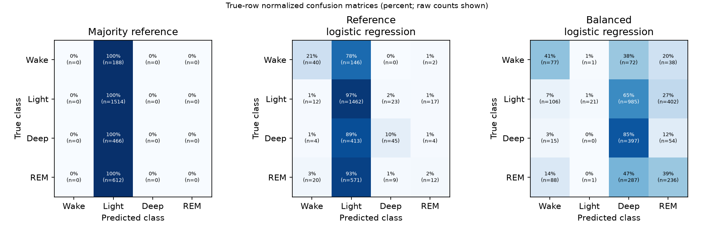

# Sleep classifier

A learning project for causal sleep-stage classification from wrist motion,
heart rate, and historical steps, using small PyTorch models in a later milestone.

## Status

The cohort audit, causal feature preparation, and first baseline comparison are complete.
Training uses 23 participants, validation uses three, and the final three test participants remain reserved.
Class-weighted logistic regression improves REM recall but lowers accuracy and macro-F1 in this experiment.
See the [graphical comparison](docs/experiments/class-weighted-baseline-2026-11-02/README.md) and [interpretation](docs/class-weighted-experiment.md).



## Local setup

Install [uv](https://docs.astral.sh/uv/getting-started/installation/), clone this
repository, and run these commands from the checkout root:

```bash
git clone https://github.com/rbl-bidilatimotei/sleep-classifier.git
cd sleep-classifier
uv sync --locked --group notebook
uv run --locked python -m sleep_classifier.data download --config configs/explore.yaml
uv run --locked python -m sleep_classifier.data audit --config configs/explore.yaml
uv run --locked jupyter lab notebooks/01_data_exploration.ipynb
```

The download fetches one participant's four modalities and dataset license.
It verifies publisher SHA-256 hashes, reuses verified files, and rejects corrupted
existing files. The manifest itself is obtained over HTTPS, not independently signed.
Audit outputs go to `artifacts/audits/1066528.json`. YAML paths resolve relative to
that YAML file, so commands also work with an absolute `--config` path from elsewhere.
The package is installed editable by uv; no notebook `sys.path` hacks are needed.

For a fresh-kernel execution without opening Jupyter:

```bash
uv run --locked python scripts/execute_notebook.py
```

The executed HTML report is saved under `artifacts/notebooks/`; the source notebook
stays output-free. This runner explicitly uses the active Python interpreter.

## Tests and formatting

```bash
uv run --locked pytest
uv run --locked ruff check .
uv run --locked ruff format --check .
```

Tests use synthetic files and mocked network responses; no dataset download is
needed. They cover malformed data, preserved ordering, duplicate detection,
missing step coverage, checksum failures, atomic downloads, and config paths.

## Notebooks and Colab

Notebooks explain experiments and call package functions. Reproducible shell
operations use module names, for example:

```python
!uv run --project /path/to/sleep-classifier --locked python -m sleep_classifier.data audit --config /path/to/sleep-classifier/configs/explore.yaml
```

`python -m` takes a dotted module name, not a filesystem path. A standalone script
instead uses `uv run python scripts/execute_notebook.py`.

Open [00_remote_setup.ipynb](notebooks/00_remote_setup.ipynb) in Colab.
Select a branch or tag that contains the required project files.
Run the numbered cells in order. Inspect each result before continuing.
Separate cells handle checkout, dependencies, download, audit, exploration, and report display.
The notebook displays the executed report as HTML.
Existing checkouts remain unchanged. Their current commit must match the selected local reference.

Colab uses a separate notebook kernel. The setup notebook runs project code through uv subprocesses.
It does not install the project dependencies into the Colab kernel.
Use local Jupyter for direct interactive imports in `01_data_exploration.ipynb`.
The Colab workflow still requires validation in an actual Colab runtime.

## Working branches and preparation

Use a working branch for each agreed change. Submit a pull request to `main`.
The primary agent owns design decisions and reviews delegated implementation work.
Smaller models can implement bounded tasks with explicit file ownership and checks.

Read [preparation decisions](docs/preparation-decisions.md) before the next milestone.
The document separates observed facts from proposed rules.
Coverage thresholds and label boundaries remain unresolved.

## Layout

```text
configs/explore.yaml            # Active data settings
src/sleep_classifier/data.py    # Shared ingestion, audit, and CLI
notebooks/00_remote_setup.ipynb # Colab command workflow
notebooks/01_data_exploration.ipynb
scripts/execute_notebook.py     # Reproducible fresh-kernel runner
tests/                        # Synthetic unit tests (no network)
docs/                          # Protocol, sources, session findings
data/raw/                     # Immutable source data, ignored by Git
artifacts/                    # Generated reports/notebooks, ignored by Git
```

Model/training/augmentation configs will accompany their implementations. We use
one authoritative `AGENTS.md`; `CLAUDE.md` imports it. Dependencies are locked in
`uv.lock`; Docker is deferred until the training workflow is established.

## Data attribution

[PhysioNet sleep-accel v1.0.0](https://physionet.org/content/sleep-accel/1.0.0/):
Walch, O. (2019), [DOI 10.13026/hmhs-py35](https://doi.org/10.13026/hmhs-py35).
Dataset license: Open Data Commons Attribution License v1.0; downloaded as
`data/raw/sleep-accel/1.0.0/LICENSE.txt`.

Original study: Walch et al., *Sleep stage prediction with raw acceleration and
photoplethysmography heart rate data derived from a consumer wearable device*,
SLEEP (2019), [DOI 10.1093/sleep/zsz180](https://doi.org/10.1093/sleep/zsz180).

## Preparation analysis

Open [notebook 02](notebooks/02_coverage_and_steps.ipynb) to inspect duplicate removal, epoch coverage, and step history.
Read [session 2](docs/session-02.md) for observed results and the label-boundary assumption.

```bash
uv run --locked python -m sleep_classifier.analysis --config configs/explore.yaml
uv run --locked --group notebook python scripts/execute_notebook.py --notebook notebooks/02_coverage_and_steps.ipynb
```

This analysis covers one development participant. The cohort audit and threshold selection remain subsequent work.

## Cohort readiness

Read [session 3](docs/session-03.md) for eligibility rules, frozen participant splits, and baseline coverage limits.
Open [notebook 03](notebooks/03_cohort_readiness.ipynb) for development-only coverage plots.
Run the reproduction commands in session 3 before opening the notebook on a fresh checkout.
The cohort archive requires about 550 MB of network transfer and 2.2 GB of extracted storage.
The baseline uses 23 training, three validation, and three untouched test participants after two integrity exclusions.

## Causal feature preparation

Open [notebook 04](notebooks/04_causal_features.ipynb) to inspect the six baseline features and sequence boundaries.
Read [session 4](docs/session-04.md) for target mapping, generated row counts, and preparation limits.

```bash
uv run --locked python -m sleep_classifier.prepare --config configs/prepare.yaml
uv run --locked --group notebook python scripts/execute_notebook.py --notebook notebooks/04_causal_features.ipynb
```

Preparation writes training and validation CSVs only. Fit any scaler on eligible training rows in the next milestone.

## First baseline: run training yourself

Open [notebook 05](notebooks/05_baseline_experiment.ipynb) for setup, preparation, and explicit training controls.
Read [session 5](docs/session-05.md) before running the first experiment.
The original reference was run by Timo. The weighted comparison was run under explicit authorization.

```bash
uv sync --locked --group baseline --group notebook
uv run --locked --group baseline python -m sleep_classifier.baseline --config configs/baseline.yaml --train
```

The report runner saves HTML only and skips the notebook's tagged training cell.

## Measured baseline results

Timo's first local run achieved 56.08% validation accuracy and 0.3045 macro-F1 with logistic regression.
REM recall was 1.96%. See [the measured results and limitations](docs/baseline-results.md).
The baseline is a reference experiment, not a useful final sleep-stage classifier.
Training logs now show stages, row counts, elapsed time, and the completed optimizer iteration count.
Logistic regression uses optimizer iterations rather than training epochs.

## Result files and graphical reports

`artifacts/` is ignored because it contains generated models, prediction tables, and full HTML reports.
These files can be rebuilt and can become large. The ignore rule does not apply to `docs/experiments/`.
Selected measured summaries and compact PNG figures are tracked there for viewing directly on GitHub.
Raw sensor data remains excluded from Git.

Open [notebook 06](notebooks/06_class_weighted_comparison.ipynb) to inspect the saved comparison.
The report module creates confusion matrices, per-class scores, standardized coefficients, and chronological prediction ribbons.

## First GRU: measured local run

Read the [first GRU experiment](docs/first-gru-experiment.md) and open [notebook 07](notebooks/07_causal_gru.ipynb).
It uses the same six features with at most ten epochs of causal context and 32 hidden units.
The first local CPU run reached 56.69% accuracy and 0.4760 macro-F1 on validation data.
See the [measured results](docs/experiments/first-gru-2026-11-03/README.md).

```bash
uv sync --locked --group gru --group notebook
uv run --locked --group gru --group notebook python -m sleep_classifier.gru_training --config configs/gru.yaml --check
```

Run the notebook's explicitly enabled training cell when ready. The final test set remains reserved.

## Local GRU follow-up

Auto device selection now supports CUDA, Apple MPS, and CPU.
Use [notebook 08](notebooks/08_gru_followup.ipynb) to inspect or launch five controlled comparisons.
Read the [experiment plan](docs/gru-followup.md) and [OPAL assessment](docs/reactive-optimizer-assessment.md).
The suite requires explicit `--train`; report generation does not train.

The [measured follow-up results](docs/experiments/gru-followup-2026-11-04/README.md)
compare restored best checkpoints. Patience twelve reached 0.5001 validation macro-F1.
These five trials used plain Adam. OPAL was tested separately on synthetic data only.

See the [project roadmap](docs/roadmap.md) for the next experiment and later Docker, FastAPI, CI, and delivery milestones.

Use [notebook 09](notebooks/09_gru_seed_comparison.ipynb) for the next [paired seed comparison](docs/gru-seed-comparison.md).
It prepares six operator-run Adam fits: two recipes across three shared seeds.

The [shared-seed results](docs/experiments/gru-seeds-2026-11-04/README.md) show a mean patience gain of 0.0080 macro-F1, driven by seed 42.

Use [notebook 10](notebooks/10_opal_pilot.ipynb) for the optional [Codex-powered OPAL pilot](docs/opal-pilot.md).
Live training requires a separate explicit opt-in; the default report runs preflight only.

The [first OPAL pilot diagnostics](docs/experiments/opal-pilot-2026-11-05/README.md) distinguish failed agent decisions from successful training.
Notebook 10 includes full status reporting and a [pinned-CLI retry](docs/opal-compatibility-notes.md).

The [successful OPAL retry](docs/experiments/opal-retry-2026-11-05/README.md) applied an optimizer change and reached 0.4836 macro-F1.
OPAL remains optional; the next experiment uses conventional Adam and grouped participant validation.

The next [grouped development experiment](docs/grouped-validation.md) is prepared in [notebook 11](notebooks/11_grouped_validation.ipynb).
Read the [learning review](docs/learning-review.md) for the evidence and open questions so far.

Start with the [project overview](docs/project-overview.md) for the full problem, experiment history, and engineering direction.
The [completed grouped GRU results](docs/experiments/gru-grouped-2026-11-06/README.md) provide the next architecture comparison reference.

Use [notebook 12](notebooks/12_transformer_comparison.ipynb) for the completed [small causal Transformer comparison](docs/transformer-experiment.md).
It reuses the grouped GRU folds and the shared trainer; paired reporting checks exact held-out epoch alignment.

The [measured Transformer results](docs/experiments/transformer-grouped-2026-11-09/README.md) record paired development gains and participant trade-offs.

The completed [controlled capacity experiment](docs/transformer-capacity.md) is available in [notebook 13](notebooks/13_transformer_capacity.ipynb).
It compares width 32 against the completed width-16 Transformer. Training remains explicitly opt-in.

The [capacity results and training curves](docs/experiments/transformer-capacity-2026-11-09/README.md) show losses across all five folds.

Use [notebook 14](notebooks/14_transformer_training_budget.ipynb) for the completed [width-16 training-budget experiment](docs/transformer-training-budget.md).
It tests forty epochs and patience twelve on the same development folds. Training remains explicitly opt-in.

The [measured budget results](docs/experiments/transformer-budget-2026-11-09/README.md) record REM gains and the remaining class trade-offs.

Use [notebook 15](notebooks/15_transformer_budget_seeds.ipynb) for the completed [shared-seed budget replication](docs/transformer-budget-seeds.md).
It reuses seed 42 and prepares both budgets for seeds 43 and 44. Training stays opt-in.

The [measured three-seed results](docs/experiments/transformer-budget-seeds-2026-11-10/README.md) record repeatable development gains and their checkpoint-selection limit.
Shared trainer messages now use the architecture-neutral logger sleep_classifier.neural_training.

Use [notebook 16](notebooks/16_transformer_context.ipynb) for the completed [context-ten versus context-thirty experiment](docs/transformer-context.md).
It reuses the measured context-ten reference and prepares five new fits. Training stays explicitly opt-in.

The [measured context results](docs/experiments/transformer-context-2026-11-10/README.md) record five-fold macro-F1 gains, Wake/Deep improvements, and a REM trade-off.

Use [notebook 17](notebooks/17_transformer_context_seeds.ipynb) for the completed [shared-seed context-thirty replication](docs/transformer-context-seeds.md).
It reuses every measured context-ten reference and trains only context-thirty seeds 43 and 44. Training stays opt-in.

The [measured context replication](docs/experiments/transformer-context-seeds-2026-11-11/README.md) records gains across all three seeds and the regularization question.

Use [notebook 18](notebooks/18_transformer_dropout.ipynb) for the completed [context-thirty dropout comparison](docs/transformer-dropout.md).
It tests residual/feedforward dropout 0.1 versus 0.2 with natural sampling unchanged. Training stays explicitly opt-in.

The [measured dropout results](docs/experiments/transformer-dropout-2026-11-11/README.md) record modest class-score gains, lower NLL, and the remaining generalization gap.

Use [notebook 19](notebooks/19_transformer_dropout_seeds.ipynb) for [shared-seed dropout replication](docs/transformer-dropout-seeds.md).
It reuses all measured dropout-0.1 references and trains only dropout-0.2 seeds 43 and 44. Training stays opt-in.

The [completed dropout replication](docs/experiments/transformer-dropout-seeds-2026-11-11/README.md) records small three-seed macro-F1 and NLL gains with mixed class effects.
The [notebook 19 guide](docs/notebook-19-guide.md) explains each cell, NLL, and the focused epoch-fourteen investigation.
Optional checkpoint replay verifies saved predictions without fitting or optimization.

Use [notebook 20](notebooks/20_transformer_diagnostics.ipynb) for the [instrumented seed-42 repeat](docs/transformer-diagnostics.md).
It prepares original folds 01 and 04 with the measured recipe unchanged. Training stays explicitly opt-in.
Each code cell explains what it does and why. Per-epoch evidence supports local reports and matched prediction comparisons.

The [measured diagnostic repeat](docs/experiments/transformer-diagnostics-2026-11-12/README.md) reproduces both original trajectories exactly.
It identifies class/participant loss spikes and worsening true-class probabilities on persistent errors.

Use [notebook 21](notebooks/21_transformer_learning_rate.ipynb) for the [fixed-recipe learning-rate diagnostic](docs/transformer-learning-rate.md).
It reuses the completed instrumented reference and prepares only learning rate 0.0003 on the same two folds.

The [measured learning-rate comparison](docs/experiments/transformer-learning-rate-2026-11-12/README.md) improves NLL but loses mean macro-F1 and REM/Deep recall.
The proposed next diagnostic retains initial learning rate 0.001 and tests a plateau schedule.

Use [notebook 22](notebooks/22_transformer_plateau.ipynb) for the [plateau scheduler diagnostic](docs/transformer-plateau.md).
It starts at 0.001 and reduces the rate after validation macro-F1 plateaus, with all other controls fixed.

The [measured scheduler comparison](docs/experiments/transformer-plateau-2026-11-12/README.md) improves NLL and smoothness but loses stage-detection scores.
The next proposal returns to representation learning with a small causal patch encoder.
