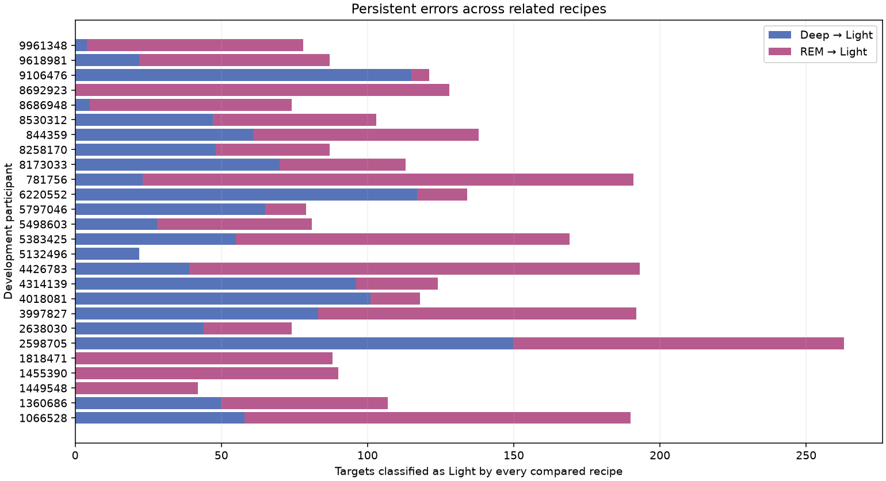
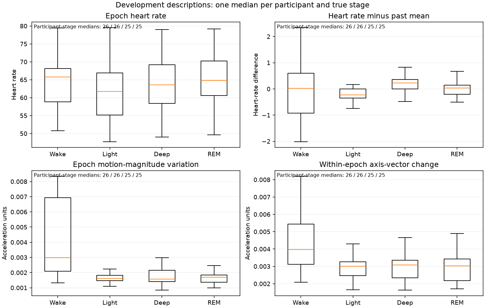

# Causal feature audit: first measured snapshot

The development-only audit ran on 2026-11-16. Reviewed on 2026-11-17.
No model was trained, no final-test observations were read, and no training feature schema was changed.
The original unsmoothed Adam/P3 reference remains selected.

## What the snapshot contains

| Item | Verified count |
| --- | ---: |
| Development participants | 26 |
| Aligned eligible epochs | 22,708 |
| Compared selected-checkpoint recipes | 4 |
| Verified development motion files | 26 |
| Recorded saved-artifact hashes | 588 |
| Final-test observation files read | 0 |

The recipes are the original reference, patch size two, AdamW decay 0.01, and label smoothing 0.05.
Their saved predictions and true-class probabilities align on identical participant/time/target keys.
Paired score, recipe, device, prepared-feature, and publisher-checksum validation pass before observations enter the audit.
The cached snapshot preserves its configuration, implementation, and output hashes.

The local dashboard is `artifacts/causal-feature-audit/dashboard.html`.
The executed notebook report is `artifacts/notebooks/28_causal_feature_audit.executed.html`.
Both remain local under ignored artifacts. The source notebook, reusable readers, tests, and compact findings remain in Git.
See the [protocol and commands](../../causal-feature-audit.md).

## Persistent Deep/REM-to-Light errors

| True stage | Stage support | Reference predicts Light | Every recipe predicts Light |
| --- | ---: | ---: | ---: |
| Deep | 3,119 | 1,438 | 1,303 |
| REM | 4,860 | 2,406 | 1,783 |

There are 3,086 persistent errors under this definition.
These are related models using the same cohort. Their agreement is not independent replication.
The counts establish an error population to inspect, not a cause or a performance ceiling.

Participant bars show counts, not rates or difficulty rankings. Nights and stage supports differ.
The dashboard keeps the full time axis while highlighting persistent targets.
Its table can filter stages and errors without removing timeline intervals.

## Diagnostic availability and causality

The heart-rate diagnostic is current epoch mean minus the mean of strictly previous eligible epochs.
It uses at most ten past epochs and requires at least four.
Histories reset at participant and segment boundaries. Current/future observations never enter the past mean.
It is available for 22,208 of 22,708 epochs. The remaining 500 startup targets stay in the audit with missing values.

The motion diagnostic averages adjacent axis-vector changes inside each completed thirty-second interval.
Pairs never cross epoch boundaries. Gaps above 0.2 seconds are excluded, with counts and observed gaps retained.
The diagnostic is available for all 22,708 eligible epochs. Mean valid-pair fraction is approximately 0.999997.
Observed zero movement remains zero; unavailable evidence is never silently replaced with zero.
This is not a time derivative, jerk, or physiological HRV measurement.

## What the descriptive evidence suggests

Each box uses one median per participant and true stage. It does not treat thousands of epochs as independent participants.
The raw heart-rate distributions overlap substantially.
Strictly past-relative heart-rate differences give a different view of stage patterns, but no classifier benefit is established.
The motion summaries also overlap substantially between sleep stages.

Matched error summaries compare persistent targets with reference-correct targets within the same participant and true stage.
For REM, 25 participants have both groups with available heart-rate history.
Persistent REM errors have lower median heart-rate deviation in 23 of these 25 participants.
The median participant-level difference is approximately −0.976 BPM.
For Deep, only fifteen participants have both matched groups; the corresponding median difference is approximately −0.017 BPM.
These post-hoc patterns do not show that the new feature can separate persistent errors from true Light epochs.
They motivate closer timeline review, not immediate model promotion.

Training-fold summaries use each fold's training participants only.
All label-conditioned medians are descriptive audit statistics, never inference features or full-night normalization inputs.
[training-fold-stage-summary.csv](training-fold-stage-summary.csv) and [matched-error-summary.csv](matched-error-summary.csv) preserve the supports and values.

## Motion cadence needs explicit treatment

Median observed within-epoch pair intervals differ between participants.
Most are near 0.02 seconds, while two participants are near 0.10 seconds.
Other participants have different observed intervals as well.
An average per-sample vector change is sensitive to cadence, so its raw amplitude is not directly comparable across participants.
The viewer exposes median/maximum pair gaps and valid-pair support alongside the feature.
[participant-cadence.csv](participant-cadence.csv) records these checks.

Do not add the raw motion-change mean to the model without addressing sampling semantics.
A later cadence-aware diagnostic could use a declared causal time grid or another sampling-aware summary.
This PR does not choose or implement that feature.

## Evaluation workspace delivered

The offline viewer provides participant, recipe, window, stage, and error controls.
It shows true and predicted stages, raw probabilities, causal heart-rate history, motion summaries, gaps, and support.
Actual timestamp gaps remain visible. Paths break at segment boundaries and missing values.
The viewer embeds its data and requires no server or external requests.
The reusable snapshot contract separates validated evidence from rendering and supports later run/epoch navigation.

The agent browser blocked local-file preview. Browser layout was therefore not verified through that tool.
Offline JavaScript tests exercised render functions, recipe/table filters, time gaps, segment breaks, and missing values.
Those tests passed on synthetic fixtures and the real snapshot. Generated static plots were inspected visually.
No alternate browser route was used.

## Next decision

Keep this PR as an audit and evaluation-workspace milestone.
Do not train, change eligibility, or promote either diagnostic from these plots alone.
Review participant timelines and decide whether one causal heart-rate feature family warrants a controlled ablation.
Resolve cadence semantics before a motion-feature ablation.
A future feature experiment must retain the same eligible targets, preserve availability information, and fit transforms on training participants only.
Keep the final test reserved. Continue run/epoch navigation and evidence bookmarks as separate platform milestones.

The [compact summary](summary.json), [snapshot manifest](snapshot-manifest.json), and [raw checksums](raw-motion-checksums.json) preserve the audit evidence.

Verification: 727 tests, Ruff lint, and whitespace checks pass. Notebook 28 exports from a fresh kernel without warnings or output errors.
