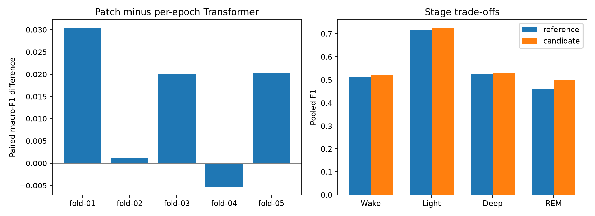
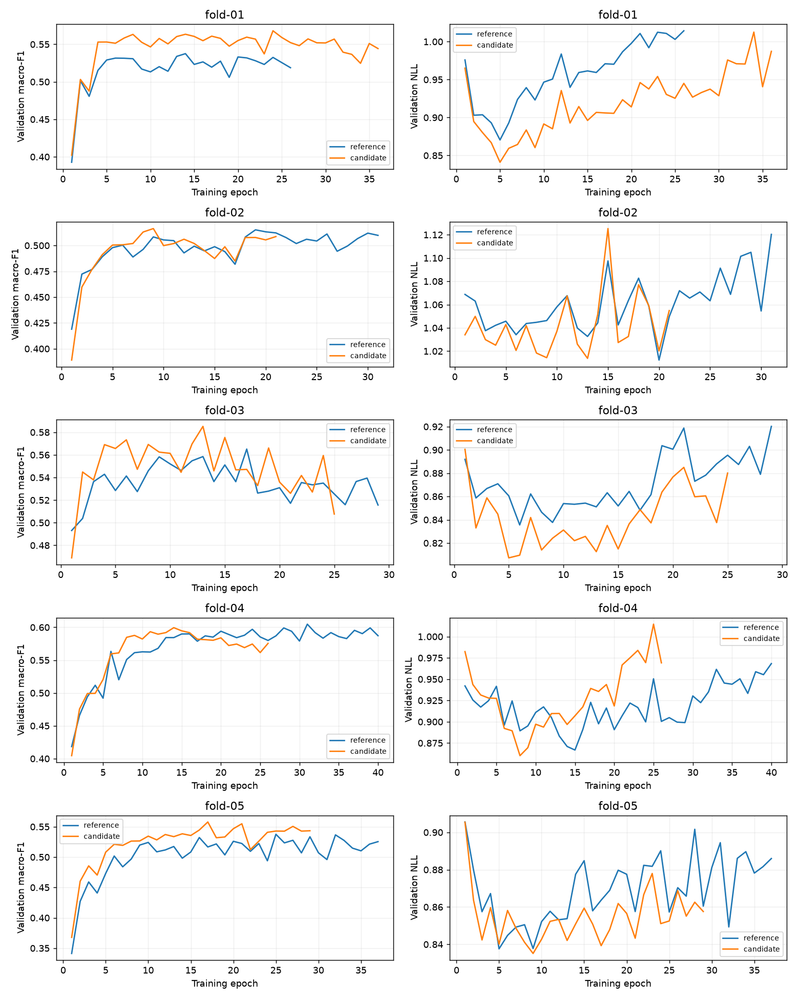

# Measured causal patch Transformer comparison

Timo completed five patch-model fits locally on MPS. Reviewed on 2026-11-13.
The paired report verifies the same 22,708 eligible targets from 26 development participants.
The final three test participants remain reserved.
This is a seed-42 architecture comparison on checkpoint-selection folds, not an independent test estimate.

## Patching improves the primary score

| Metric | Per-epoch Transformer | Three-epoch patch Transformer | Difference |
| --- | ---: | ---: | ---: |
| Mean fold macro-F1 | 0.55204 | 0.56538 | +0.01334 |
| Pooled macro-F1 | 0.55494 | 0.56939 | +0.01445 |
| Pooled accuracy | 62.912% | 64.149% | +1.237 percentage points |
| Selected pooled NLL | 0.92577 | 0.89553 | −0.03024 |
| REM precision | 51.30% | 54.87% | +3.576 percentage points |
| REM recall | 41.91% | 45.76% | +3.848 percentage points |
| REM F1 | 0.46133 | 0.49905 | +0.03772 |

Unlike the optimizer experiments, this candidate improves mean fold macro-F1 as well as accuracy and probability loss.
Four folds improve macro-F1. Fourteen participants improve and twelve decline.
The mean paired gain remains positive after excluding the largest-gain fold 01: +0.00905 across the remaining four folds.
The sample deviation of fold differences is 0.01485, a descriptive quantity rather than a confidence interval.
The training folds overlap, and repeated targets do not create independent participants.

## Fold trade-offs

| Fold | Macro-F1, reference → patch | Difference | Accuracy, reference → patch |
| --- | ---: | ---: | ---: |
| 01 | 0.53754 → 0.56802 | +0.03048 | 61.805% → 65.206% |
| 02 | 0.51518 → 0.51640 | +0.00122 | 61.358% → 59.947% |
| 03 | 0.56513 → 0.58519 | +0.02006 | 64.587% → 65.922% |
| 04 | 0.60478 → 0.59945 | −0.00533 | 65.123% → 65.123% |
| 05 | 0.53758 → 0.55783 | +0.02026 | 61.589% → 64.131% |

The result does not improve every participant or fold.
Fold 02 loses accuracy despite a small macro-F1 gain. Fold 04 keeps identical accuracy while its class balance changes.
[paired-comparison.json](paired-comparison.json) preserves individual participants, class metrics, supports, and confusion matrices.

## REM improves without sacrificing precision

REM true positives increase from 2,037 to 2,224. False-positive REM predictions fall from 1,934 to 1,829.
Both precision and recall improve, so the F1 gain is not simply a changed precision–recall trade-off.
All four pooled stages improve precision, recall, and F1, although some gains are small.

| Stage | F1, reference → patch | Recall, reference → patch |
| --- | ---: | ---: |
| Wake | 0.51345 → 0.52281 | 43.59% → 44.54% |
| Light | 0.71836 → 0.72540 | 77.04% → 77.59% |
| Deep | 0.52660 → 0.53031 | 49.34% → 49.50% |
| REM | 0.46133 → 0.49905 | 41.91% → 45.76% |

Deep recall gains only 0.16 percentage points. REM remains difficult despite its clearer relative improvement.
The model's pooled accuracy does not establish uniformly good minority-stage detection.

## Loss and selected checkpoints

| Fold | Selected NLL, reference → patch | Candidate best/completed epoch |
| --- | ---: | ---: |
| 01 | 0.95933 → 0.93049 | 24 / 36 |
| 02 | 1.05867 → 1.01438 | 9 / 21 |
| 03 | 0.84823 → 0.81257 | 13 / 25 |
| 04 | 0.92241 → 0.89680 | 14 / 26 |
| 05 | 0.85730 → 0.83929 | 17 / 29 |

Selected probability loss improves in all five folds.
Every candidate fold still ends with higher validation NLL than its selected checkpoint while evaluation-mode training NLL falls.
Patching improves the measured trade-off, but does not eliminate the generalization-gap pattern.
The final epoch is not the checkpoint used for the reported inference scores.
[checkpoint-diagnostics.json](checkpoint-diagnostics.json), [pooled-nll.json](pooled-nll.json), and [epoch-evidence.json](epoch-evidence.json) retain the calculations.

## Short-history and transition checks

These post-hoc slices join exact participant/time/target identities to the prepared eligible validation rows.
Available history is segment-local row count, capped at thirty, matching causal sequence construction.
A transition means the current target differs from the previous contiguous eligible target within the same participant and segment.
Segment starts have unknown prior stages and are not counted as transitions.
No slice label becomes a model input or changes evaluation eligibility.

| Stratum | Targets | Macro-F1, reference → patch |
| --- | ---: | ---: |
| Available history 1–2 epochs | 295 | 0.45621 → 0.41856 |
| Available history 3–29 epochs | 2,279 | 0.47068 → 0.50610 |
| Full thirty-epoch history | 20,134 | 0.53767 → 0.55201 |
| First target after a contiguous true-stage change | 1,398 | 0.40631 → 0.40679 |

The first partial patch loses performance. That small stratum contains only ten Deep targets.
Stage-transition detection is essentially flat, so overall gains do not establish better transition timing.
The history strata have different class mixtures; compare recipes within a slice rather than ranking slices against each other.
These analyses are exploratory and do not prove why the architecture improved.
[posthoc-history-and-transitions.json](posthoc-history-and-transitions.json) includes supports and full class metrics for every slice.

## Next experiment: replicate before further tuning

Retain patch size three as a promising candidate, without declaring a new global default from one seed.
Repeat the identical patch recipe with seeds 43 and 44 across the same five development folds.
Reuse the measured dropout-0.2 references for all three seeds and the completed seed-42 patch candidate.
Only ten new fits are required, capped at 400 total epochs.
Keep the raw thirty-epoch context, width sixteen, dropout 0.2, Adam 0.001, budget 40/12, natural sampling, loss, and diagnostics fixed.

Report paired seed effects, every fold difference, participant wins/losses, REM precision/recall/F1, and Deep behavior.
Check whether the overall gain and REM improvement repeat. Treat cold-start behavior as a follow-up concern, not a simultaneous patch change.
Do not change patch size, overlap, model width, regularization, or scheduler in the replication.
A repeated gain motivates the next focused question, such as short-history handling or patch size.
A mixed result argues against selecting the seed-42 winner as a universal improvement.

The architecture has 2,756 parameters versus 2,884, and a changed initialization layout.
This remains an architecture-recipe comparison rather than a parameter-matched proof of a patching mechanism.
Seed repeats assess initialization variability on the same participants, not independent-population generalization.
No participant-data training ran during review. Timo executed the measured fits.
