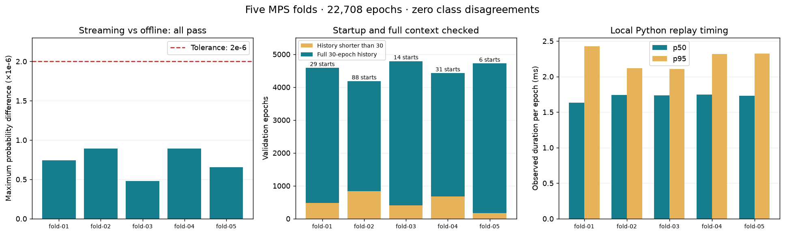

# Chronological inference matches offline validation

Timo completed all five frozen LR0.001 MPS motion folds through notebook 41.
The audit passes on all 22,708 eligible validation epochs from 26 development participants.
Current source hashes match the recorded snapshot. Independent CSV checks reproduce the probability differences, target identities, history lengths, and resets.
The final-test participants remain reserved. No final-test observations were read.

## Numerical parity

| Fold | Epochs | Maximum streaming/offline probability difference | Class disagreements | History starts |
| --- | ---: | ---: | ---: | ---: |
| 01 | 4,587 | 7.45e-7 | 0 | 29 |
| 02 | 4,182 | 8.94e-7 | 0 | 88 |
| 03 | 4,792 | 4.77e-7 | 0 | 14 |
| 04 | 4,427 | 8.94e-7 | 0 | 31 |
| 05 | 4,720 | 6.56e-7 | 0 | 6 |

The largest absolute difference is 8.94e-7. Every fold stays below the predeclared tolerance of 2e-6.
These are small numerical differences consistent with floating-point execution across different batch shapes.
Every predicted class matches offline inference. Every offline probability also matches its saved validation probability exactly in this run.
The result validates the prepared-feature inference path without increasing the model's classification accuracy.

## History and model state

All 22,708 history lengths match participant-local offline windows.
The audit covers 20,134 full-context epochs and 2,574 shorter-history epochs, including 168 history starts.
There are 142 segment-change resets and 21 participant-change resets. Five additional starts initialize the five fold predictors.
Each history stays bounded at thirty epochs. Early epochs and context eviction preserve prediction parity.

No separate time_gap reset occurred in this dataset replay because prepared segment boundaries already identify the gaps.
Direct timestamp-gap reset behavior remains covered by synthetic tests; do not describe it as an observed real-data event here.
Every fold reports unchanged model parameters and buffers, no gradients, and no training.
Current checkpoint and source-file hashes still match the audit snapshot.

## Timing and interpretation limits

Local MPS per-fold p50 processing durations range from 1.63 to 1.75 ms.
Per-fold p95 durations range from 2.11 to 2.42 ms.
These Python replay observations include local overhead. They do not establish a device-independent deployment latency guarantee.
They also exclude the thirty-second epoch collection interval and upstream sensor ingestion.

The predictor received seven prepared summaries in original feature units, with stored scaling and HR augmentation applied during inference.
Ground-truth labels were used for audit alignment only. They were not model inputs.
The test begins after aggregation, eligibility decisions, segmentation, and saved-policy motion imputation.
It does not establish end-to-end raw-sensor equivalence, handling of all unsupported epochs, or device generalization beyond this MPS run.
CPU and cross-backend equivalence need separate evidence before deployment on another backend.

[summary.json](summary.json) preserves the measured report and artifact identities.
[verification.json](verification.json) records independent per-epoch evidence checks without running new training or repeating the streaming audit.
The source prediction CSVs remain under artifacts/chronological-inference and stay outside Git.

## Next work chunk: consolidate the deployable inference contract

Retain the LR0.001 motion recipe and pause further model tuning.
Prepare a model card and a versioned inference-bundle contract before implementing more deployment components.
Specify feature definitions, units, availability times, normalization, missing-data policy, reset behavior, class mapping, and checkpoint identity.
Separate offline fold evidence from a future single deployment model; do not select the highest-scoring fold as the deployment model.
Define compatibility and validation checks for loading the bundle, with a small label-free inference example.

After that contract is stable, audit the raw-sensor-to-epoch adapter against offline preparation using development data.
Keep Docker, FastAPI, and economical CI as later scoped steps. No final-test evaluation or training is required for the next documentation milestone.

Review checks: 1,266 project tests passed. Ruff and whitespace checks passed.
The completed notebook passed fresh-kernel report-only execution without repeating inference.
Its original user execution was preserved locally. The plot's alternative-text metadata was corrected for HTML export.
