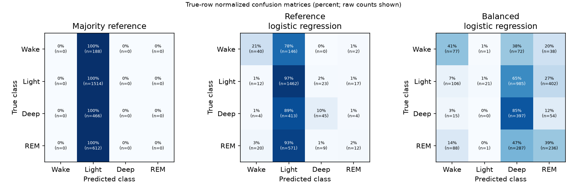
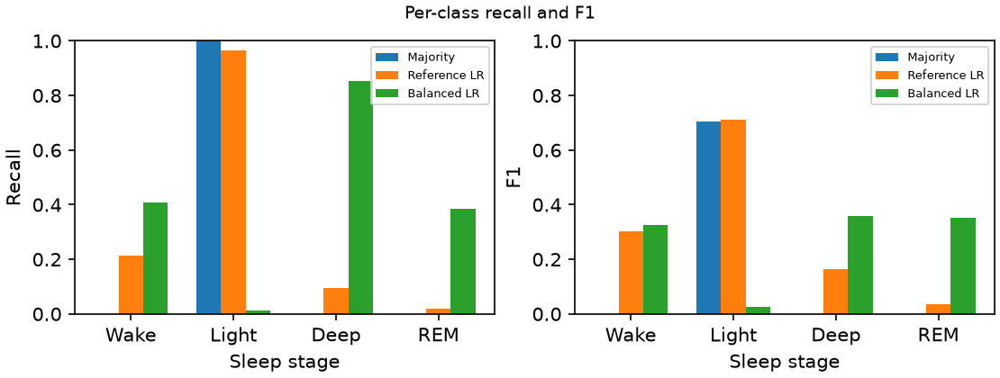
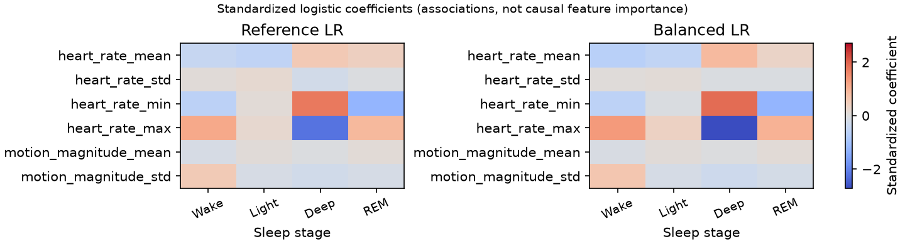
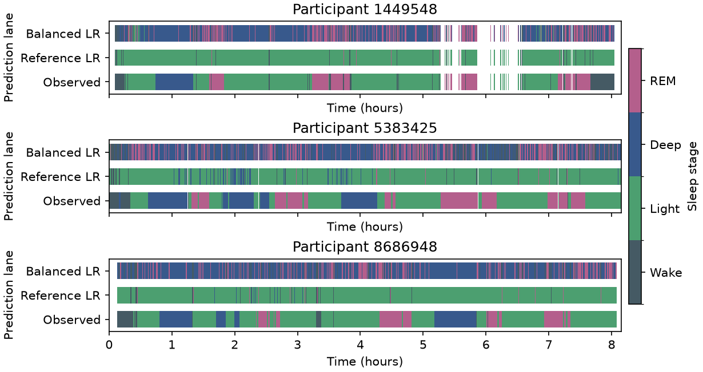

# Experiment comparison

This report compares saved validation metrics. It does not fit models.
The validation split contains 3 participants. Results may vary with the held-out people.

## Summary

| Run | Accuracy | Balanced accuracy | Macro F1 | REM recall | Retained / scored epochs | Coverage |
| --- | ---: | ---: | ---: | ---: | ---: | ---: |
| Majority reference | 0.545 | 0.250 | 0.176 | 0.000 | 2780 / 2884 | 96.4% |
| Reference logistic regression | 0.561 | 0.324 | 0.304 | 0.020 | 2780 / 2884 | 96.4% |
| Balanced logistic regression | 0.263 | 0.415 | 0.266 | 0.386 | 2780 / 2884 | 96.4% |

## Figures

Logistic coefficients show standardized associations, not causal importance.
