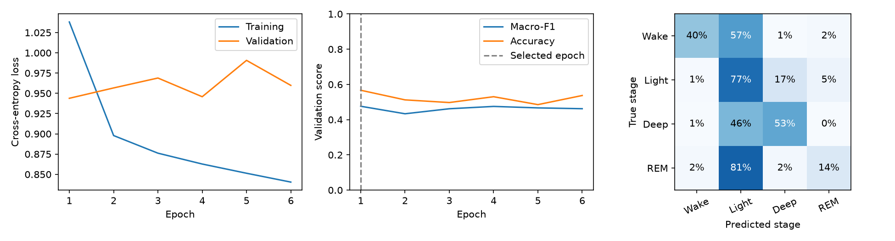

# First causal GRU result

Timo ran notebook 07 locally on CPU on 2026-11-03.
The model used 32 hidden units and up to ten epochs of history.
The six features, participant split, and coverage policy match the baseline.

| Metric | Logistic regression | GRU |
| --- | ---: | ---: |
| Accuracy | 56.08% | 56.69% |
| Macro-F1 | 0.3045 | 0.4760 |
| REM recall | 1.96% | 14.38% |
| REM precision | 34.29% | 49.72% |
| Deep recall | 9.66% | 53.22% |

The GRU improves class-level performance despite a small accuracy change.
REM remains the weakest class, with F1 of 0.2231.
These results cover 2,780 eligible epochs from three validation participants.
The final test set remains reserved.

Epoch 1 had the highest validation macro-F1. Training continued through epoch 6.
Training loss decreased from 1.0381 to 0.8404; validation loss fluctuated between 0.9439 and 0.9907.
This suggests limited generalization improvement after the first epoch, rather than failed training.
One run cannot establish whether a larger model or longer training will help.
The GRU combines nonlinear modeling and temporal context; a context-one ablation separates their contributions.

The [summary](summary.json) records configuration, history, metrics, packages, split, and the source metrics hash.
The original checkpoint, predictions, and complete metrics remain in ignored artifacts/gru-context-10.
