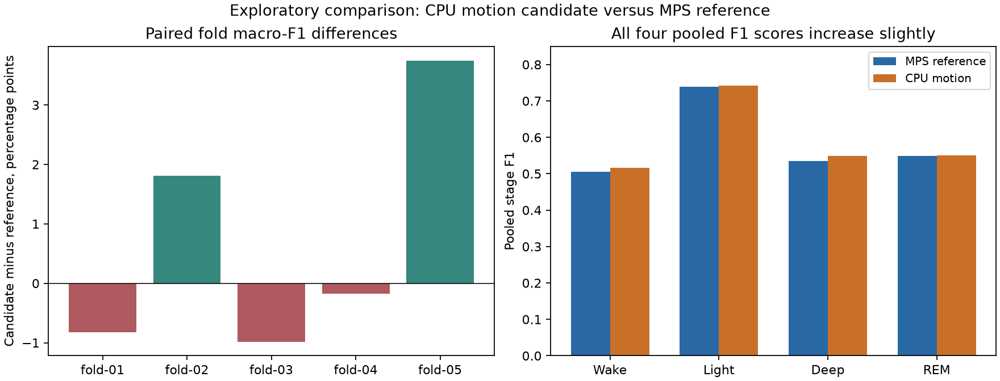
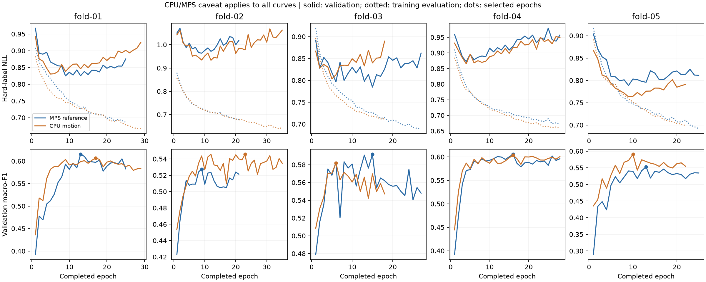

# Motion candidate improves pooled scores, with an unresolved device difference

Timo completed all five seed-42 candidate folds locally. The saved comparison matches a fresh validation against the immutable source summaries.
All 22,708 eligible targets and 26 development participants remain matched. The final test remains reserved.
The candidate used CPU; the measured reference used MPS. Every reported difference below carries that limitation.

## Promising screening evidence, not a confirmed motion benefit

| Metric | MPS full-HR reference | CPU motion candidate |
| --- | ---: | ---: |
| Mean fold macro-F1, primary | 0.57854 | 0.58569 |
| Pooled macro-F1 | 0.58191 | 0.58951 |
| Pooled accuracy | 65.964% | 66.444% |
| Selected pooled hard-label NLL | 0.85473 | 0.86329 |

Mean fold macro-F1 increases by 0.00715. The descriptive sample deviation of paired fold differences is 0.02028.
Pooled accuracy gains 0.480 percentage points, or 109 correct predictions.
Only two folds improve; three decline. Fourteen participants improve macro-F1 and twelve decline.
The aggregate gain is concentrated in folds 02 and 05, rather than being a consistent fold-level improvement.
[summary.json](summary.json) records all fold, participant, class, support, and device metadata.
Do not use dependent development folds to claim statistical significance or final-test performance.

| Fold | Reference macro-F1 | Candidate macro-F1 | Difference | Accuracy difference, percentage points |
| --- | ---: | ---: | ---: | ---: |
| 01 | 0.61502 | 0.60680 | −0.00822 | −0.828 |
| 02 | 0.52758 | 0.54565 | +0.01807 | +2.535 |
| 03 | 0.59170 | 0.58188 | −0.00982 | −0.918 |
| 04 | 0.60548 | 0.60369 | −0.00179 | −0.271 |
| 05 | 0.55293 | 0.59043 | +0.03750 | +2.055 |

## All four pooled stage F1 scores improve

| Stage | Precision, reference → candidate | Recall | F1 |
| --- | ---: | ---: | ---: |
| Wake | 60.17% → 64.89% | 43.49% → 42.80% | 0.50488 → 0.51582 |
| Light | 69.05% → 69.30% | 79.52% → 79.86% | 0.73917 → 0.74204 |
| Deep | 61.91% → 62.84% | 47.00% → 48.80% | 0.53435 → 0.54936 |
| REM | 59.27% → 59.04% | 51.17% → 51.63% | 0.54925 → 0.55082 |

Wake recall falls, but its precision gain raises pooled F1. Wake is not worse by every metric.
Wake loses thirteen true positives while reducing false positives from 548 to 441.
Deep has the clearest F1 gain: +0.01501, with 56 additional true positives and two fewer false positives.
Light gains 44 true positives. REM gains 22, alongside 32 additional false positives, so its F1 gain is only +0.00157.

Deep→Light errors decrease from 1,509 to 1,440. REM→Light errors increase from 2,203 to 2,219.
The small REM F1 gain therefore does not show that the added feature resolves REM-to-Light confusion.
Keep error destinations and precision beside recall when interpreting stage-level improvements.

## Better selected labels do not imply better probabilities

| Fold | Selected epoch, reference → candidate | Reference selected NLL | Candidate selected NLL | Candidate final NLL |
| --- | --- | ---: | ---: | ---: |
| 01 | 13 → 17 | 0.82513 | 0.86181 | 0.92496 |
| 02 | 9 → 23 | 0.96367 | 0.97782 | 1.06269 |
| 03 | 15 → 6 | 0.78439 | 0.81272 | 0.88963 |
| 04 | 16 → 16 | 0.92144 | 0.91694 | 0.94883 |
| 05 | 13 → 10 | 0.79581 | 0.76425 | 0.79107 |

Selected pooled NLL worsens by 0.00856. Folds 01–03 worsen; folds 04–05 improve.
NLL measures assigned true-class probabilities, while F1 uses discrete predicted classes.
Their directions can differ, especially when some wrong predictions become more confident.
NLL alone does not identify calibration error separately from other probability-quality changes.

Every candidate final validation NLL exceeds its selected value. Training-evaluation NLL decreases over the same interval in every fold.
Late training/validation separation remains. The added feature has not resolved probability overfitting.
Keep the original macro-F1 checkpoint rule. Do not select a favorable epoch after seeing these curves.
[epoch-evidence.json](epoch-evidence.json) preserves comparable evaluation-loss and macro-F1 trajectories.

## Gains occur mainly with full context

| Slice | Targets | Reference macro-F1 | Candidate macro-F1 |
| --- | ---: | ---: | ---: |
| History 1–4 | 500 | 0.44015 | 0.42164 |
| History 5–29 | 2,074 | 0.52929 | 0.52230 |
| Full context | 20,134 | 0.56061 | 0.57740 |
| Stage transitions | 1,398 | 0.39073 | 0.42812 |

Full-context and transition slices improve; startup slices decline.
History bins are disjoint. Transition targets overlap those bins, so their scores cannot be added to explain the primary gain.
These post-hoc slices do not establish a temporal mechanism.
[temporal-slices.json](temporal-slices.json) retains the device limitation, class scores, and target supports.

## Next experiment: match the execution device

Retain the full-HR ten-epoch recipe as the working reference until the motion gain survives a device-matched comparison.
Repeat only the same motion candidate on MPS, at seed 42, against the existing MPS reference.
Use a fresh, explicitly MPS configuration and output directory. Preserve the completed CPU result.
Keep the feature definition, folds, targets, HR transform, context, model, optimizer, loss, budget, and checkpoint rule unchanged.
This requires five new candidate fits, which Timo will run locally after the next experiment is prepared.

The MPS repeat also allows a same-feature CPU/MPS comparison, although one run per backend does not estimate backend variability reliably.
Initialization, floating-point operations, stochastic paths, and checkpoint selection can diverge between backends.
The present data do not quantify how much of the observed difference each source contributes.
A device-matched repeat removes the known backend difference from the feature comparison; it does not guarantee identical runtime behavior across dates.
The candidate still requires 48 additional projection weights, so the comparison remains a feature-recipe test.

Do not change the loss, sampling, architecture, or regularization before this repeat.
If the matched result is promising, consider seed replication next. No new training or final-test observations were used in this review.

Review verification: the saved paired report exactly matches a fresh validator build.
Eleven notebook and command-identity checks pass. Ruff and whitespace checks pass. Fresh-kernel HTML export passes without training.
The implementation's full suite passed 1,162 tests during the preceding device-reporting fix.
