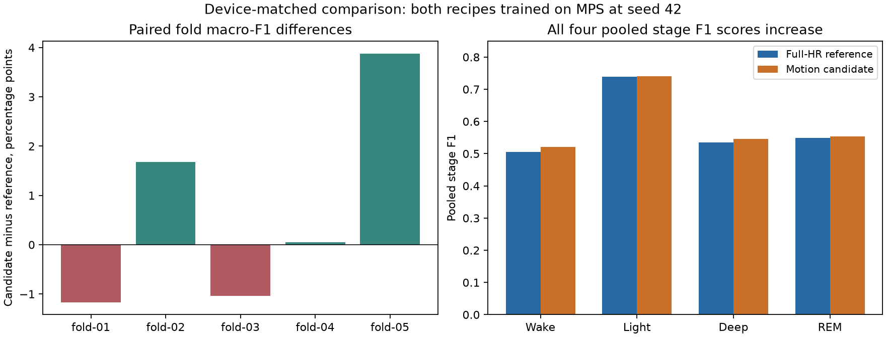
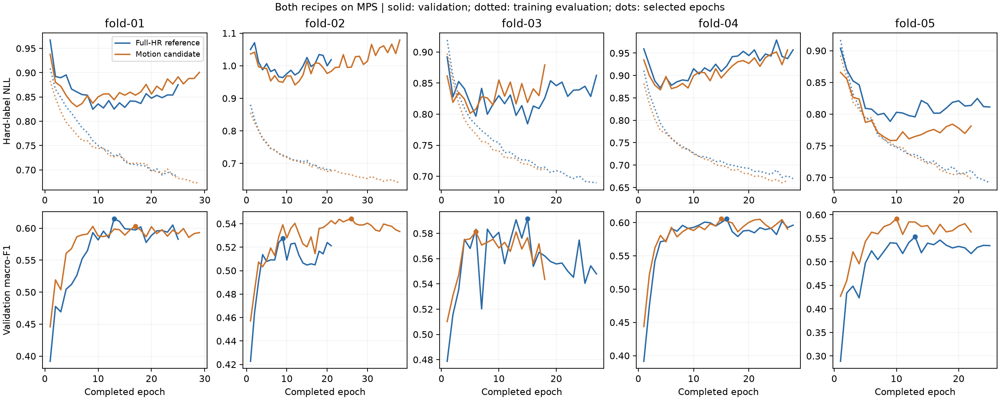

# Motion gives a modest seed-42 gain on matched MPS runs

Timo completed all five motion-candidate folds locally. The saved paired report matches a fresh strict validator build.
Both recipes used MPS. Recorded package versions match in all five fold pairs.
No device exception is enabled; all 22,708 targets and 26 development participants remain matched.
The final-test participants remain reserved.

## Positive aggregate, uneven fold effects

| Metric | Full-HR reference | Motion candidate |
| --- | ---: | ---: |
| Mean fold macro-F1, primary | 0.57854 | 0.58534 |
| Pooled macro-F1 | 0.58191 | 0.59039 |
| Pooled accuracy | 65.964% | 66.298% |
| Selected pooled hard-label NLL | 0.85473 | 0.85845 |

Mean fold macro-F1 increases by 0.00680. The descriptive sample deviation of paired fold differences is 0.02123.
Pooled accuracy gains 0.335 percentage points, or 76 correct predictions.
Three folds improve, although fold 04 changes very little. Sixteen participants improve macro-F1; ten decline.
Fold 05 provides the largest gain. The remaining four folds have a slightly negative mean difference, so the aggregate benefit is concentrated.
Retain all five folds in the primary result. This observation does not justify excluding a difficult fold.
[summary.json](summary.json) preserves the complete fold, participant, class, target, and device evidence.

| Fold | Reference macro-F1 | Candidate macro-F1 | Difference | Accuracy difference, percentage points |
| --- | ---: | ---: | ---: | ---: |
| 01 | 0.61502 | 0.60335 | −0.01167 | −1.068 |
| 02 | 0.52758 | 0.54439 | +0.01681 | +0.885 |
| 03 | 0.59170 | 0.58129 | −0.01041 | −1.169 |
| 04 | 0.60548 | 0.60594 | +0.00046 | +0.407 |
| 05 | 0.55293 | 0.59174 | +0.03881 | +2.669 |

Fold 05 reaches 69.03% accuracy and 0.59174 macro-F1. It has the highest candidate accuracy and largest paired improvement.
Fold 04 has the highest candidate macro-F1, at 0.60594.

## Wake gains through fewer false alarms; stage recall trade-offs remain

| Stage | Precision, reference → candidate | Recall | F1 |
| --- | ---: | ---: | ---: |
| Wake | 60.17% → 64.74% | 43.49% → 43.59% | 0.50488 → 0.52103 |
| Light | 69.05% → 69.80% | 79.52% → 78.89% | 0.73917 → 0.74068 |
| Deep | 61.91% → 61.67% | 47.00% → 48.96% | 0.53435 → 0.54584 |
| REM | 59.27% → 57.93% | 51.17% → 53.09% | 0.54925 → 0.55400 |

All four pooled F1 scores improve. Light loses recall, while its precision gain leaves F1 slightly higher.
Wake gains two correct predictions and removes 96 false positives, from 548 to 452.
Its F1 improvement mainly reflects more precise Wake predictions, with nearly unchanged sensitivity.
Light loses 80 correct predictions and removes 192 false positives, from 4,570 to 4,378.
Deep gains 61 correct predictions but adds 47 false positives. REM gains 93 correct predictions but adds 165 false positives.
Their recall gains therefore coexist with lower precision.

Deep→Light errors fall from 1,509 to 1,419. REM→Light errors fall from 2,203 to 2,126.
REM→Deep errors rise from 59 to 72: thirteen additional targets, or 0.267 percentage points of all REM targets.
That increase is real, but REM→Light remains much larger at 2,126 targets.
Deep→REM errors also rise, from 127 to 158. The feature changes several decision boundaries rather than uniformly separating the stages.

## The probability overfitting pattern remains

| Fold | Selected epoch, reference → candidate | Reference selected NLL | Candidate selected NLL | Candidate final NLL |
| --- | --- | ---: | ---: | ---: |
| 01 | 13 → 17 | 0.82513 | 0.85367 | 0.90074 |
| 02 | 9 → 26 | 0.96367 | 0.99589 | 1.07902 |
| 03 | 15 → 6 | 0.78439 | 0.80793 | 0.87914 |
| 04 | 16 → 15 | 0.92144 | 0.89448 | 0.95705 |
| 05 | 13 → 10 | 0.79581 | 0.75884 | 0.78134 |

Selected pooled NLL worsens by 0.00373. Folds 01–03 worsen; folds 04–05 improve.
NLL evaluates true-class probabilities, whereas macro-F1 evaluates discrete predicted classes.
An improvement in selected labels does not guarantee improved probability quality. NLL alone does not isolate calibration error.
Every candidate final validation NLL exceeds its selected value, while training-evaluation NLL decreases over the same interval.
The late training/validation separation persists. Do not increase the training budget or change selection after viewing these curves.
[epoch-evidence.json](epoch-evidence.json) records comparable trajectories and selected epochs.

## Full context and transition slices improve

| Slice | Targets | Reference macro-F1 | Candidate macro-F1 |
| --- | ---: | ---: | ---: |
| History 1–4 | 500 | 0.44015 | 0.43130 |
| History 5–29 | 2,074 | 0.52929 | 0.50571 |
| Full context | 20,134 | 0.56061 | 0.57885 |
| Stage transitions | 1,398 | 0.39073 | 0.41716 |

Startup slices decline, while the full-context and transition slices improve.
History bins are disjoint; transitions overlap them. Their nonlinear scores cannot be added to explain the primary effect.
These post-hoc views do not establish why the feature helps particular targets.
[temporal-slices.json](temporal-slices.json) preserves per-stage metrics, supports, and matched-device metadata.

## What the MPS repeat establishes

The positive aggregate direction persists after matching the known backend difference.
Mean fold macro-F1 gains are +0.00715 for the earlier CPU candidate and +0.00680 for this MPS candidate against the same MPS reference.
That agreement strengthens the case for further testing, while the CPU comparison remains exploratory context.
Do not average CPU and MPS results as independent seed replications.
This matched run supports a modest feature-recipe benefit at seed 42, not a broad or mechanistic conclusion.
One added channel still adds 48 projection weights. The comparison does not separate sensor information from that necessary capacity change.
Repeated development experiments and shared folds also limit stronger generalization claims.

## Next: matched MPS motion candidates at seeds 43 and 44

Replicate initialization variability before changing features, loss, architecture, or regularization.
Run five new motion fits at seed 43 and five at seed 44, all on explicit MPS.
Reuse the existing full-HR MPS references and the completed seed-42 motion result.
All ten reference folds were verified against their saved hashes, expected seeds, MPS devices, and the same base recipe.
Their paths are artifacts/transformer-window-local-hr-seeds/seed-43/candidate and its seed-44 counterpart.
Keep folds, targets, feature source, transformations, model, optimizer, loss, budget, and checkpoint rule fixed.
Use fresh candidate output directories. Preserve both completed motion runs.

Review per-seed mean paired fold macro-F1, participant changes, stage precision/recall/F1, error destinations, and NLL.
Check whether gains remain concentrated in fold 05 and whether startup or Light-recall costs recur.
Keep the original full-HR recipe as the working reference until this replication is reviewed.
The follow-up requires ten new candidate fits, which Timo will run locally after preparation in the next milestone.
No new training or final-test observations were used in this results review.

Review verification: the saved paired report equals a fresh strict validator build.
Fifteen notebook/configuration/command-identity checks pass. Ruff and whitespace checks pass.
Notebook 37 exports from a fresh kernel without setup, preparation, preflight, or training.
