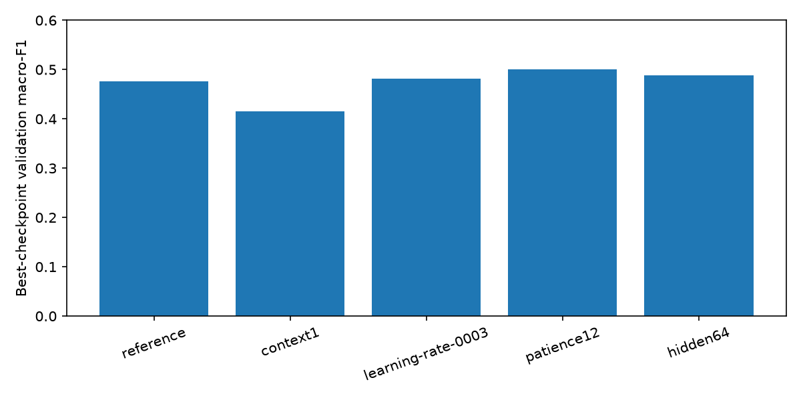

# Measured GRU follow-up

Timo ran these trials locally on MPS. Results were inspected on 2026-11-04.
All trials used plain Adam, seed 42, the same features, and the frozen participant split.
No OPAL agent or language model participated in these trials.
Compare restored best checkpoints, rather than the last epoch in each log.

| Trial | Best epoch | Macro-F1 | Accuracy | REM recall | REM precision |
| --- | ---: | ---: | ---: | ---: | ---: |
| reference | 1 | 0.4760 | 56.69% | 14.38% | 49.72% |
| context1 | 16 | 0.4153 | 54.57% | 24.84% | 36.71% |
| learning-rate-0003 | 10 | 0.4816 | 50.25% | 31.21% | 29.80% |
| patience12 | 12 | 0.5001 | 54.42% | 44.12% | 41.67% |
| hidden64 | 7 | 0.4883 | 53.35% | 27.45% | 36.76% |

Context ten improved macro-F1 by 0.0608 over context one in this run.
Deep recall increased from 20.17% to 53.22%; REM recall decreased.
History helps overall class balance but does not improve every stage.
Patience twelve reached the best macro-F1 at epoch twelve.
The twenty-epoch cap prevented full patience exhaustion in that trial.
Lower training loss alone does not establish improved generalization.
The lower learning rate and larger hidden size produced small macro-F1 gains.
One seed cannot establish a reliable advantage.

## Recommended next comparison

Compare reference against patience twelve with three shared seeds before adding capacity or another architecture.
Use fresh output directories and the same inputs and validation participants.
Then use grouped development folds to assess participant sensitivity.
Keep the final test participants reserved until model choices are fixed.
A Codex-powered OPAL pilot should be a separate Adam comparison with an identical model recipe.

The [summary](summary.json) records settings, scores, and verified metric hashes.
Full checkpoints and predictions remain under ignored artifacts/gru-followup.
