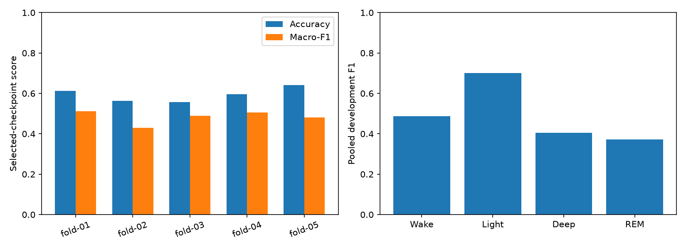

# GRU grouped development validation

Timo completed five participant-disjoint development folds. Results were reviewed on 2026-11-06.
Every development participant was validated once. Final-test observations remained reserved.

| Fold | Accuracy | Macro-F1 | Selected epoch |
| --- | ---: | ---: | ---: |
| fold-01 | 61.33% | 0.5115 | 11 |
| fold-02 | 56.38% | 0.4290 | 2 |
| fold-03 | 55.70% | 0.4900 | 6 |
| fold-04 | 59.54% | 0.5063 | 6 |
| fold-05 | 64.05% | 0.4812 | 15 |

Mean fold macro-F1 is 0.4836, with sample standard deviation 0.0329.
Pooled accuracy is 59.45%; pooled macro-F1 is 0.4914 across 22,708 eligible epochs from 26 participants.
Fold means and pooled scores have different weighting and must not be interchanged.

Fold five has the highest accuracy but recalls only 10.37% of Deep epochs.
Light recall in that fold is 88.90%. This explains why high accuracy does not guarantee balanced stage detection.
The highest macro-F1 folds are one and four. Deep F1 is highest in fold three.
Pooled REM precision is 45.92%, recall 31.28%, and F1 0.3721.
Selected epochs range from two to fifteen; early validation peaks are not universal.

Each validation fold also selected its checkpoint and stopping time.
These are development-CV results, not independent outer-test estimates or final-test performance.
Different held-out populations prevent treating the pooled score change from earlier experiments as model improvement.

The [summary](summary.json) records fold membership, per-class and participant scores, coverage, and verified metric hashes.
The next comparison keeps these same folds and features while changing the model recipe to a small causal Transformer.
