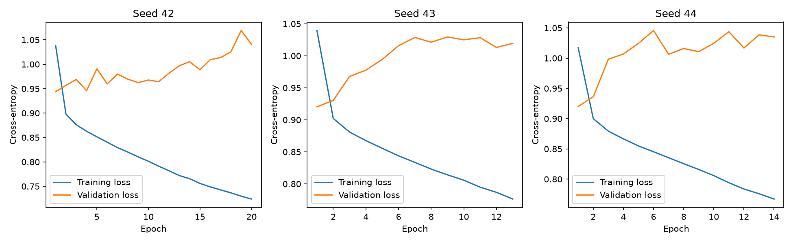

# GRU shared-seed results

Timo completed six MPS runs. Results were inspected on 2026-11-04.
All runs used Adam and the same frozen participant split, features, and twenty-epoch cap.

| Seed | Reference macro-F1 | Patience 12 macro-F1 | Difference | Selected epochs |
| --- | ---: | ---: | ---: | --- |
| 42 | 0.4760 | 0.5001 | +0.0240 | 1 / 12 |
| 43 | 0.5028 | 0.5028 | 0.0000 | 1 / 1 |
| 44 | 0.4959 | 0.4959 | 0.0000 | 2 / 2 |

Reference mean macro-F1: 0.4916, sample standard deviation 0.0139.
Patience twelve mean: 0.4996, sample standard deviation 0.0035.
Mean paired difference: +0.0080, sample standard deviation 0.0139.
These are descriptive statistics for three seeds, not confidence intervals or significance tests.

Training loss decreases while validation loss generally increases.
This is consistent with overfitting or participant distribution differences; it does not identify their cause.
Precision and recall are stored for the selected checkpoint, not for each training epoch.
Do not infer a monotonic decline in every class metric from these histories.

## Scientific conclusions across experiments

- Majority accuracy masks poor minority-stage performance
- Class weighting changes the precision/recall trade-off; it did not improve overall macro-F1
- The GRU improves class-level scores over logistic regression on this validation split
- The seed-42 context ablation supports a useful history effect, but needs broader confirmation
- Larger hidden size and lower learning rate have no replicated advantage yet
- Longer patience improved one of three seeds; two checkpoint selections were unchanged
- Best-checkpoint selection protects reported results from deterioration in later epochs
- Six seed runs still evaluate the same three held-out people, not six independent cohorts

Longer patience cannot worsen the best observed validation score when the training path is identical and includes the shorter run.
That selection property does not establish improved performance on new participants.
All model choices remain development decisions. Final test observations remain reserved.

## Next experiment

Prepare a bounded Codex-powered OPAL pilot using the unchanged reference model and Adam control.
Treat this as an optimizer experiment, not a proposed cure for overfitting.
Preserve validation solely for checkpoint selection in the first pilot.
Confirm promising recipes later with grouped development folds.
Do not increase model size or the epoch cap based only on lower training loss.

The [summary](summary.json) records all scores, paired comparisons, and verified metric hashes.
Full histories, checkpoints, and predictions remain in ignored artifacts/gru-seeds.
