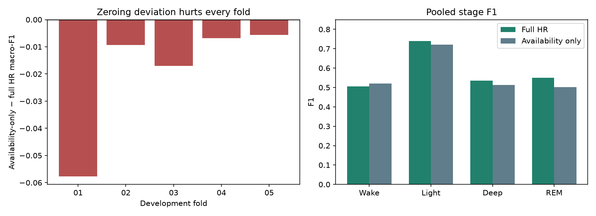
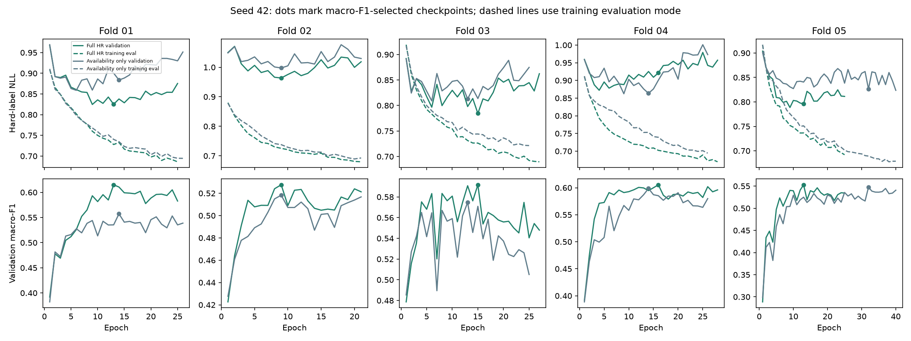

# Removing HR deviation reduces performance

Timo completed notebook 31 locally on MPS. All five availability-only control fits are complete.
The paired validator confirms matching artifacts, fitted normalization, 22,708 eligible targets, and 26 development participants.
The full-HR seed-42 result is reused. The three final-test participants remain reserved.

## A useful negative control, supporting explicit deviation

| Metric | Full HR: deviation + availability | Availability only: deviation zeroed |
| --- | ---: | ---: |
| Mean fold macro-F1, primary | 0.57854 | 0.55926 |
| Pooled macro-F1 | 0.58191 | 0.56437 |
| Pooled accuracy | 65.964% | 63.806% |
| Selected pooled hard-label NLL | 0.85473 | 0.87383 |

The mean paired macro-F1 difference is −0.01929. Its descriptive five-fold sample deviation is 0.02196.
Every fold loses macro-F1 and accuracy. Seven participants improve macro-F1; nineteen decline.
The loss is not an experiment failure: the intervention removed the feature whose contribution we wanted to test.
It supports retaining explicit deviation conditional on availability, this architecture, and this seed-42 training procedure.
It does not prove physiological necessity or performance on independent participants.

| Fold | Full-HR macro-F1 | Availability-only macro-F1 | Difference | Accuracy difference, percentage points |
| --- | ---: | ---: | ---: | ---: |
| 01 | 0.61502 | 0.55727 | −0.05775 | −5.450 |
| 02 | 0.52758 | 0.51827 | −0.00931 | −1.411 |
| 03 | 0.59170 | 0.57469 | −0.01701 | −0.960 |
| 04 | 0.60548 | 0.59872 | −0.00676 | −0.565 |
| 05 | 0.55293 | 0.54734 | −0.00559 | −2.331 |

Fold 01 again contributes most. Excluding it descriptively still leaves a mean macro-F1 loss of 0.00967.
Do not use that sensitivity summary to change the original all-fold selection rule.
[summary.json](summary.json) preserves verified fold, participant, class, support, and confusion-matrix scores.

## REM loses substantially, but Wake improves

| Stage | Precision, full HR → availability only | Recall | F1 |
| --- | ---: | ---: | ---: |
| Wake | 60.17% → 62.25% | 43.49% → 44.70% | 0.50488 → 0.52033 |
| Light | 69.05% → 67.44% | 79.52% → 77.56% | 0.73917 → 0.72148 |
| Deep | 61.91% → 56.66% | 47.00% → 46.94% | 0.53435 → 0.51341 |
| REM | 59.27% → 55.56% | 51.17% → 45.82% | 0.54925 → 0.50226 |

Removing deviation loses 260 correct REM predictions, from 2,487 to 2,227.
REM-to-Light errors rise from 2,203 to 2,424.
Light loses 251 correct predictions. Deep loses two; Wake gains 23. The net loss is 490 correct predictions.
Deep's recall is nearly unchanged, but more false-positive Deep predictions reduce precision and F1.
Not every metric becomes worse: Wake improves in precision, recall, and F1.
The deviation feature therefore contributes useful REM/Light discrimination alongside a Wake trade-off.

The original HR summaries remain available in both models.
The control could still learn past-relative patterns from those sequences; it simply lacks the explicit deviation channel.
The result supports that explicit representation under the current small model and training budget.
It does not show that the control has no access to past heart-rate information.

## Matched construction strengthens this comparison

Both models retain eight internal channels, 2,852 nominal parameters, identical parameter ordering, and the same seeded initial weights.
Only the deterministic mask differs. All normalization states match exactly across the five corresponding folds.
The mask applies after scaling and missing-history handling, before patch projection.
Availability, original features, raw context, eligible targets, optimizer, loss, budget, and checkpoint rule remain fixed.
The zero channel makes its projection weights inactive. Equal nominal size does not imply equal functional capacity.
Different training trajectories and selected checkpoints remain part of the feature-recipe effect.

## Loss curves retain trade-offs

| Fold | Selected epoch, full HR → availability only | Full-HR selected NLL | Control selected NLL | Control final NLL |
| --- | --- | ---: | ---: | ---: |
| 01 | 13 → 14 | 0.82513 | 0.88366 | 0.95141 |
| 02 | 9 → 9 | 0.96367 | 0.99754 | 1.02969 |
| 03 | 15 → 13 | 0.78439 | 0.81285 | 0.87472 |
| 04 | 16 → 14 | 0.92144 | 0.86354 | 0.97308 |
| 05 | 13 → 32 | 0.79581 | 0.82623 | 0.82369 |

Selected pooled NLL worsens by 0.01910. Four selected fold NLLs worsen.
Fold 04 improves selected NLL despite lower macro-F1 and accuracy. Probability loss and classification decisions measure different properties.
Folds 01–04 finish with higher validation NLL than at their selected checkpoint.
Fold 05 has slightly lower final NLL than selected NLL, but the checkpoint rule remains macro-F1.
Do not replace the selected model after inspecting a secondary loss curve.
Both recipes retain late training/validation separation. Removing deviation does not establish a solution to overfitting.
[epoch-evidence.json](epoch-evidence.json) records compact trajectories, selected epochs, and final losses.

## Transitions improve after deviation is removed

| Slice | Targets | Full-HR macro-F1 | Availability-only macro-F1 |
| --- | ---: | ---: | ---: |
| History 1–4 | 500 | 0.44015 | 0.43349 |
| History 5–29 | 2,074 | 0.52929 | 0.52278 |
| Full history | 20,134 | 0.56061 | 0.54628 |
| Stage transitions | 1,398 | 0.39073 | 0.40769 |

All history-bin scores decline, while transition macro-F1 improves by 0.01696.
This repeats an important limit of the full-HR recipe: its overall gain does not imply better stage-boundary detection.
History bins are disjoint; transitions overlap them. These are post-hoc descriptive slices with differing class supports.
[temporal-slices.json](temporal-slices.json) preserves class scores and supports.

## Next: the symmetric deviation-only control

Keep the full HR recipe as the working development reference.
Do not replicate a performance-degrading availability-only recipe merely to search for a better score.
Instead, isolate the flag's conditional contribution with one complementary seed-42 control across all five folds.
Keep the standardized deviation unchanged and set only the availability channel to zero.
Retain eight internal channels, nominal parameter count, initialization layout, training-only normalization, and every other control.
Reuse the full-HR reference. This requires five new fits, capped at 200 epochs.

If deviation alone retains the main gain, the explicit flag may be unnecessary under this recipe.
If it loses performance, that supports keeping both channels together.
In either case, inspect Wake and transition trade-offs beside REM, macro-F1, and NLL.
A small difference would not establish equivalence from one seed.
A later seed replication should follow any candidate-promotion decision.

This narrow ablation is more informative than another broad audit or architecture change at this point.
No additional participant-data training ran during this review. The final test remains untouched.

Validation: 876 tests, Ruff, whitespace checks, and fresh-kernel HTML export pass.
