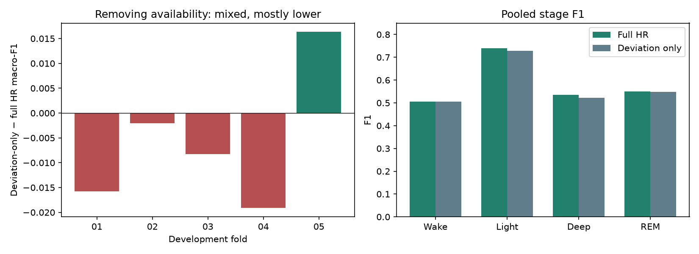
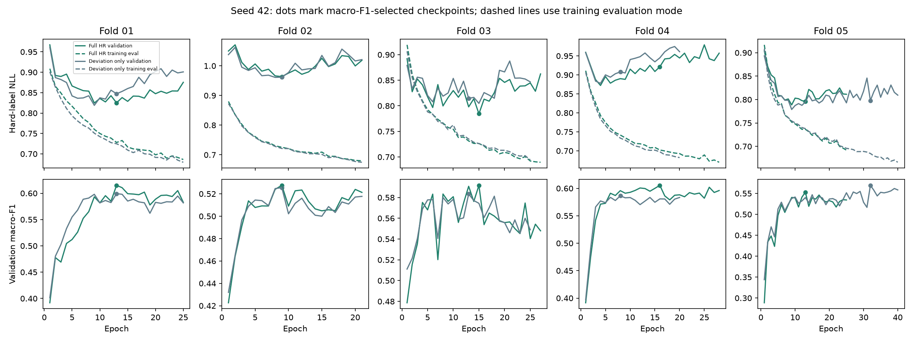

# Removing availability has a smaller, mixed cost

Timo completed notebook 32 locally on MPS. All five deviation-only control fits are complete.
The paired validator confirms matching normalization, model layout, recorded recipes, 22,708 eligible targets, and 26 development participants.
The full-HR seed-42 result is reused. The three final-test participants remain reserved.

## Keep the flag for now; necessity is not established

| Metric | Full HR: deviation + availability | Deviation only: availability zeroed |
| --- | ---: | ---: |
| Mean fold macro-F1, primary | 0.57854 | 0.57277 |
| Pooled macro-F1 | 0.58191 | 0.57639 |
| Pooled accuracy | 65.964% | 64.977% |
| Selected pooled hard-label NLL | 0.85473 | 0.86299 |

The mean paired macro-F1 difference is −0.00577. Its descriptive five-fold sample deviation is 0.01403.
Four folds decline in macro-F1 and accuracy. Twelve participants improve macro-F1; fourteen decline.
The effect is smaller and less uniform than the earlier −0.01929 loss after deviation was removed.
Retain both channels as the working recipe. This one-seed comparison does not prove that availability is necessary or irrelevant.
[summary.json](summary.json) preserves verified fold, participant, class, support, and confusion-matrix scores.

| Fold | Full-HR macro-F1 | Deviation-only macro-F1 | Difference | Accuracy difference, percentage points |
| --- | ---: | ---: | ---: | ---: |
| 01 | 0.61502 | 0.59928 | −0.01574 | −2.943 |
| 02 | 0.52758 | 0.52551 | −0.00207 | +0.263 |
| 03 | 0.59170 | 0.58344 | −0.00827 | −1.148 |
| 04 | 0.60548 | 0.58635 | −0.01913 | −0.316 |
| 05 | 0.55293 | 0.56928 | +0.01635 | −0.657 |

Fold 02 gains accuracy while losing macro-F1 slightly. Fold 05 gains macro-F1 while losing accuracy.
These opposite movements are possible because accuracy weights each epoch equally, while macro-F1 weights each stage equally.
Do not select the next recipe from either favorable fold alone.

## Higher REM and Deep recall does not mean better F1

| Stage | Precision, full HR → deviation only | Recall | F1 |
| --- | ---: | ---: | ---: |
| Wake | 60.17% → 59.84% | 43.49% → 43.75% | 0.50488 → 0.50546 |
| Light | 69.05% → 69.25% | 79.52% → 76.97% | 0.73917 → 0.72907 |
| Deep | 61.91% → 57.19% | 47.00% → 48.09% | 0.53435 → 0.52247 |
| REM | 59.27% → 57.47% | 51.17% → 52.47% | 0.54925 → 0.54856 |

REM gains 63 true positives, but also gains 178 false positives. Its F1 is slightly lower and essentially unchanged numerically.
Deep gains 34 true positives and 221 false positives. Its precision loss outweighs its recall gain, reducing F1 by 0.01189.
Wake gains five correct predictions and only 0.00058 F1. Treat that small change cautiously.
Light loses 326 correct predictions. The net loss across all stages is 224 correct predictions.
The control therefore shifts decisions away from Light without establishing better balanced stage detection.

## Loss curves do not support removing the flag

| Fold | Selected epoch, full HR → deviation only | Full-HR selected NLL | Control selected NLL | Control final NLL |
| --- | --- | ---: | ---: | ---: |
| 01 | 13 → 13 | 0.82513 | 0.84722 | 0.90088 |
| 02 | 9 → 9 | 0.96367 | 0.96175 | 1.02099 |
| 03 | 15 → 13 | 0.78439 | 0.81452 | 0.84679 |
| 04 | 16 → 8 | 0.92144 | 0.90787 | 0.96108 |
| 05 | 13 → 32 | 0.79581 | 0.79793 | 0.80941 |

Selected pooled NLL rises by 0.00826. Folds 02 and 04 improve selected NLL; the other three worsen.
The candidate finishes above selected validation NLL on every fold while training-evaluation NLL decreases after selection.
The late probability-overfitting pattern remains. Keep the macro-F1 checkpoint rule; do not substitute final or lower-NLL checkpoints post-hoc.
Fold 05 selects much later and reaches the forty-epoch cap. That is part of the changed training trajectory, not a new budget setting.
[epoch-evidence.json](epoch-evidence.json) preserves selected/final losses and compact comparable evaluation trajectories.

## Full-history scores are nearly unchanged

| Slice | Targets | Full-HR macro-F1 | Deviation-only macro-F1 |
| --- | ---: | ---: | ---: |
| History 1–4 | 500 | 0.44015 | 0.43460 |
| History 5–29 | 2,074 | 0.52929 | 0.51471 |
| Full history | 20,134 | 0.56061 | 0.56050 |
| Stage transitions | 1,398 | 0.39073 | 0.39452 |

Both startup bins decline, while full-history macro-F1 is nearly unchanged and transition macro-F1 improves slightly.
This suggests the explicit flag may help encode startup conditions, but it does not establish the mechanism.
The flag is already derivable from valid lengths and positions. It adds a convenient representation, rather than new sensor observations.

Do not attribute the whole primary loss to startup from these scores alone.
Macro-F1 is nonlinear, fold aggregation differs from pooled slices, and class supports vary.
History bins are disjoint; transitions overlap them. These remain post-hoc descriptive findings.
[temporal-slices.json](temporal-slices.json) preserves all class scores and supports.

## Next: replicate this exact ablation across seeds

Keep the full HR recipe unchanged. Repeat deviation-only candidates for seeds 43 and 44 across the same five development folds.
Reuse their completed full-HR reference results and both measured seed-42 results.
This requires ten new candidate fits, capped at 400 epochs in total. Timo runs training locally.
Keep the availability mask, context, normalization policy, model layout, optimizer, loss, dropout, diagnostics, budget, and checkpoint rule fixed.
Only training seeds and output paths change.

This tests the smaller, mixed flag effect rather than searching for a lucky better score.
The full-HR reference already varies across seeds, so one small negative effect does not settle the usefulness of the explicit flag.
Report every seed's paired mean fold effect and the three-seed descriptive mean/sample deviation.
Inspect stage precision and F1 beside recall, especially Light losses and Deep false positives.
Keep startup and transition behavior as secondary evidence.

If the primary loss repeats, retain the flag and stop this ablation series.
If effects vary or average near zero, describe that uncertainty rather than claiming equivalence.
Any proposed promotion must consider the primary score and stage trade-offs together; do not promote from recall alone.
The same participants repeat across seeds, so these are not independent population trials or final-test estimates.
No additional participant-data training ran during review. The final test remains untouched.

Validation: 924 tests, Ruff, whitespace checks, and fresh-kernel HTML export pass.
