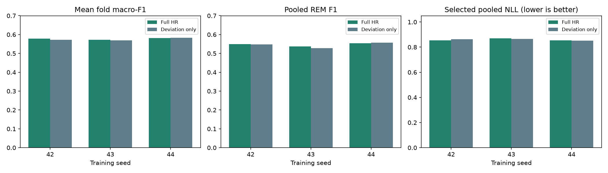
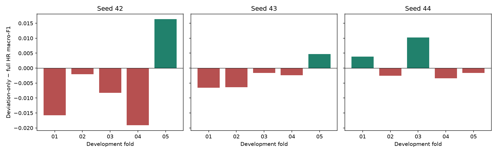

# Availability has a small, mixed effect across seeds

Timo completed notebook 33 locally on MPS. All three shared-seed comparisons are complete.
The paired validators confirm matching recipes, normalization, predictions, 22,708 eligible targets, and 26 development participants per seed.
All full-HR references and the seed-42 control were reused. Only candidates 43 and 44 required new training.
The three final-test participants remain reserved.

## Keep availability as the default; stop this ablation series

| Seed | Full-HR mean fold macro-F1 | Availability removed | Paired difference | Pooled accuracy, full HR → removal |
| --- | ---: | ---: | ---: | ---: |
| 42 | 0.57854 | 0.57277 | −0.00577 | 65.964% → 64.977% |
| 43 | 0.57189 | 0.56944 | −0.00246 | 65.184% → 64.713% |
| 44 | 0.58220 | 0.58351 | +0.00131 | 66.404% → 66.259% |

The mean seed effect is −0.00231 macro-F1. Its descriptive sample deviation is 0.00354.
Eleven of fifteen seed/fold comparisons decline in macro-F1. Nine decline in accuracy.
Participant macro-F1 improves for 12/26, 8/26, and 12/26 participants across seeds 42, 43, and 44.
Pooled accuracy falls at every seed, although seed 44 gains a small amount of macro-F1.

The result does not establish that availability is necessary or irrelevant. Removing it has no consistent primary-score benefit.
Retain the already replicated full-HR recipe as the working reference and stop this flag-ablation series.
This is a pragmatic default, rather than a claim of statistically proven superiority or equivalence.
The same participant folds repeat across seeds; they are not fifteen independent cohorts or final-test estimates.
[summary.json](summary.json) preserves verified fold, participant, class, support, and confusion-matrix reports.

## The small fold gains do not repeat consistently

| Fold | Seed 42 macro-F1 difference | Seed 43 difference | Seed 44 difference |
| --- | ---: | ---: | ---: |
| 01 | −0.01574 | −0.00659 | +0.00387 |
| 02 | −0.00207 | −0.00641 | −0.00255 |
| 03 | −0.00827 | −0.00157 | +0.01025 |
| 04 | −0.01913 | −0.00242 | −0.00344 |
| 05 | +0.01635 | +0.00471 | −0.00157 |

Fold 05 improves macro-F1 at seeds 42 and 43, but not 44.
Folds 02 and 04 decline at every seed. Do not choose a recipe from a favorable seed or fold alone.

## Class trade-offs repeat more clearly than the overall gain

| Seed | Wake F1, full HR → removal | Light F1 | Deep F1 | REM F1 |
| --- | ---: | ---: | ---: | ---: |
| 42 | 0.50488 → 0.50546 | 0.73917 → 0.72907 | 0.53435 → 0.52247 | 0.54925 → 0.54856 |
| 43 | 0.49685 → 0.50549 | 0.73171 → 0.72784 | 0.53988 → 0.53418 | 0.53656 → 0.52838 |
| 44 | 0.51550 → 0.52103 | 0.74365 → 0.74112 | 0.53129 → 0.53067 | 0.55399 → 0.55679 |

Wake F1 improves slightly at every seed, while Light and Deep F1 decline at every seed.
REM F1 declines at seeds 42 and 43, and improves slightly at 44.
REM recall also varies: it rises at seeds 42 and 44, but falls at 43.
The earlier recall increase therefore does not repeat as a uniform REM benefit.
Higher recall alone still does not establish better classification when precision falls.
Keep each stage's precision and recall visible in the saved report.

## Probability quality and overfitting remain mixed

| Seed | Selected pooled NLL, full HR | Availability removed | Difference |
| --- | ---: | ---: | ---: |
| 42 | 0.85473 | 0.86299 | +0.00826 |
| 43 | 0.86984 | 0.86608 | −0.00376 |
| 44 | 0.85300 | 0.85170 | −0.00130 |

Lower NLL is better. Its small gains at seeds 43 and 44 coexist with lower accuracy at both seeds.
Classification decisions and probability loss need not move together.
Selected comparisons include different checkpoint choices under the same fixed macro-F1 rule.
[epoch-evidence.json](epoch-evidence.json) preserves selected/final losses and comparable compact trajectories.
Late validation/training separation persists in the saved curves. Removing the flag is not established as an overfitting remedy.
Do not switch to lower-NLL or final checkpoints after reviewing these results.

## Startup effects do not support a general mechanism

| Slice | Targets per seed | Seed 42 macro-F1 difference | Seed 43 difference | Seed 44 difference |
| --- | ---: | ---: | ---: | ---: |
| History 1–4 | 500 | −0.00555 | +0.02348 | −0.02074 |
| History 5–29 | 2,074 | −0.01457 | −0.04518 | +0.01169 |
| Full history, 30 epochs | 20,134 | −0.00011 | −0.00013 | +0.00255 |
| Stage transitions | 1,398 | +0.00379 | +0.00375 | +0.00190 |

Full-history macro-F1 changes little. Startup effects vary by seed, so the seed-42 startup hypothesis remains unconfirmed.
Transition macro-F1 improves slightly at all three seeds, a consistent secondary trade-off rather than an overall promotion case.
History bins are disjoint; transitions overlap them. Supports and class mixtures differ.
Do not add slice macro-F1 values to explain the primary effect.
[Seed 42](seed-42-temporal-slices.json), [seed 43](seed-43-temporal-slices.json), and [seed 44](seed-44-temporal-slices.json) preserve class scores and supports.

## Next: test the HR reference timescale

Keep both HR channels and stop masking them. Do not add another seed or search for a favorable flag result.
Test one new hypothesis: a slower recent HR reference may provide a more useful relative-level representation.
Compare twenty strictly previous epochs, ten minutes, against the current ten previous epochs, five minutes.
This is a proposed representation hypothesis, not an established physiological mechanism or predicted improvement.

Retain the same thirty-epoch raw input window, minimum four previous epochs, and binary availability rule.
Both derived channels must remain inside each supplied window. Do not precompute session-wide histories that extend the input boundary.
The model keeps eight channels, 2,852 parameters, and the same trainable initialization layout.
Normalization still fits available training targets only. The new deviation definition can legitimately change its fitted mean and scale.
The original HR scale and number of available fitting targets should remain identical.

Reuse the full-HR seed-42 reference. Train five fresh twenty-epoch-horizon candidates, capped at 200 epochs.
Keep raw observations, eligibility, participant folds, seed, model, optimizer, loss, dropout, diagnostics, budget, and checkpoint rule fixed.
The horizon and its resulting training-only deviation normalization are the only intended representation changes.
Assess paired mean fold macro-F1, all stages, NLL, and temporal slices before deciding on replication.
Keep the final test untouched. No additional participant-data training ran during this review.

Validation: 937 tests, Ruff, whitespace checks, and fresh-kernel HTML export pass.
