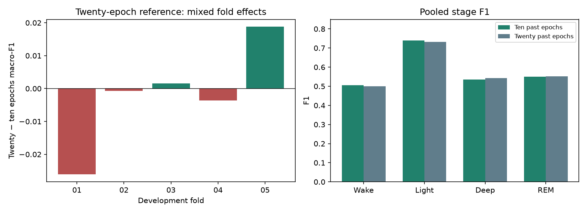
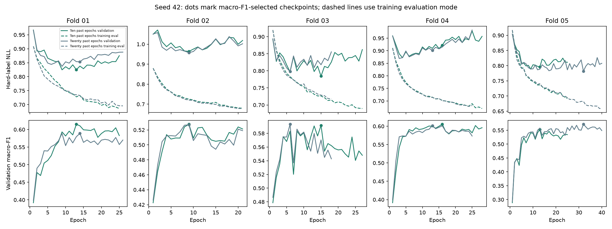

# Twenty past HR epochs change the trade-off, without an overall win

Timo completed notebook 34 locally on MPS. All five candidate folds are complete.
The paired validator confirms the same 22,708 eligible targets, 26 development participants, model layout, and declared horizon intervention.
The ten-epoch full-HR seed-42 reference is reused. The three final-test participants remain reserved.

## Retain the ten-epoch working reference

| Metric | Ten past HR epochs | Twenty past HR epochs |
| --- | ---: | ---: |
| Mean fold macro-F1, primary | 0.57854 | 0.57653 |
| Pooled macro-F1 | 0.58191 | 0.58193 |
| Pooled accuracy | 65.964% | 65.506% |
| Selected pooled hard-label NLL | 0.85473 | 0.85533 |

The mean paired fold macro-F1 difference is −0.00201. Its descriptive sample deviation is 0.01606.
Two folds improve macro-F1 and three improve accuracy. Twelve participants improve macro-F1; fourteen decline.
Pooled macro-F1 changes by only +0.000013, while accuracy loses 0.458 percentage points.
The stage gains nearly cancel the stage losses. This does not establish a better overall recipe or equivalence.
Retain ten past epochs and both HR channels. Stop this local HR-window tuning series rather than selecting a favorable fold.
[summary.json](summary.json) preserves verified fold, participant, class, support, and confusion-matrix results.

| Fold | Reference macro-F1 | Candidate macro-F1 | Difference | Accuracy difference, percentage points |
| --- | ---: | ---: | ---: | ---: |
| 01 | 0.61502 | 0.58890 | −0.02612 | −3.314 |
| 02 | 0.52758 | 0.52690 | −0.00068 | +0.741 |
| 03 | 0.59170 | 0.59329 | +0.00159 | +0.021 |
| 04 | 0.60548 | 0.60183 | −0.00365 | −0.520 |
| 05 | 0.55293 | 0.57173 | +0.01880 | +0.826 |

Fold 05 has the largest paired macro-F1 gain. Fold 03 has the highest candidate macro-F1, not fold 05.
Fold 01 has the largest loss and outweighs the fold-05 gain in the primary mean.
Fold 02 gains accuracy while losing a little macro-F1. Those scores weight stage errors differently.

## Deep and REM gains are real but modest

| Stage | Precision, ten → twenty | Recall | F1 |
| --- | ---: | ---: | ---: |
| Wake | 60.17% → 61.76% | 43.49% → 41.91% | 0.50488 → 0.49937 |
| Light | 69.05% → 69.52% | 79.52% → 77.41% | 0.73917 → 0.73256 |
| Deep | 61.91% → 59.94% | 47.00% → 49.70% | 0.53435 → 0.54338 |
| REM | 59.27% → 57.12% | 51.17% → 53.48% | 0.54925 → 0.55239 |

Deep gains 84 correct predictions and REM gains 112. Their F1 gains are +0.00903 and +0.00314.
Both gain recall while losing precision. These are modest improvements rather than a broad stage-detection breakthrough.
Wake loses 30 correct predictions and Light loses 270. The net loss is 104 correct predictions.
Wake and Light precision improve, but their recall losses reduce F1.
Deep also adds 134 false positives, while REM adds 242. Keep precision beside recall when judging the stage trade-off.

## The longer horizon does not cure late probability overfitting

| Fold | Selected epoch, ten → twenty | Reference selected NLL | Candidate selected NLL | Candidate final NLL |
| --- | --- | ---: | ---: | ---: |
| 01 | 13 → 14 | 0.82513 | 0.85357 | 0.88803 |
| 02 | 9 → 9 | 0.96367 | 0.95765 | 1.00206 |
| 03 | 15 → 6 | 0.78439 | 0.79778 | 0.85566 |
| 04 | 16 → 13 | 0.92144 | 0.90131 | 0.98258 |
| 05 | 13 → 32 | 0.79581 | 0.78169 | 0.80776 |

Selected pooled NLL worsens by only 0.00060, effectively neutral descriptively.
Folds 02, 04, and 05 improve selected NLL. Folds 01 and 03 worsen.
All candidate final validation NLLs exceed their selected values, while training-evaluation NLL decreases after selection.
The same late training/validation separation remains. Keep the original macro-F1 checkpoint rule.
Fold 05 selects much later and reaches the forty-epoch cap. Its result alone does not justify increasing the budget again.
[epoch-evidence.json](epoch-evidence.json) preserves selected/final evaluation losses and compact trajectories.

## Temporal slices remain descriptive

| Slice | Targets | Ten-epoch macro-F1 | Twenty-epoch macro-F1 |
| --- | ---: | ---: | ---: |
| History 1–4 | 500 | 0.44015 | 0.44193 |
| History 5–29 | 2,074 | 0.52929 | 0.51141 |
| Full history | 20,134 | 0.56061 | 0.56254 |
| Stage transitions | 1,398 | 0.39073 | 0.40376 |

Full-history and transition scores improve, but partial-history scores decline.
History bins are disjoint; transitions overlap them. Do not add their nonlinear macro-F1 values to explain the primary effect.
[temporal-slices.json](temporal-slices.json) preserves class scores and supports.

Both models use the same thirty raw epochs. The longer history never extends outside a supplied window.
Availability, original HR scaling, available fitting-target counts, model size, and initial trainable parameter layout stay fixed.
The changed deviation definition legitimately changes its training-fitted mean/scale and subsequent optimization trajectory.
Even targets with too little past history to distinguish the raw definitions can change through fitted statistics and learned weights.
This comparison does not isolate a physiological timescale mechanism.

## Next: cadence-aware motion diagnostics before another feature model

Keep the ten-epoch full-HR recipe as the working reference. Do not replicate or tune this near-neutral horizon result further now.
The earlier [causal feature audit](../causal-feature-audit-2026-11-17/README.md) found discarded axis-change information and sampling-cadence differences.
Raw adjacent-sample change amplitudes therefore need further validation before becoming model inputs.

Prepare a bounded development-only audit of axis-vector changes on a declared one-second grid inside each completed epoch.
Select only observations at or before each grid time, with an explicit maximum reading age and no cross-epoch carry.
Report valid grid points/pairs, reading ages, actual sample lags, missingness, and cadence alongside the diagnostic mean.
Retain all existing targets. Distinguish missing support from observed zero change.
Compare the new diagnostic with adjacent-sample change and the reference's Wake/Deep/REM errors at participant level.
These summaries remain post-hoc evidence, not training features or classification improvements.

This audit must preserve verified raw inputs, immutable snapshots, and the final-test exclusion boundary.
No model training or feature promotion belongs in that PR. Review support and sampling semantics before choosing one later feature ablation.
No additional participant-data optimization ran during this results review.

Validation: 1,022 tests, Ruff, whitespace checks, and fresh-kernel HTML export pass.
