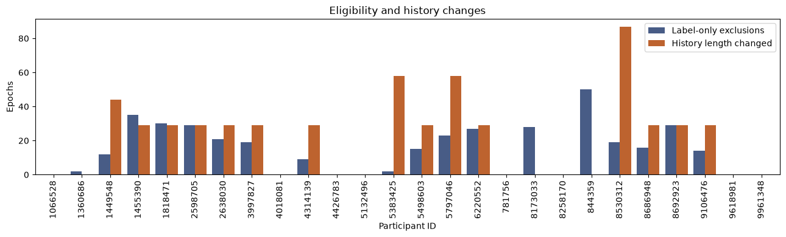

# Notebook 44: label-free preparation findings

Date: 2026-11-24. Scope: twenty-six development participants. No model loading, training, or final-test observation access.

## Measured result

Numerical preparation passed on shared epoch starts at absolute tolerance 1e-8.
The six base features and six coverage measurements had zero mismatches across 23,823 shared epochs.
Fixed-lag motion matched exactly on 22,705 saved identities. Three saved eligible motion epochs lay outside the conservative clock boundary.
The complete [summary](summary.json) records participant results and input hashes.
The [manifest](manifest.json) identifies configuration, implementation, and output bytes.

| Diagnostic | Epochs |
| --- | ---: |
| Completed clock epochs | 24,738 |
| Saved preparation epochs | 23,827 |
| Shared clock/reference epochs | 23,823 |
| Clock-only epochs | 915 |
| Sensor-eligible clock-only epochs | 589 |
| Covered shared epochs without a scored target | 380 |
| Shared eligible epochs with changed history | 566 |
| Reference-only epochs | 4 |
| Eligible reference-only epochs | 3 |
| Unexpected sensor-eligibility rule differences | 0 |

## What changed

The old preparation rejects an unscored epoch even when its sensors have enough coverage.
It then resets the history segment before the next eligible target.
The sensor-only path retains that covered epoch and continues the segment.
All 566 changed shared contexts contain such an unscored epoch in their retained history.
These changes affect fifteen development participants. The [context-cause table](context-causes.json) records the attribution.
Clock-only epochs account for none of these 566 shared-context changes in this run.

The clock uses declared origin zero and closes epochs through the earlier final sensor timestamp.
Four saved reference epochs fall outside its end boundary; three were eligible research targets.
This is a disclosed session-tail difference, not a numerical feature error.
The audit does not silently remove those targets from a reported accuracy comparison: no classification metrics were computed.

## Conclusion and next step

The existing summary formulas can operate without sleep labels. The existing research epoch-selection and reset policy cannot transfer unchanged to a live system.
This finding does not invalidate the saved research scores. It identifies a deployment-policy difference whose prediction impact remains unmeasured.
Do not assume that retaining more history improves scores.

Next, replay the frozen models with sensor-only coverage and resets. Apply saved fitted transforms without fitting new statistics.
Join scored development targets only after prediction. Compare shared targets and report boundary exclusions separately.
Keep the final test reserved. No retraining or architecture change is needed to measure this effect.

## Verification

The audit checks raw checksums and development membership before sensor reads. It never opens raw label files.
Synthetic tests cover boundaries, duplicate conflicts, future-data stability, label independence, context causes, forbidden reads, and immutable snapshot reuse.
Notebook 44 passes fresh-kernel report-only execution. Its optional operations default to false.
The full development audit completed using the fixed formulas. No checkpoint was read or modified.

The targeted non-training suite passes 323 tests. Ruff and whitespace checks pass.
Regression cases include configuration edits, reordered references, incomplete motion snapshots, and notebook execution gates.
