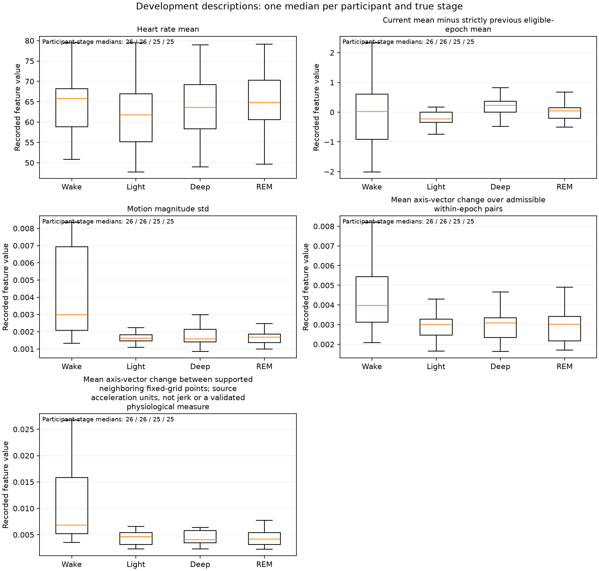

# Fixed-lag motion is feasible, with overlapping stage distributions

This development-only audit follows the neutral twenty-epoch HR-reference result.
It does not train a model or change the working full-HR ten-epoch recipe.
The verified scope contains 26 development participants and all 22,708 matched targets.
The three reserved test participants' observations remain unopened.

## Support and cadence

Each completed epoch schedules 29 interior one-second ticks and 28 neighboring pairs.
Each tick uses the latest same-epoch reading at or before it, with maximum age 0.2 seconds.
The feature averages axis-vector differences between supported neighboring ticks.
Missing pairs remain missing; observed zero change remains zero.

| Minimum point and pair fraction | Supported targets | Unsupported targets |
| --- | ---: | ---: |
| 0.50 | 22,708 | 0 |
| 0.80 | 22,708 | 0 |
| 0.95 | 22,685 | 23 |

Every target has a defined estimate in every stage. No target was dropped.
All 26 participants have median pair support 1.0.
Participant raw median observation gaps range from about 0.015 to 0.100 seconds.
Participant medians of within-epoch median selected-pair lags range from about 0.9986 to 1.0054 seconds.
These measurements support a consistent declared comparison interval; they do not prove independence from acquisition cadence or sensor filtering.
[participant-cadence-support.csv](participant-cadence-support.csv) preserves the individual measurements.

## Stage and error contrasts

| Stage | Median of participant-stage grid-change medians |
| --- | ---: |
| Wake | 0.006801 |
| Light | 0.004601 |
| Deep | 0.004068 |
| REM | 0.004206 |

Values use source acceleration units. They are neither displacement nor jerk.
Wake tends to show larger changes, while Light, Deep, and REM overlap substantially.
The figure shows one median per participant and stage, rather than treating neighboring epochs as independent people.
Deep and REM each have 25 contributing participants; Wake and Light each have 26.

Within the same participant and true stage, reference errors to Light tend to have lower grid-change medians than correct predictions.
The median participant contrast is −0.029596 for Wake, −0.000209 for Deep, and −0.000121 for REM.
These are post-hoc descriptive contrasts, not estimated causal effects or classification gains.
They do not show that this feature can recover missed targets. Quiet Wake can remain difficult.
The related ten- and twenty-epoch models do not provide independent replication.
[summary.json](summary.json) preserves denominators, availability, training-fold stage summaries, and error contrasts.

## Interpretation and next decision

A synthetic linear trajectory shows why adjacent-observation amplitudes change with sampling cadence while the declared one-second comparison is stable.
A second example shows directional information absent from magnitude variation, and activity missed when endpoints return to the same vector.
Neither demonstration establishes physiological validity or empirical prediction value.

Review notebook 35 and its offline dashboard before selecting one later model ablation.
A reasonable next candidate is one fixed-lag motion channel added to the retained full-HR ten-epoch recipe, with explicit missing-support handling.
Keep all targets, fit transforms on training participants only, and hold the model, folds, seeds, and optimization settings fixed.
Do not add availability or support thresholds based on favorable stage plots. First define their inference contract.
No candidate feature enters the model in this audit PR. Timo will run any later training locally.

## Evidence and verification

The raw audit completed in 20.8 seconds after checksum and development-allowlist verification.
The immutable local snapshot lives under artifacts/motion-grid-audit.
The curated manifest records its original output and implementation hashes.
The curated distribution plot was rendered afterward with wrapped titles; its PNG is not the original snapshot PNG.
The original snapshot remains unchanged. Cached loading validates its hashes without rereading raw observations.
Native-browser layout verification was not performed; offline JavaScript contracts and static figures were checked.

Validation: 1,127 tests pass. Ruff and whitespace checks pass. Notebook 35 exports from a fresh kernel without training.
