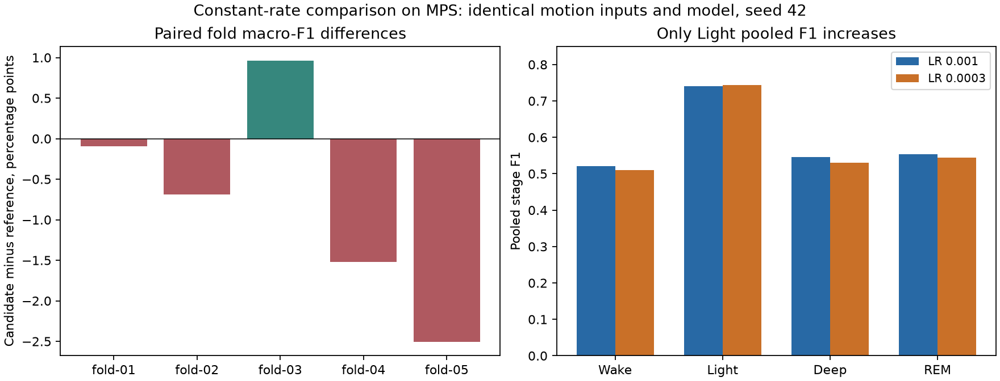
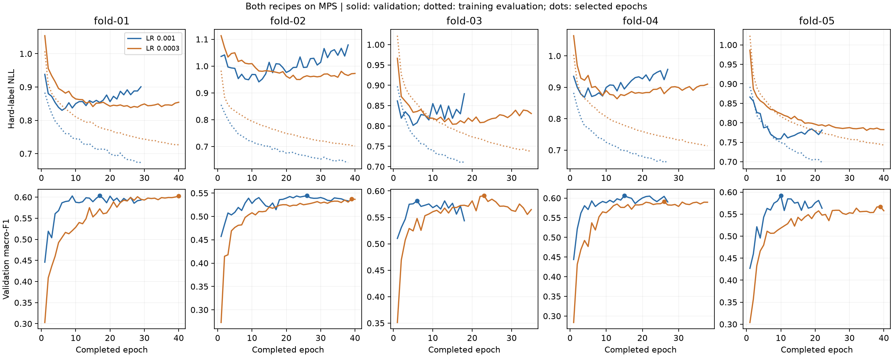

# Lower learning rate loses macro-F1 within forty epochs

Timo completed all five LR0.0003 candidate folds locally. The saved comparison exactly matches a fresh strict learning-rate validator build.
The LR0.001 reference and candidate use MPS, the same motion inputs, 2,900 parameters, folds, and 22,708 eligible targets.
All fitted-input metadata remain matched. The final-test participants remain reserved.

## Keep LR0.001 as the working rate

| Metric | LR0.001 reference | LR0.0003 candidate |
| --- | ---: | ---: |
| Mean fold macro-F1, primary | 0.58534 | 0.57768 |
| Pooled macro-F1 | 0.59039 | 0.58185 |
| Pooled accuracy | 66.298% | 66.250% |
| Selected pooled hard-label NLL | 0.85845 | 0.85636 |

The mean paired fold macro-F1 change is −0.00767, with descriptive sample deviation 0.01327.
Only fold 03 improves macro-F1. Eleven participants improve and fifteen decline.
Pooled accuracy loses only eleven correct predictions, or 0.048 percentage points, while class-balanced performance declines more clearly.
The lower rate is unsuccessful on the predeclared primary score within this budget.
It offers a small probability-quality benefit: selected NLL decreases by 0.00209.
Do not promote LR0.0003 based only on that secondary gain.
[summary.json](summary.json) preserves complete fold, participant, class, source, and capacity checks.

| Fold | Reference macro-F1 | Candidate macro-F1 | Difference | Accuracy difference, percentage points |
| --- | ---: | ---: | ---: | ---: |
| 01 | 0.60335 | 0.60244 | −0.00091 | −0.262 |
| 02 | 0.54439 | 0.53754 | −0.00685 | +0.430 |
| 03 | 0.58129 | 0.59095 | +0.00965 | +1.023 |
| 04 | 0.60594 | 0.59075 | −0.01519 | +0.203 |
| 05 | 0.59174 | 0.56670 | −0.02504 | −1.589 |

Three folds improve accuracy, but only one improves macro-F1. These scores weight the stage errors differently.
Fold 05 has the largest regression on both measures.

## More targets are predicted as Light

| Stage | Precision, reference → candidate | Recall | F1 |
| --- | ---: | ---: | ---: |
| Wake | 64.74% → 63.58% | 43.59% → 42.54% | 0.52103 → 0.50975 |
| Light | 69.80% → 68.70% | 78.89% → 80.92% | 0.74068 → 0.74312 |
| Deep | 61.67% → 61.61% | 48.96% → 46.46% | 0.54584 → 0.52970 |
| REM | 57.93% → 60.54% | 53.09% → 49.53% | 0.55400 → 0.54482 |

Light gains 260 true positives, while Wake loses 20, Deep loses 78, and REM loses 173.
The total number of Light predictions rises by 610, including 350 additional false positives.
This trade-off explains the near-flat accuracy alongside lower macro-F1. No sampling or class-weight change occurred.

REM→Light errors increase from 2,126 to 2,317. Deep→Light errors increase from 1,419 to 1,529.
REM→Deep errors decrease from 72 to 59, but the much larger Light error destination worsens.
REM precision improves while recall and F1 decline. Inspect both directions instead of calling the stage uniformly better or worse.

## The smaller steps change the budget interpretation

| Fold | Selected epoch, reference → candidate | Candidate completed epochs | Reference selected NLL | Candidate selected NLL |
| --- | --- | ---: | ---: | ---: |
| 01 | 17 → 40 | 40 | 0.85367 | 0.85423 |
| 02 | 26 → 39 | 40 | 0.99589 | 0.97158 |
| 03 | 6 → 23 | 35 | 0.80793 | 0.80902 |
| 04 | 15 → 26 | 38 | 0.89448 | 0.87958 |
| 05 | 10 → 39 | 40 | 0.75884 | 0.78262 |

Every candidate selects later than the corresponding reference.
Folds 01, 02, and 05 reach the forty-epoch cap and select epoch 40 or 39.
Those runs do not establish how the lower rate behaves with additional compute.
The result is consistent with slower learning within a fixed budget, but it does not prove undertraining is the only cause.

Candidate folds 03 and 04 exhaust patience at epochs 35 and 38.
Their validation NLL rises after selection while training-evaluation NLL continues falling.
The capped folds have little or no post-selection evidence. Fold 05's final NLL is slightly lower than its selected-checkpoint value.
It would therefore be incorrect to repeat the earlier claim that every candidate fold shows rising NLL after selection.
Lower-rate trajectories show less late loss growth within forty epochs, while the classification score is generally worse.
NLL and macro-F1 evaluate different properties; NLL alone does not isolate calibration error.
[epoch-evidence.json](epoch-evidence.json) preserves the selected/final values and comparable trajectories.

## Every temporal slice loses macro-F1

| Slice | Targets | Reference macro-F1 | Candidate macro-F1 |
| --- | ---: | ---: | ---: |
| History 1–4 | 500 | 0.43130 | 0.39298 |
| History 5–29 | 2,074 | 0.50571 | 0.50132 |
| Full context | 20,134 | 0.57885 | 0.56278 |
| Stage transitions | 1,398 | 0.41716 | 0.39758 |

The smaller rate does not resolve the known startup weakness in this experiment.
History bins are disjoint, while transitions overlap them. Their scores cannot be added to explain the primary effect.
[temporal-slices.json](temporal-slices.json) preserves class scores and target support.

## Next experiment: separate learning rate from available budget

Retain LR0.001 as the working setting. Preserve this forty-epoch LR0.0003 result as a completed fixed-budget comparison.
Do not immediately replicate the worse rate across more seeds or change model capacity, loss, or sampling.

Recommend a separate eighty-epoch LR0.0003 experiment at seed 42, with patience twelve and all other controls unchanged.
Compare it primarily with this forty-epoch LR0.0003 run under an explicit training-budget policy.
Use all five MPS folds and a fresh output directory. Timo runs the five new fits after the next milestone is prepared.
The two folds that already exhausted patience may stop at similar points; the capped folds motivate the additional-budget question.
A fresh run is required unless a separately verified full optimizer/RNG resume mechanism is implemented.

The hypothesis is that the lower rate needs more budget to recover stage discrimination while retaining its probability-quality benefit.
No result is guaranteed. More epochs also offer more validation-checkpoint selection opportunities, which must remain an explicit caveat.
An improvement in selected validation macro-F1 alone does not prove better generalization.
Keep the original checkpoint rule and final-test reservation unchanged.
No longer run is started or prepared during this results review.

Review verification: the saved paired comparison matches a fresh strict build.
Seventeen notebook/command-identity checks, Ruff, whitespace checks, and fresh-kernel HTML export pass.
No new participant-data optimization or final-test observations were used.
