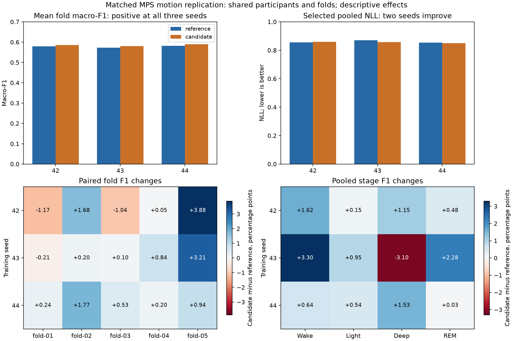
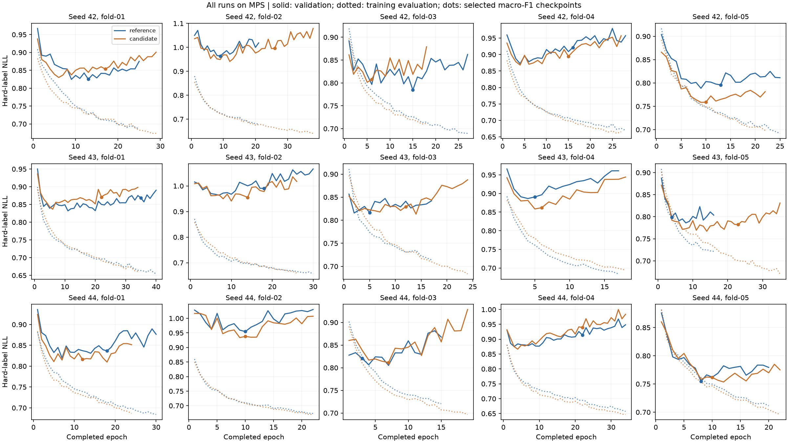

# The motion gain repeats across three MPS training seeds

Timo completed all seed-43 and seed-44 candidate folds. The seed-42 pair and all three references were reused.
The saved study summary exactly matches a fresh strict validator build. All runs use MPS, with no device exception.
Each seed evaluates the same 22,708 development targets from 26 participants. The final test remains reserved.

## The primary improvement is stable across initialization seeds

| Seed | Reference mean fold macro-F1 | Motion mean fold macro-F1 | Paired gain | Accuracy, reference → motion | Participants with F1 gain |
| --- | ---: | ---: | ---: | --- | ---: |
| 42 | 0.57854 | 0.58534 | +0.00680 | 65.964% → 66.298% | 16/26 |
| 43 | 0.57189 | 0.58016 | +0.00827 | 65.184% → 66.223% | 17/26 |
| 44 | 0.58220 | 0.58955 | +0.00735 | 66.404% → 67.029% | 14/26 |

The mean seed effect is +0.00747 macro-F1; its descriptive sample deviation is 0.00074.
Every seed improves both the primary score and pooled accuracy. Twelve of fifteen seed-fold cells improve macro-F1.
The effect direction survives initialization changes, although its distribution across participants and stages varies.
Only seven participants improve at every seed; three decline at every seed. Sixteen improve when their seed effects are averaged.
The seed deviation is not a confidence interval. Repeated seed-fold cells share participants and are not independent evaluation populations.
[summary.json](summary.json) records complete per-seed, fold, participant, and stage results.

## Some cohorts benefit more consistently

| Fold | Seed 42 F1 change | Seed 43 F1 change | Seed 44 F1 change | Mean change |
| --- | ---: | ---: | ---: | ---: |
| 01 | −0.01167 | −0.00210 | +0.00243 | −0.00378 |
| 02 | +0.01681 | +0.00197 | +0.01771 | +0.01216 |
| 03 | −0.01041 | +0.00097 | +0.00527 | −0.00139 |
| 04 | +0.00046 | +0.00835 | +0.00196 | +0.00359 |
| 05 | +0.03881 | +0.03214 | +0.00938 | +0.02678 |

Folds 02, 04, and 05 improve at every seed. Fold 05 has the strongest average gain, although fold 02 leads at seed 44.
Folds 01 and 03 remain slightly negative on average. Retain all folds; do not select a favorable cohort.
This pattern suggests cohort sensitivity alongside the stable positive seed-level aggregate.

## Wake, Light, and REM F1 improve consistently; Deep does not

| Stage | Seed 42 pooled F1 change | Seed 43 change | Seed 44 change | Mean change |
| --- | ---: | ---: | ---: | ---: |
| Wake | +0.01615 | +0.03302 | +0.00638 | +0.01852 |
| Light | +0.00150 | +0.00954 | +0.00535 | +0.00546 |
| Deep | +0.01149 | −0.03100 | +0.01531 | −0.00140 |
| REM | +0.00476 | +0.02283 | +0.00034 | +0.00931 |

The replicated primary gain does not establish a replicated Deep-stage benefit.
At seed 43, Deep recall falls from 49.37% to 45.94%, and precision also falls from 59.55% to 57.02%.
At that seed, Light gains 277 true positives while Deep loses 107. The aggregate improvement contains a clear stage trade-off.
Wake gains 68 true positives. REM gains F1 mainly through higher precision, from 57.14% to 62.64%, with nearly unchanged recall.

At seed 44, Deep F1 improves through higher precision even though its recall decreases slightly.
REM's F1 gain at seed 44 is only 0.00034. Keep precision and recall beside F1; the same aggregate direction can reflect different errors.
These are descriptive effects of the feature recipe, including its necessary 48 additional projection weights.
They do not isolate a physiological mechanism or remove adaptation to repeatedly inspected development data.

## Probability quality improves at two seeds, while late overfitting remains

| Seed | Reference selected pooled NLL | Motion selected pooled NLL | Difference |
| --- | ---: | ---: | ---: |
| 42 | 0.85473 | 0.85845 | +0.00373 |
| 43 | 0.86984 | 0.85750 | −0.01234 |
| 44 | 0.85300 | 0.85030 | −0.00270 |

The mean of the three per-seed NLL values decreases from 0.85919 to 0.85542.
This is a descriptive mean over repeated participants, not three independent cohorts or a pooled new test population.
NLL and macro-F1 measure different properties. NLL alone does not distinguish calibration error from other probability-quality changes.
Every motion-candidate fold finishes with validation NLL above its selected-checkpoint NLL, while training-evaluation NLL decreases.
The late training/validation separation therefore persists across all fifteen candidate folds.
[epoch-evidence.json](epoch-evidence.json) and [selected-nll.json](selected-nll.json) preserve comparable evidence.

## Startup remains a limitation

| Slice | Seed 42 macro-F1 change | Seed 43 change | Seed 44 change |
| --- | ---: | ---: | ---: |
| History 1–4, 500 targets | −0.00885 | −0.06031 | +0.01025 |
| History 5–29, 2,074 targets | −0.02358 | −0.01749 | −0.03797 |
| Full context, 20,134 targets | +0.01824 | +0.01634 | +0.01004 |
| Transitions, 1,398 targets | +0.02643 | +0.02020 | −0.00491 |

Full-context scores improve at every seed. Partial-history scores for epochs 5–29 decline at every seed.
Transition gains do not hold at seed 44. History bins are disjoint; transition targets overlap them.
These post-hoc slices cannot be added to explain the primary effect and do not establish why particular targets improve.
The three seed-specific temporal JSON files preserve stage scores and supports.

## Decision and next experiment

Use the motion-augmented MPS recipe as the working feature reference for subsequent development experiments.
The primary gain repeats across all three seeds, without changing the target population or backend.
Keep the no-motion references and CPU motion result intact as historical evidence. Do not evaluate the final test yet.

Next, compare constant learning rate 0.0003 with 0.001 at seed 42 on the same motion recipe.
Use all five MPS folds and reuse the completed seed-42 motion reference. Keep forty epochs, patience twelve, and every other setting fixed.
This requires five new candidate fits; Timo will run them locally.

The hypothesis is that smaller optimizer steps may improve the selected checkpoint's probability quality or stage trade-off within the fixed budget.
The earlier lower-rate experiment used a different unpatched Transformer recipe; it does not answer this current feature-recipe question.
The lower rate is not a guaranteed cure for overfitting or an asymptotic convergence comparison.
If the candidate hits the epoch cap, report that limit rather than changing the budget during the run.
Keep selection by validation macro-F1 and inspect NLL secondarily. Do not select another epoch after reading the results.

Review verification: the saved study summary equals a fresh strict build.
Twenty-two notebook/seed-reuse/command-identity checks, Ruff, whitespace checks, and fresh-kernel HTML export pass.
No participant-data optimization or final-test observations were used in this review.
