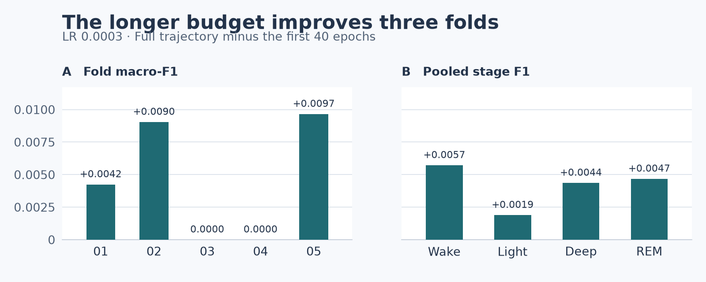
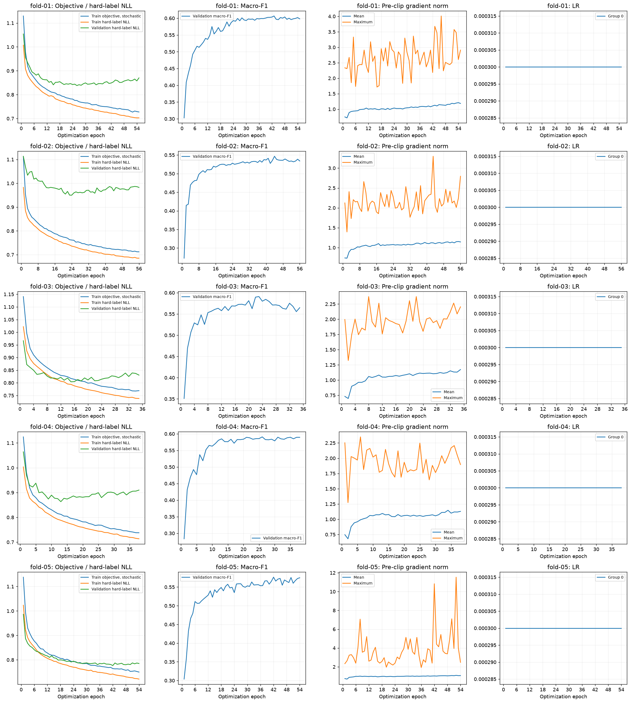

# A longer budget partly closes the lower-rate macro-F1 gap

The longer LR0.0003 trajectories raise mean fold macro-F1 from **0.577675 to 0.582262**. The gain of **0.004587** leaves the longer run **0.003081** below the archived LR0.001 result. Keep the LR0.001 fixed-lag motion recipe as the working configuration.

## Checkpoint comparison

Each new MPS trajectory uses seed 42, patience 12, and a maximum of 80 training epochs. The comparison uses the same fixed-lag motion inputs and five participant-grouped folds, with 22,708 eligible targets from 26 participants. The prefix selects the earliest maximum validation macro-F1 through epoch 40 or the patience stop, whichever comes first. The full trajectory applies the same rule through the stop.

The saved prefix report exactly matches a fresh strict validator build. Prefix fold scores and pooled confusion counts equal the archived notebook 39 metrics. The prefix checkpoints come from the new trajectories. [Budget configuration](../../../configs/motion-training-budget-grouped.yaml) · [Learning-rate results](../motion-learning-rate-2026-11-20/README.md) · [Validated summary](summary.json)

| Metric | LR0.0003, 40-epoch prefix | LR0.0003, up to 80 epochs | Archived LR0.001 |
| --- | ---: | ---: | ---: |
| Mean fold macro-F1 (primary) | 0.577675 | 0.582262 | 0.585343 |
| Pooled macro-F1 | 0.581848 | 0.586007 | 0.590389 |
| Pooled accuracy | 0.662498 | 0.665228 | 0.662982 |
| Selected pooled NLL | 0.856359 | 0.854271 | 0.85845 |

Accuracy rises by 0.273 percentage points, or 62 additional correct predictions. Selected pooled NLL falls by 0.002088. All four stages gain pooled F1, with the largest gain in Wake (+0.00572).

| Fold | Prefix selected epoch | Full selected epoch | Completed epochs | Fold macro-F1 change |
| --- | ---: | ---: | ---: | ---: |
| 01 | 40 | 43 | 55 | +0.004243 |
| 02 | 39 | 44 | 56 | +0.009039 |
| 03 | 23 | 23 | 35 | 0.000000 |
| 04 | 26 | 26 | 38 | 0.000000 |
| 05 | 39 | 42 | 54 | +0.009652 |

Folds 01, 02, and 05 select later checkpoints. Folds 03 and 04 exhaust patience before epoch 40, and every fold stops before epoch 80. The full search includes every prefix checkpoint, so its selected fold macro-F1 is at least as high by construction. The three fold gains describe the benefit of extra checkpoint choices on these same validation folds.

## Validation loss rises after selection

Between the selected checkpoint and the stop, training-evaluation NLL falls and validation NLL rises in all folds. The divergence is consistent with late overfitting. It compares the selected and final epochs, and the intermediate curves fluctuate.

| Fold | Training-evaluation NLL, selected → final | Validation NLL, selected → final |
| --- | ---: | ---: |
| 01 | 0.72123 → 0.70273 | 0.85310 → 0.87021 |
| 02 | 0.70005 → 0.68545 | 0.96822 → 0.98266 |
| 03 | 0.76506 → 0.73810 | 0.80902 → 0.83048 |
| 04 | 0.74321 → 0.71353 | 0.87958 → 0.90997 |
| 05 | 0.74222 → 0.72138 | 0.77665 → 0.78513 |

The full epoch records support the selected-to-final comparison. [Epoch evidence](epoch-evidence.json)

## Freeze the recipe and audit streaming inference

Use the saved LR0.001 motion checkpoints for a training-free chronological replay on development participants. Compare streaming features, probabilities, and predictions with offline validation, including startup, participant resets, segment boundaries, and context eviction. This checks whether the working recipe can reproduce its offline behavior from prepared epoch summaries. Raw sensor ingestion and motion imputation require separate end-to-end checks. [Working configuration](../../../configs/fixed-lag-motion-mps-grouped.yaml)

The same 26 development participants guided checkpoint and recipe selection across experiments. Treat these results as descriptive development evidence and keep the final-test participants reserved. The streaming audit is the next step in place of another learning-rate or seed sweep.
