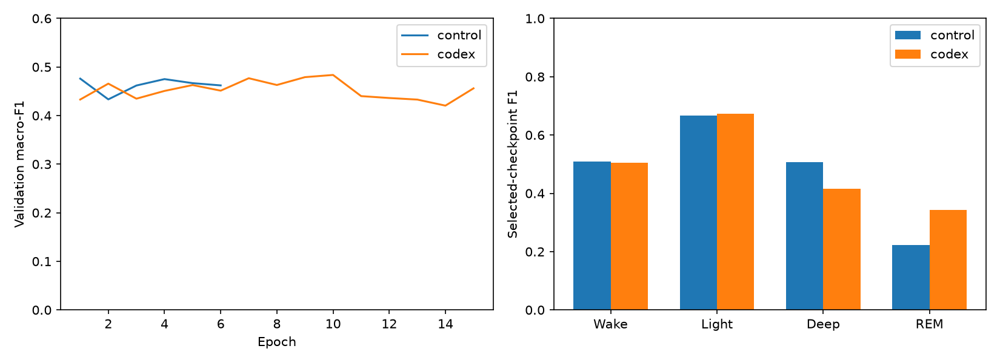

# Successful OPAL retry

Timo completed this controlled retry on 2026-11-05.
Codex CLI 0.160.1 passed the context audit. One optimizer change was applied at update 50.
The update remained active through completion with no rejection or reversion.
The final optimizer program version is one. The selected checkpoint is at update 3120, after the change.

| Metric | Adam control | OPAL keep | Live OPAL |
| --- | ---: | ---: | ---: |
| Macro-F1 | 0.4760 | 0.4760 | 0.4836 |
| Accuracy | 56.69% | 56.69% | 56.58% |
| REM F1 | 0.2231 | 0.2231 | 0.3422 |
| Deep F1 | 0.5061 | 0.5061 | 0.4148 |
| Selected epoch | 1 | 1 | 10 |
| Completed epochs | 6 | 6 | 15 |
| Optimizer updates | 1872 | 1872 | 4680 |
| Measured elapsed seconds | 12.02 | 11.37 | 280.89 |

## What changed

The accepted program changed Adam beta2 from 0.999 to 0.99 and ramped its learning rate toward 0.004.
It also implemented decay and training-loss plateau feedback with gradient clipping.
These describe the saved program; we did not separately ablate each component.
Generated programs remain in ignored artifacts. Their hashes are recorded in the summary.

## Interpretation

The integration succeeded. The macro-F1 gain is 0.0076 on one seed and three validation participants.
REM improved while Deep deteriorated. Accuracy changed little.
The live model also received 2.5 times as many training updates under the same early-stopping rule.
Do not attribute the difference solely to optimizer quality or generalize it across participants.
Validation loss increased despite lower training loss, so adaptive optimization did not resolve the generalization gap.

Agent waiting took 255.2 seconds. Reported input tokens were 179,991, including 163,712 cached input tokens.
Output tokens were 7,758, for 187,749 total tokens including cached input.
The 20,000-token soft cap was exceeded inside the active turn. Dollar cost is unknown.
No further live OPAL runs are required for the next experiment milestone.

The [summary](summary.json) includes metrics, class scores, histories, settings, runtime versions, and artifact hashes.
The [first attempt](../opal-pilot-2026-11-05/README.md) remains recorded as an integration failure.
OPAL stays optional; conventional Adam is the next grouped-validation reference.
