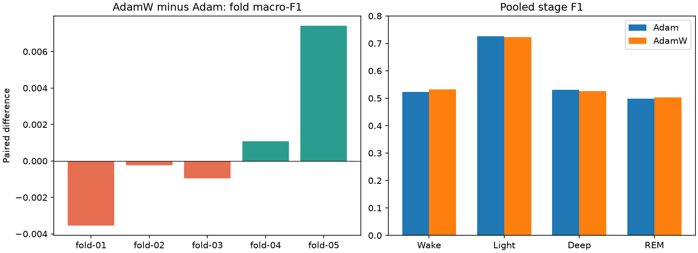

# Measured AdamW weight decay

Timo completed all five candidate fits locally on MPS. Reviewed on 2026-11-16.
Both recipes score the same 22,708 eligible targets from 26 development participants.
The paired metrics, predictions, feature manifests, effective decay groups, devices, and base recipes validate.
The three final-test participants remain reserved.

## Decision: retain the replicated Adam reference

| Metric | Adam | AdamW decay 0.01 |
| --- | ---: | ---: |
| Mean fold macro-F1 | 0.56538 | 0.56613 |
| Pooled macro-F1 | 0.56939 | 0.57099 |
| Pooled accuracy | 64.149% | 63.991% |
| Selected pooled NLL | 0.89553 | 0.88445 |

Mean paired macro-F1 gain is only 0.00075. The sample deviation of the five fold differences is 0.00408.
Two of five folds improve. Participants show fourteen gains, one tie, and eleven losses.
The result does not establish equivalence or statistical significance. It also does not justify promoting the one-seed AdamW candidate.
Retain the original Adam, patch-size-three recipe, which has multi-seed evidence.
[summary.json](summary.json) records complete fold, participant, class, and confusion-matrix scores.

| Fold | Adam macro-F1 | AdamW macro-F1 | Difference | Accuracy difference, percentage points |
| --- | ---: | ---: | ---: | ---: |
| 01 | 0.56802 | 0.56448 | −0.00354 | −0.349 |
| 02 | 0.51640 | 0.51617 | −0.00023 | −0.024 |
| 03 | 0.58519 | 0.58423 | −0.00096 | −0.042 |
| 04 | 0.59945 | 0.60053 | +0.00108 | 0 |
| 05 | 0.55783 | 0.56524 | +0.00741 | −0.360 |

The accuracy differences are small and nonpositive. Fold 04 ties exactly in accuracy.
Fold 05 gains macro-F1 despite losing accuracy because macro-F1 weights the four class scores equally.
These are reused development folds with overlapping training participants. They are not independent population replications.

## Stage trade-offs

| Stage | Precision, Adam → AdamW | Recall | F1 |
| --- | ---: | ---: | ---: |
| Wake | 63.28% → 63.20% | 44.54% → 46.01% | 0.52281 → 0.53252 |
| Light | 68.11% → 68.10% | 77.59% → 76.88% | 0.72540 → 0.72224 |
| Deep | 57.10% → 56.97% | 49.50% → 48.89% | 0.53031 → 0.52622 |
| REM | 54.87% → 54.49% | 45.76% → 46.71% | 0.49905 → 0.50299 |

Wake and REM F1 improve modestly. Light and Deep F1 decline.
REM gains 46 correct predictions while its precision decreases slightly.
The small primary gain is therefore a class trade-off rather than an across-the-board improvement.

## NLL improves, with a checkpoint-selection qualification

| Fold | Selected epoch, Adam → AdamW | Selected NLL, Adam → AdamW | AdamW final NLL |
| --- | --- | --- | ---: |
| 01 | 24 → 8 | 0.93049 → 0.88235 | 0.91177 |
| 02 | 9 → 9 | 1.01438 → 1.01233 | 1.05094 |
| 03 | 13 → 13 | 0.81257 → 0.81181 | 0.88073 |
| 04 | 14 → 14 | 0.89680 → 0.89440 | 0.96817 |
| 05 | 17 → 32 | 0.83929 → 0.83760 | 0.84856 |

All five selected NLL values improve, but approximately 87.74% of the pooled improvement comes from fold 01.
Its selected checkpoint moves sixteen epochs earlier. At matched epoch eight, NLL changes only from 0.88364 to 0.88235.
Thus the selected-checkpoint gain cannot be attributed entirely to better fixed-epoch regularization.
At matched epoch seventeen, fold-05 AdamW macro-F1 is 0.55164, below the reference's 0.55783.
The later selected candidate checkpoint contributes materially to its final reported F1 gain.
These matched-epoch diagnostics are post-hoc. They do not replace the declared macro-F1 checkpoint rule.

All five candidate final validation NLL values exceed selected NLL, while evaluation-mode training NLL falls after selection.
The probability-overfitting pattern remains. AdamW at this decay is not a cure.
[epoch-evidence.json](epoch-evidence.json) preserves compact trajectories and matched earlier-selected-epoch comparisons.
NLL measures true-class probability loss. It is not a calibration-only score, and lower NLL does not imply higher macro-F1.

## Temporal diagnostics

| Slice | Targets | Adam macro-F1 | AdamW macro-F1 |
| --- | ---: | ---: | ---: |
| History 1–2 | 295 | 0.41856 | 0.41828 |
| History 3–29 | 2,279 | 0.50610 | 0.50840 |
| Full history | 20,134 | 0.55201 | 0.55142 |
| Stage transitions | 1,398 | 0.40679 | 0.40193 |

The history bins are disjoint. The transition slice overlaps them.
Histories and transitions reset at participant and gap-induced segment boundaries.
Deep-transition recall remains 32 of 152 targets. REM-transition F1 falls from 0.31429 to 0.30291.
No consistent transition or short-history improvement appears.
Small class supports and post-hoc definitions limit interpretation.
[temporal-slices.json](temporal-slices.json) records the complete stage scores and support.

## Next: one label-smoothing comparison

Use the original Adam, patch-size-three reference. Do not combine AdamW with another intervention yet.
Test training cross-entropy with label smoothing 0.05 on all five original seed-42 folds.
Keep architecture, features, context, sampling, learning rate, diagnostics, clipping, and budget 40/12 fixed.
For four classes, the smoothed training target assigns 0.9625 to the true class and 0.0125 to each other class.
Keep validation loss and evaluation-mode training NLL unsmoothed. Keep macro-F1 checkpoint selection unchanged.
Log the smoothed training objective separately from ordinary hard-label NLL.

The hypothesis is that a modest target-softening penalty reduces overconfident errors while preserving stage detection.
This is a hypothesis, not evidence that the labels are wrong or that smoothing will improve REM/Deep.
The [original study](https://arxiv.org/abs/1906.02629) provides motivation; it does not establish performance on this dataset.
The [PyTorch cross-entropy documentation](https://docs.pytorch.org/docs/2.15/generated/torch.nn.CrossEntropyLoss.html) defines the smoothing parameter.

EMA remains a later option, but introduces a second weight stream and new checkpoint semantics.
The tested scheduler improved some loss behavior while reducing stage scores, so do not repeat it without a new hypothesis.
Muon is available, but its [PyTorch implementation](https://docs.pytorch.org/docs/2.15/generated/torch.optim.Muon.html) requires two-dimensional parameters.
Our model also has biases and LayerNorm vectors, so it would need another optimizer path and further learning-rate/group decisions.
That complexity is less directly motivated than a single loss change for this small model.

Do not automatically replicate a marginal intervention or start a broad optimizer/loss grid.
If smoothing does not improve the primary score, review feature information and participant-specific errors before further regularization tuning.
The reserved test remains unused. Timo runs all participant-data training manually.

Validation: 621 tests, Ruff lint, whitespace checks, and fresh-kernel HTML export pass.
