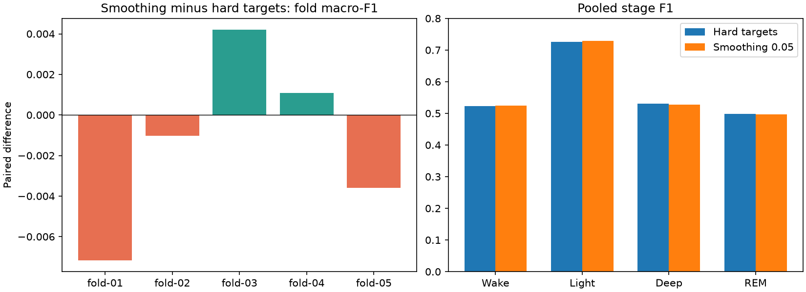
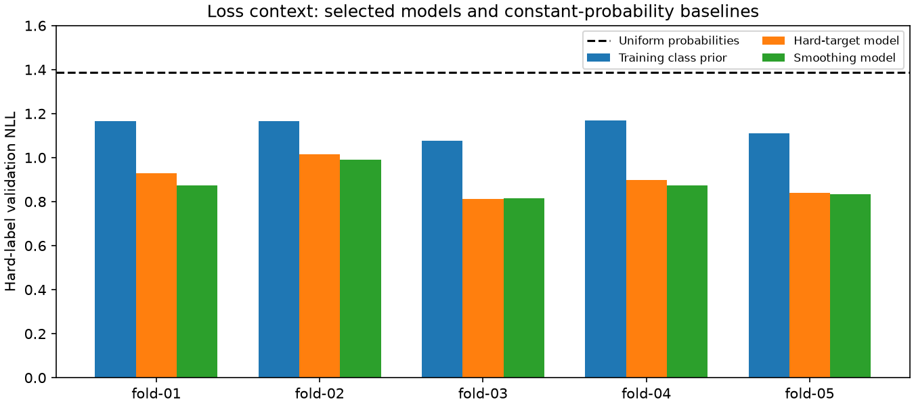

# Measured training-label smoothing

Timo completed all five smoothing-0.05 fits locally on MPS. Reviewed on 2026-11-16.
Both recipes score the same 22,708 eligible targets from 26 development participants.
Saved predictions, metrics, effective loss definitions, feature manifests, devices, and base recipes validate.
The three final-test participants remain reserved.

## Decision: retain the unsmoothed Adam/P3 reference

| Metric | Hard-target reference | Training smoothing 0.05 |
| --- | ---: | ---: |
| Mean fold macro-F1, primary | 0.56538 | 0.56408 |
| Pooled macro-F1 | 0.56939 | 0.56887 |
| Pooled accuracy | 64.149% | 64.334% |
| Selected pooled hard-label NLL | 0.89553 | 0.87437 |

The primary paired difference is −0.00130. Its five-fold sample deviation is 0.00435.
Only folds 03 and 04 improve macro-F1. Eleven participants improve and fifteen decline.
Accuracy improves on four folds, but this does not establish a balanced stage-classification improvement.
This one-seed result does not justify replacing the replicated original Adam/P3 recipe.
The small change does not prove equivalence or statistical significance.
[summary.json](summary.json) records all fold, participant, class, support, and confusion-matrix scores.

| Fold | Reference macro-F1 | Candidate macro-F1 | Difference | Accuracy difference, percentage points |
| --- | ---: | ---: | ---: | ---: |
| 01 | 0.56802 | 0.56086 | −0.00716 | −0.436 |
| 02 | 0.51640 | 0.51538 | −0.00102 | +0.191 |
| 03 | 0.58519 | 0.58939 | +0.00419 | +0.376 |
| 04 | 0.59945 | 0.60054 | +0.00108 | +0.407 |
| 05 | 0.55783 | 0.55424 | −0.00359 | +0.381 |

## Accuracy gains concentrate in Light

| Stage | Precision, reference → smoothing | Recall | F1 |
| --- | ---: | ---: | ---: |
| Wake | 63.28% → 64.27% | 44.54% → 44.22% | 0.52281 → 0.52396 |
| Light | 68.11% → 67.87% | 77.59% → 78.55% | 0.72540 → 0.72821 |
| Deep | 57.10% → 59.36% | 49.50% → 47.35% | 0.53031 → 0.52684 |
| REM | 54.87% → 54.49% | 45.76% → 45.60% | 0.49905 → 0.49647 |

Light gains 123 correct predictions. Wake loses six, Deep loses 67, and REM loses eight.
The net gain of 42 correct predictions explains the 0.185-percentage-point accuracy improvement.
The candidate predicts Light 232 more times and Deep 216 fewer times.
Light accounts for 12,825 of 22,708 targets, so its gains weigh heavily in accuracy.
Macro-F1 gives each class equal weight and therefore exposes a different trade-off.
Wake F1 is slightly higher, rather than lower. Its recall falls while precision improves.
Deep precision improves, but the recall loss reduces F1. Both REM precision and recall decline slightly.

## Interpret the two loss definitions separately

The stochastic training curve uses smoothed cross-entropy. Validation and training-evaluation curves use hard-label NLL.
The training targets are 0.9625 for the true class and 0.0125 for each other class.
The smoothed training objective has a theoretical per-example minimum of approximately 0.20111, rather than zero.
This entropy floor applies to the smoothed objective, not hard-label validation NLL.
The measured training objective near 0.83–0.86 is not near that floor, but its size alone does not identify the cause.

Do not subtract the smoothed stochastic curve from hard-label validation NLL as an ordinary generalization gap.
Their objectives differ. Dropout and within-epoch weight changes also affect the stochastic curve.
Instead, compare training-evaluation hard-label NLL with validation hard-label NLL at the same end-of-epoch weights.
Those curves still separate late in training.

Absolute NLL needs reference values. For four classes, uniform probabilities give NLL ln(4) = 1.38629.
A constant class distribution fitted separately to each fold's training labels gives pooled validation NLL 1.13677.
The candidate's selected NLL of 0.87437 is below both baselines.
It corresponds to approximately 0.417 geometric mean probability on the true class, not mean accuracy or arithmetic mean confidence.
These comparisons show useful predictive information. They do not establish deployment readiness or a performance ceiling.
NLL is not a calibration-only metric, and a lower value does not guarantee better class decisions.

The class-prior baseline reads development training labels only when fitting probabilities.
It reads held-out development labels only when scoring, with no final-test observations.
[loss-context.json](loss-context.json) records each fold's training counts, probabilities, held-out scores, and the entropy calculation.

## Fold 03 and the remaining overfitting pattern

| Fold | Selected epoch, reference → candidate | Reference NLL | Candidate NLL | Candidate final NLL |
| --- | --- | ---: | ---: | ---: |
| 01 | 24 → 8 | 0.93049 | 0.87463 | 0.89424 |
| 02 | 9 → 9 | 1.01438 | 0.98981 | 1.02311 |
| 03 | 13 → 13 | 0.81257 | 0.81371 | 0.86121 |
| 04 | 14 → 14 | 0.89680 | 0.87447 | 0.91974 |
| 05 | 17 → 17 | 0.83929 | 0.83330 | 0.85322 |

Fold 03 has the lowest candidate selected and minimum NLL, both at epoch thirteen.
Its matched reference NLL is nevertheless slightly lower. The candidate gains F1 while worsening NLL on this fold.
It also has the lowest class-prior baseline NLL, indicating a different class mixture from the other held-out cohorts.
Cross-fold loss rankings alone cannot establish which model change helped.

Four selected NLLs improve. Fold 01 again selects an earlier checkpoint, so its selected comparison mixes regularization and checkpoint selection.
At matched epoch eight, its NLL changes from 0.88364 to 0.87463, a smaller gain than the selected-checkpoint comparison.
All five candidate final validation NLLs exceed selected NLL while training-evaluation NLL falls after selection.
For fold 03, selected training-evaluation NLL is 0.76522 versus validation NLL 0.81371.
At the final epoch, these become 0.71939 and 0.86121. The comparable hard-label gap therefore widens.
Smoothing reduces some probability-loss growth, but does not eliminate the overfitting pattern.
Keep the original macro-F1 checkpoint rule. Do not replace checkpoints after inspecting NLL.
[epoch-evidence.json](epoch-evidence.json) preserves both objective definitions, compact trajectories, and matched-epoch evidence.

## Temporal slices also do not support promotion

| Slice | Targets | Reference macro-F1 | Candidate macro-F1 |
| --- | ---: | ---: | ---: |
| History 1–2 | 295 | 0.41856 | 0.41788 |
| History 3–29 | 2,279 | 0.50610 | 0.49872 |
| Full history | 20,134 | 0.55201 | 0.55068 |
| Stage transitions | 1,398 | 0.40679 | 0.40121 |

All macro-F1 slices decline. Deep-transition recall falls from 32 of 152 targets to 27 of 152.
History bins are disjoint; transition targets overlap them. Segment starts do not count as transitions.
Small supports and post-hoc definitions limit interpretation. These slices never become model inputs.
[temporal-slices.json](temporal-slices.json) records each class score and support.

## Recommended next milestone: bounded causal feature audit

Stop the local optimizer/loss grid for now. Retain the original unsmoothed Adam/P3 recipe.
Do not automatically replicate this negative primary result or introduce EMA as another immediate tuning knob.

Audit the input representation and persistent Deep/REM-to-Light errors on development participants.
The current model receives four heart-rate summaries and two motion-magnitude summaries per epoch.
Those summaries discard the order of sensor readings within each thirty-second interval.
For example, a constant axis vector and changing axis directions can share identical motion magnitudes.
Magnitude mean and standard deviation alone cannot distinguish those constructed cases.
This motivates checking discarded motion dynamics; it does not prove that the real errors have that cause.

Inspect three bounded questions:

1. Which Deep/REM-to-Light errors persist across the reference and recent controlled interventions?
2. Do heart-rate levels differ mainly between participants, and do strictly past-relative trends add useful separation?
3. Do validated axis-change summaries distinguish movement that magnitude summaries hide, given sampling gaps and coverage?

Use development data only. Fit any statistics on each training fold.
Reset causal rolling histories at participant and segment boundaries. Preserve the same eligible target population.
Do not normalize from the complete future night, use centered windows, or supply previous true stages as features.
Choose one feature family only if the audit supports a clear hypothesis.
Then prepare one fixed-model feature ablation on the original folds, with the original optimizer, loss, budget, and checkpoint rule.
No feature audit, new feature implementation, or next training recipe is included in this results PR.

The repeated development studies remain adaptive exploration, not independent final-test evidence.
They do not prove an information ceiling or show that the labels are wrong.
Timo runs all future participant-data training manually. No participant optimization ran during this review.

Validation: 661 tests, Ruff lint, whitespace checks, and fresh-kernel HTML export pass.
