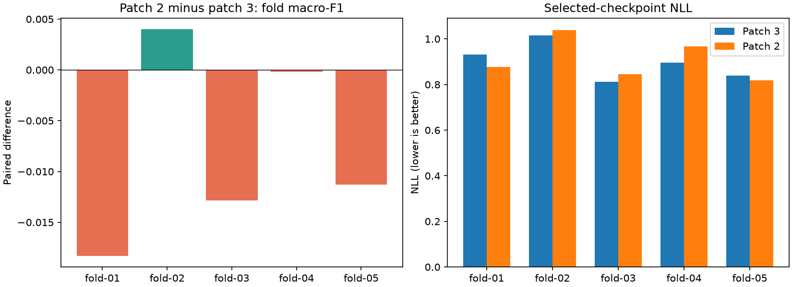
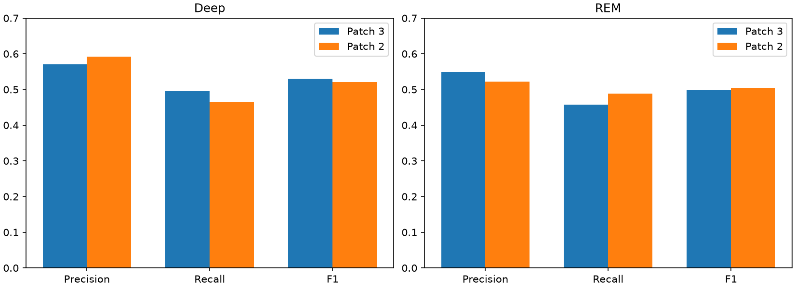

# Measured two-epoch patch comparison

Timo completed all five candidate fits locally on MPS. Reviewed on 2026-11-13.
Both recipes score the same 22,708 eligible targets from 26 development participants.
The paired artifact, prediction, recipe, device, population, and feature-manifest checks pass.
The three final-test participants remain reserved.

## Decision: retain patch size three

| Metric | Patch 3 reference | Patch 2 candidate |
| --- | ---: | ---: |
| Mean fold macro-F1, primary | 0.56538 | 0.55765 |
| Pooled macro-F1 | 0.56939 | 0.56369 |
| Pooled accuracy | 64.149% | 63.572% |
| Selected pooled NLL | 0.89553 | 0.90547 |

The primary paired difference is −0.00773. Only one of five folds and twelve of 26 participants improve macro-F1.
The sample standard deviation of the five fold differences is 0.00928.
These are descriptive development scores. Folds share training participants, and validation selects checkpoints.
Repeated use of these development folds does not provide independent final-test evidence.

Patch size two does not justify replacing the replicated patch-size-three reference.
The result concerns this joint-channel architecture and fixed recipe, rather than all smaller-patch models.
Initialization layout and parameter count also change: 2,756 parameters become 2,740.
See [summary.json](summary.json) for all fold, participant, class, and confusion-matrix results.

## Fold comparisons and the meaning of best

| Fold | Reference macro-F1 | Candidate macro-F1 | Difference | Candidate accuracy |
| --- | ---: | ---: | ---: | ---: |
| 01 | 0.56802 | 0.54973 | −0.01829 | 63.876% |
| 02 | 0.51640 | 0.52039 | +0.00399 | 60.952% |
| 03 | 0.58519 | 0.57232 | −0.01287 | 64.608% |
| 04 | 0.59945 | 0.59925 | −0.00020 | 64.762% |
| 05 | 0.55783 | 0.54655 | −0.01128 | 63.432% |

Fold 02 is the only paired improvement. Its accuracy rises by 1.004 percentage points.
It is not the strongest absolute candidate fold. Fold 04 has both the highest candidate macro-F1 and accuracy.
Keep absolute rankings separate from improvements against the same fold's reference.
Different folds contain different participants, class mixtures, and training sets.

## REM improves through recall, while Deep loses recall

| Stage | Precision, patch 3 → patch 2 | Recall | F1 |
| --- | ---: | ---: | ---: |
| Wake | 63.28% → 59.96% | 44.54% → 44.28% | 0.52281 → 0.50937 |
| Light | 68.11% → 68.27% | 77.59% → 76.19% | 0.72540 → 0.72012 |
| Deep | 57.10% → 59.20% | 49.50% → 46.43% | 0.53031 → 0.52040 |
| REM | 54.87% → 52.24% | 45.76% → 48.85% | 0.49905 → 0.50489 |

REM F1 rises by 0.00585, with recall gaining 3.09 percentage points and precision losing 2.63 points.
There are 150 additional correct REM predictions, but also more false REM predictions.
The model assigns REM to 5,680 targets instead of 5,079. True REM support stays 4,860.
Deep F1 falls by 0.00992. Its precision improves, but recall loses 3.08 percentage points.
Correct Deep predictions fall from 1,544 to 1,448, with true support fixed at 3,119.
The REM gain therefore accompanies losses in all three other pooled stage F1 scores.

## NLL and the fold-05 curve

NLL is the negative log probability assigned to the true class, averaged over targets.
It measures probability quality and strongly penalizes confident errors.
Macro-F1 uses predicted labels, then gives each class equal weight.
A change in probability confidence can improve NLL without improving class decisions.
NLL is not a calibration-only measure. It also reflects discrimination and the cohort's label difficulty.

| Fold | Candidate selected epoch | Reference selected NLL | Candidate selected NLL | Candidate minimum NLL and epoch | Candidate final NLL |
| --- | ---: | ---: | ---: | --- | ---: |
| 01 | 11 | 0.93049 | 0.87603 | 0.84990 at 5 | 0.93939 |
| 02 | 19 | 1.01438 | 1.03941 | 0.97371 at 12 | 1.06164 |
| 03 | 13 | 0.81257 | 0.84597 | 0.83972 at 15 | 0.87683 |
| 04 | 31 | 0.89680 | 0.96779 | 0.87162 at 14 | 1.00370 |
| 05 | 32 | 0.83929 | 0.81738 | 0.81738 at 32 | 0.83527 |

Fold 05 has the lowest selected and minimum NLL among candidate folds.
Its selected macro-F1 epoch also minimizes its NLL. However, its F1 still loses against the patch-three reference.
Fold 02 shows the reverse: it gains F1 and accuracy, but its selected NLL worsens.
This contrast explains why the loss plots and stage tables can suggest different rankings.
Compare each candidate with its matched reference before comparing different held-out cohorts.

Selected pooled NLL worsens from 0.89553 to 0.90547, despite improvements on folds 01 and 05.
All five candidate final NLL values exceed their selected NLL values.
Evaluation-mode training NLL falls after selection in every candidate fit.
Thus the previous probability-overfitting pattern remains; fold 05's better curve is not a general cure.
Fold 04 reaches minimum NLL at epoch 14 but selected macro-F1 at epoch 31.
Later epochs can improve hard-label decisions while making remaining errors more confident.
Keep the predeclared macro-F1 checkpoint rule. Do not replace selected checkpoints after inspecting NLL.
[epoch-evidence.json](epoch-evidence.json) preserves compact trajectories, selected epochs, and minimum/final loss values.

## Did finer patches address the temporal weaknesses?

| Slice | Targets | Reference macro-F1 | Candidate macro-F1 | Difference |
| --- | ---: | ---: | ---: | ---: |
| History 1–2 | 295 | 0.41856 | 0.42695 | +0.00839 |
| History 3–29 | 2,279 | 0.50610 | 0.51399 | +0.00789 |
| Full history | 20,134 | 0.55201 | 0.54424 | −0.00778 |
| Stage transitions | 1,398 | 0.40679 | 0.39585 | −0.01094 |

History bins are disjoint. The transition slice overlaps those bins.
Histories reset at participant and segment boundaries. Transitions require contiguous labels within the same segment.
Ground-truth stage changes define evaluation slices only; previous true stages never enter the model.

The candidate modestly improves short-history F1, but loses F1 on the much larger full-history slice.
Deep-transition F1 improves from 0.27948 to 0.29224 through precision.
Its recall stays 0.21053: both models detect 32 of 152 Deep transitions.
REM-transition F1 falls from 0.31429 to 0.29857, despite the aggregate REM gain.
The first-two-epoch slice contains only ten Deep targets. Do not overinterpret these small exploratory groups.
The finer-granularity hypothesis receives mixed support, rather than a general transition benefit.
[temporal-slices.json](temporal-slices.json) contains each slice's full class scores and support.

## Recommended next experiment

Retain the multi-seed patch-size-three recipe. Do not automatically replicate the negative patch-size-two primary result.
Stop this local patch-size grid before trying a larger architecture.

Next, test one explicit regularization recipe: decoupled weight decay with the patch-size-three model.
Start with AdamW decay 0.01, keeping seed 42, all five original folds, rate 0.001, and the 40/12 budget fixed.
Keep features, raw context, dropout, natural sampling, unweighted loss, and checkpoint selection unchanged.
Define the decay parameter groups before running. Exclude biases and LayerNorm parameters.
Verify zero-decay AdamW against the current Adam step with synthetic inputs before describing this as a controlled decay comparison.
If equivalence fails, add a measured zero-decay control or report the change as an optimizer-recipe comparison.
This proposal is not implemented or run in this PR.

The hypothesis is that explicit parameter regularization reduces the generalization gap while preserving stage detection.
It may fail: previous lower-rate and scheduler experiments improved probability loss while losing classification scores.
Keep paired mean fold macro-F1 primary. Inspect NLL, REM/Deep trade-offs, participants, and temporal slices as secondary evidence.
Replicate a useful result before replacing the reference. Keep the final test unused.

No participant-data optimization ran during this review. Timo executed all measured fits.

Validation: 546 tests, Ruff lint, and whitespace checks pass. The fresh-kernel notebook HTML export completes without errors.
