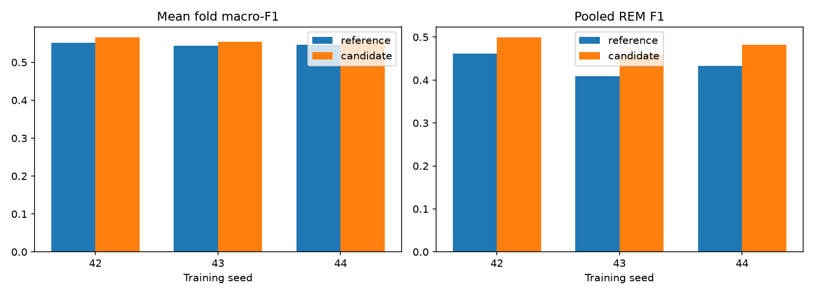
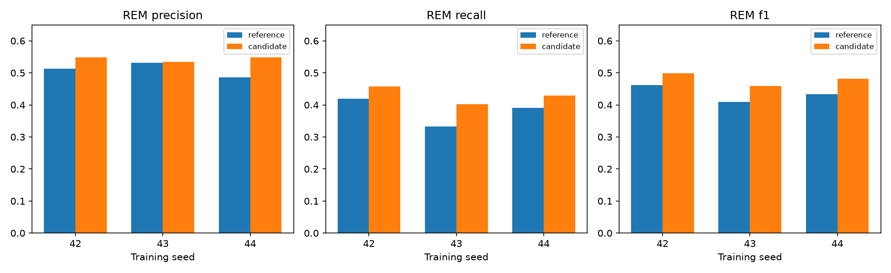

# Measured patch-architecture seed replication

Timo completed the seed-43 and seed-44 patch fits locally on MPS. Reviewed on 2026-11-13.
All three paired studies pass the saved-metric, recipe, population, device, and fold checks.
Each seed scores the same 22,708 eligible targets from 26 development participants.
The final three test participants remain reserved.

## The primary gain repeats

| Seed | Mean fold macro-F1, reference → patch | Paired gain | Fold wins | Participant wins | Pooled accuracy, reference → patch |
| --- | ---: | ---: | ---: | ---: | ---: |
| 42 | 0.55204 → 0.56538 | +0.01334 | 4/5 | 14/26 | 62.912% → 64.149% |
| 43 | 0.54367 → 0.55350 | +0.00983 | 3/5 | 15/26 | 63.859% → 63.339% |
| 44 | 0.54587 → 0.55874 | +0.01287 | 4/5 | 15/26 | 61.811% → 64.497% |

Mean paired seed macro-F1 gain is 0.01201, with sample standard deviation 0.00190 across three effects.
Eleven of fifteen seed/fold cells improve. The same people repeat across seeds, and training folds overlap.
These are descriptive training-randomness repeats, not independent population replications or a confidence interval.
Pooled accuracy declines at seed 43 despite its positive macro-F1 effect.

The repeated primary gain supports patch size three as the working development reference.
It does not establish a universal improvement for every participant, stage, or deployment condition.
[summary.json](summary.json) preserves all fold, participant, class, support, and confusion-matrix results.

## Candidate stage rankings

The table below contains patch candidates only, not their per-epoch reference bars.

| Training seed | Wake F1 | Light F1 | Deep F1 | REM F1 |
| --- | ---: | ---: | ---: | ---: |
| 42 | 0.52281 | 0.72540 | **0.53031** | **0.49905** |
| 43 | **0.52322** | 0.72290 | 0.51672 | 0.45912 |
| 44 | 0.51693 | **0.73254** | 0.52906 | 0.48200 |

Seed 43 leads Wake only, by a small margin over seed 42.
Seed 44 leads Light. Seed 42 leads Deep and REM, plus mean fold macro-F1.
Seed 44 has the highest pooled candidate accuracy.
Ranking absolute scores is different from ranking each seed's gain against its own reference.

## REM gains and the precision distinction

| Seed | Precision, reference → patch | Recall | F1 |
| --- | ---: | ---: | ---: |
| 42 | 51.30% → 54.87% | 41.91% → 45.76% | 0.46133 → 0.49905 |
| 43 | 53.11% → 53.40% | 33.21% → 40.27% | 0.40866 → 0.45912 |
| 44 | 48.61% → 54.86% | 39.12% → 42.98% | 0.43347 → 0.48200 |

REM precision, recall, and F1 improve for every seed.
Seed 44 has the largest precision increase: +6.25 percentage points.
Its absolute precision is essentially tied with seed 42: 54.8582% versus 54.8729%.
Seed 42 leads absolute recall and F1. Seed 43 has the largest recall increase, +7.06 points, but the lowest absolute recall.
These results support a repeatable REM benefit without claiming uniformly best precision or recall from one seed.

Deep F1 declines for seeds 43 and 44, despite the positive overall macro-F1 effects.
The seed-42 observation that every pooled stage improves does not generalize to all seeds.
Do not describe the patch recipe as an across-the-board stage improvement.

## Probability loss and training trajectories

| Seed | Selected pooled NLL, reference → patch |
| --- | ---: |
| 42 | 0.92577 → 0.89553 |
| 43 | 0.90828 → 0.91153 |
| 44 | 0.91924 → 0.87284 |

NLL improves for two seeds and worsens slightly for seed 43.
This is another reason to keep probability loss and macro-F1 separate.
Final validation NLL exceeds selected NLL in fourteen of fifteen candidate fits.
Training-evaluation NLL falls after selection in all fifteen.
The exception is seed-43 fold 05, whose final NLL is lower than selected NLL despite a different macro-F1 checkpoint.
Patching does not eliminate the generalization-gap pattern.
[pooled-nll.json](pooled-nll.json) and [epoch-evidence.json](epoch-evidence.json) preserve probability and trajectory evidence.

## A repeated granularity concern

History and transition slices are post-hoc, using exact participant/time/target matches to eligible prepared rows.
History count resets within each participant and segment. Transitions require a prior contiguous thirty-second target in that same segment.
Segment starts are not classified as transitions with an unknown previous stage.
No analysis flag becomes a training feature or changes model eligibility.

| Seed | First-two-epoch macro-F1, reference → patch | Transition macro-F1 | Deep transition F1 |
| --- | ---: | ---: | ---: |
| 42 | 0.45621 → 0.41856 | 0.40631 → 0.40679 | 0.33333 → 0.27948 |
| 43 | 0.43592 → 0.41977 | 0.38876 → 0.39534 | 0.30189 → 0.28037 |
| 44 | 0.43624 → 0.39772 | 0.41975 → 0.39044 | 0.33333 → 0.25243 |

The first-two-epoch slice contains 295 targets, including only ten Deep targets.
The transition slice contains 1,398 targets, including 152 Deep transitions.
Different supports and class mixtures limit conclusions; repeated seeds do not add new people to these slices.
Still, the repeated short-history and Deep-transition losses motivate a finer-granularity hypothesis.
They do not prove that patch size causes those losses.
[posthoc-history-and-transitions.json](posthoc-history-and-transitions.json) records exact slice definitions, supports, and class metrics.

## Next experiment: two epochs per patch

Use patch size three as the working development reference.
Test patch size two at seed 42 across all five original development folds.
Keep the same thirty raw epochs, six features, width sixteen, dropout 0.2, Adam 0.001, natural sampling, loss, clipping, diagnostics, and budget 40/12.
The candidate uses fifteen sixty-second tokens rather than ten ninety-second tokens.
It has 2,740 parameters versus 2,756, so the capacity difference is small but not zero.
Initialization layout and attention granularity still change; this is an architecture-recipe comparison.

The hypothesis is that finer tokens preserve useful temporal detail and improve partial-history or transition behavior while retaining REM gains.
Compare mean fold macro-F1 first, then REM/Deep precision, recall, F1, matched history slices, and transition slices.
Do not select a patch size from one favorable slice, seed, or fold alone.
This bounded first comparison needs five new fits, capped at 200 epochs; reuse the completed patch-size-three seed-42 result.
Replicate a useful result before replacing the multi-seed reference.
Do not add another patch size, overlap, scheduler, larger network, or changed loss in the same experiment.
The final test participants remain untouched.

No participant-data optimization ran during review. Timo executed all measured fits.
