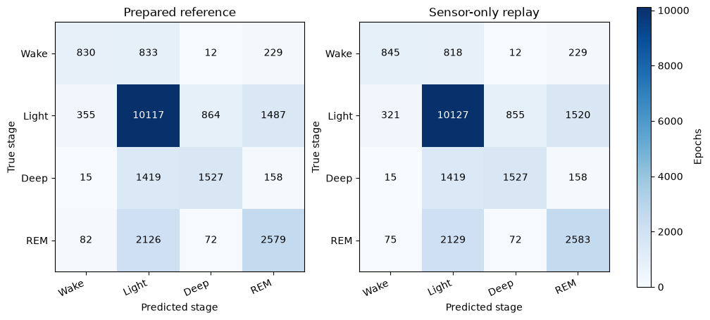
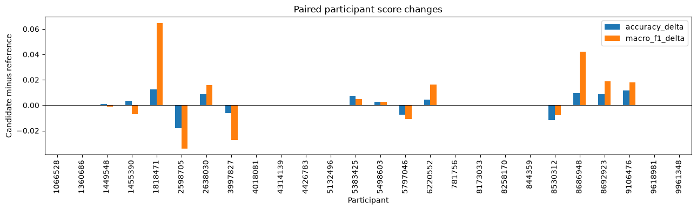

# Notebook 45: sensor-only frozen-model replay

Date: 2026-11-25. Scope: five frozen seed-42 MPS checkpoints and twenty-six held-out development participants.
No training or final-test observation access occurred. The [verified report](report.json) and [snapshot manifest](manifest.json) preserve the measured evidence.

## Execution and control

All five legacy-reset controls reproduced every saved probability exactly, with zero class disagreements.
All history lengths and reset reasons matched across 22,708 reference epochs.
Weights and fitted preprocessing stayed unchanged. The models remained in evaluation mode and created no gradients.

Candidate prediction used sensor-only eligibility and resets. Target labels were joined after prediction.
The candidate produced 23,674 predictions. The paired comparison used the same 22,705 scored identities for both policies.
There were 969 extra candidate predictions: 380 covered unscored epochs and 589 sensor-eligible epochs outside the saved label schedule.
These extra predictions were not scored. Three reference targets remained outside the conservative tail boundary; their identities are recorded in the report.

## Paired results

| Metric | Legacy resets | Sensor-only resets | Change |
| --- | ---: | ---: | ---: |
| Accuracy | 66.2982% | 66.4259% | +0.1277 percentage points |
| Pooled macro-F1 | 0.590391 | 0.593919 | +0.003528 |
| Validation NLL | 0.858437 | 0.854614 | -0.003823 |

NLL is the mean negative log probability assigned to the true stage. It contains no class weighting or label smoothing.
A lower NLL indicates better true-class probability assignments on this scored population. It does not alone establish calibration.

| Fold | Accuracy change, percentage points | Macro-F1 change | NLL change |
| --- | ---: | ---: | ---: |
| 01 | 0.0000 | 0.000000 | +0.000306 |
| 02 | +0.0239 | -0.000565 | -0.008418 |
| 03 | +0.7304 | +0.017464 | -0.010292 |
| 04 | -0.0452 | +0.003389 | -0.004094 |
| 05 | -0.1060 | +0.000276 | +0.003059 |

Fold 03 supplies 35 additional correct classifications. The pooled net gain is 29, so the remaining folds offset part of that gain.
Accuracy improves in two folds, ties in one, and falls in two. Macro-F1 improves in three, ties in one, and falls in one.
This is a small, heterogeneous development result. It is not evidence of a general accuracy gain across new people or training seeds.

| Stage | Legacy F1 | Sensor-only F1 | Change |
| --- | ---: | ---: | ---: |
| Wake | 0.521030 | 0.534810 | +0.013781 |
| Light | 0.740684 | 0.741470 | +0.000786 |
| Deep | 0.545942 | 0.546822 | +0.000880 |
| REM | 0.553909 | 0.552572 | -0.001336 |

Wake supplies most of the macro-F1 gain. Deep recall is unchanged.
REM recall rises slightly, but precision falls enough to reduce REM F1. The policy is not a specific REM improvement.

## What caused the changes

The saved preparation rejects covered epochs without a scored sleep label, then resets history before the next eligible target.
The sensor-only path keeps those observations and continues its bounded context.
This changes 566 shared histories, as predicted by notebook 44.

All 566 changed histories have a probability difference above 2e-6. Of these, 177 change their selected class.
The remaining 22,139 shared epochs have exactly identical probabilities.
No class changes occur outside the changed histories. This supports attribution to the history policy rather than weight updates or unrelated numerical drift.

The [prediction attribution](attribution.json) records:

- 89 previous errors become correct
- 60 previous correct decisions become errors
- 28 wrong decisions change to another wrong class
- 29 additional correct decisions remain overall

Among the affected 566 epochs, accuracy changes from 54.24% to 59.36%.
That localized change becomes small after pooling with the unchanged majority.
Ten participants gain correct decisions, four lose them, and twelve tie. One tied participant still has changed class decisions.

## Conclusion and next work

The sensor-only policy is operationally usable and preserves most predictions. It removes a reset dependency that a live system cannot observe.
Its adoption should follow that input-contract requirement, with the modest development gain treated as supporting evidence.
Do not claim that more history always helps, or relabel the old research results as this policy's results.
The result does not justify another architecture or hyperparameter sweep yet.

Next, build a bounded, stateful raw-event adapter with an explicit session origin, completion watermark, and session-end rule.
First support ordered events with an explicit late-event rejection policy. Compare different input chunk sizes against notebook 44's batch preparation.
Verify emitted features, coverage, resets, and frozen predictions. Keep the same weights and final-test exclusion.
This closes the remaining raw-event input boundary before a CLI service, FastAPI endpoint, or Docker deployment.
