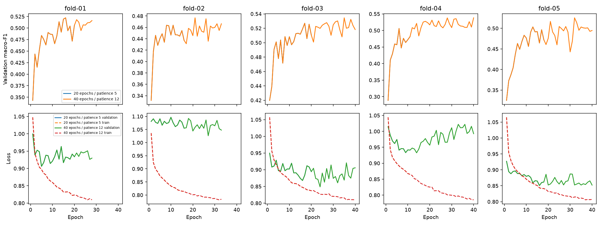

# Measured width-16 training-budget comparison

Timo completed five fresh 40-epoch / patience-12 fits locally on MPS.
The report was reviewed on 2026-11-09 against the measured 20-epoch / patience-5 reference.
Verified saved predictions cover the same 22,708 eligible epochs and 26 development participants.

| Score | Budget 20/5 | Budget 40/12 | Difference |
| --- | ---: | ---: | ---: |
| Mean fold macro-F1 | 0.50446 | 0.51943 | +0.01497 |
| Pooled macro-F1 | 0.50542 | 0.52228 | +0.01686 |
| Pooled accuracy | 60.855% | 61.538% | +0.683 percentage points |
| REM precision | 52.236% | 53.514% | +1.278 points |
| REM recall | 31.728% | 40.267% | +8.539 points |
| REM F1 | 0.39478 | 0.45955 | +0.06477 |
| Deep F1 | 0.45415 | 0.45165 | -0.00250 |
| Light F1 | 0.71194 | 0.71166 | -0.00029 |
| Wake F1 | 0.46082 | 0.46627 | +0.00546 |

Four folds gained macro-F1; fold 01 was unchanged. Seventeen participants improved, three declined, and six were unchanged.
The paired mean gain was 0.01497 with sample deviation 0.01258.
REM improved in both recall and precision. It is the main source of pooled macro-F1 progress.
Deep recall increased from 40.01% to 41.10%, but precision fell from 52.50% to 50.12%.
Light recall declined from 80.27% to 78.15%, while precision increased.
These are class trade-offs, not uniform progress across every stage.

## What the histories show

| Fold | Reference best / completed epochs | Candidate best / completed epochs | Macro-F1 change |
| --- | ---: | ---: | ---: |
| 01 | 16 / 20 | 16 / 28 | 0.00000 |
| 02 | 11 / 16 | 21 / 33 | +0.01295 |
| 03 | 17 / 20 | 35 / 40 | +0.00753 |
| 04 | 6 / 11 | 40 / 40 | +0.03224 |
| 05 | 13 / 18 | 32 / 40 | +0.02213 |

All five candidate histories exactly match the reference histories over their common prefixes.
This supports attributing the observed training-path differences to the budget extension in this local run.
It does not promise deterministic equality on other devices or future runs.
Four selected checkpoints occurred after epoch twenty. Fold 04 also found a better checkpoint at epoch eighteen after the old stopping point.
Both patience and the cap mattered operationally. Their individual contributions were not isolated by this combined experiment.
Fold 01 gained nothing from eight additional epochs.
The larger budget used 181 epochs versus 85 in the reference, about 2.13 times as many.
Three folds reached forty epochs; only fold 04 selected the final epoch.
That is insufficient evidence to extend the budget automatically again.

Training loss continued to fall, but validation loss did not improve uniformly.
In fold 04, macro-F1 rose while validation loss worsened relative to the selected reference checkpoint.
Cross-entropy and macro-F1 measure different properties. Better class decisions do not establish improved probability calibration.
The saved histories do not include per-epoch class precision or recall, so they cannot locate the exact onset of REM gains.

## Evidence and limits

[summary.json](summary.json) contains complete verified fold, participant, class, and confusion-matrix results.
[training-history.json](training-history.json) contains the curves' source values.
Notebook 14 reproduces the comparison from local grouped artifacts without optimization during report export.

A larger budget offers more validation checkpoint opportunities. These folds also select their checkpoints.
The one-seed improvement is a development finding, not independent evidence of better generalization.
The folds share training participants. Epochs and repeated predictions are not independent people.
The final three test participants remain reserved.

## Next experiment

Repeat both budgets with shared seeds 43 and 44 on the same five folds.
Reuse seed 42 rather than rerunning it. Fix all other model and preparation settings.
Compare paired effects per seed and report their mean and sample deviation.
Retain per-fold, participant, and class trade-offs; do not treat fifteen seed/fold cells as independent trials.
The maximum new work is twenty fits and 600 epochs. Timo starts all training.
