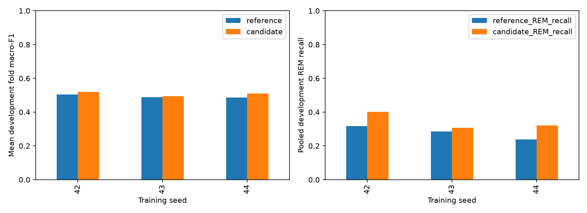

# Measured shared-seed Transformer budget replication

Timo completed both width-16 budgets for seeds 43 and 44 on local MPS.
Seed 42 reuses the earlier measured comparison. The three-seed report was reviewed on 2026-11-10.
Each pair verifies the same 22,708 eligible epochs from 26 development participants.
Seed and fold cells repeat these people; they do not create additional independent participants.

| Seed | Reference mean fold macro-F1 | Longer-budget mean fold macro-F1 | Paired gain | REM recall, reference → candidate |
| --- | ---: | ---: | ---: | ---: |
| 42 | 0.50446 | 0.51943 | +0.01497 | 31.73% → 40.27% |
| 43 | 0.48759 | 0.49522 | +0.00764 | 28.56% → 30.74% |
| 44 | 0.48634 | 0.51036 | +0.02403 | 23.74% → 32.04% |

The mean paired seed effect is +0.01554 macro-F1, with sample deviation 0.00821 across three seeds.
Mean fold macro-F1 averaged across seeds rises from 0.49280 to 0.50834.
All three seeds gain pooled accuracy, pooled macro-F1, REM precision, REM recall, and REM F1.
Seed 42 has the strongest absolute candidate scores and the largest REM recall increase.
Seed 44 has the largest paired macro-F1 increase, not seed 42.
These findings support keeping the longer budget as the working development reference.
They do not establish improved performance on new participants.

| Seed | REM precision, reference → candidate | REM F1, reference → candidate | Improved participants |
| --- | ---: | ---: | ---: |
| 42 | 52.24% → 53.51% | 0.39478 → 0.45955 | 17 / 26 |
| 43 | 45.49% → 47.47% | 0.35090 → 0.37317 | 4 / 26 |
| 44 | 45.15% → 48.09% | 0.31122 → 0.38454 | 7 / 26 |

Deep F1 falls slightly for seeds 42 and 43 and is nearly unchanged for seed 44.
Longer training does not improve every stage uniformly.
The full [summary.json](summary.json) preserves each seed's fold, participant, class, and confusion-matrix results.

## What the curves and selected epochs show

| Seed | Reference selected epochs | Candidate selected epochs | Reference / candidate total epochs |
| --- | --- | --- | ---: |
| 42 | 16, 11, 17, 6, 13 | 16, 21, 35, 40, 32 | 85 / 181 |
| 43 | 4, 4, 2, 5, 4 | 4, 4, 2, 5, 40 | 44 / 103 |
| 44 | 18, 14, 5, 5, 16 | 18, 14, 5, 24, 23 | 79 / 144 |

All fifteen shared training-history prefixes match exactly in this local run.
Seven seed/fold cells improve macro-F1; eight select the same score. None declines.
Seed 43 gains only in fold 05. Seed 44 gains mainly in fold 04 (+0.11507 macro-F1).
That concentration makes the mean gain sensitive to specific participant groups and training trajectories.
The longer budget uses 428 epochs versus 208, about 2.06 times as many.
It does not remove early peaks: four seed-43 folds still select epochs two through five.

Matching prefixes and best-validation selection explain the absence of fold losses.
The longer runs search a superset of the reference checkpoints on the same validation population.
Their selected validation macro-F1 cannot be lower when the reference trajectory is contained exactly.
Positive development gains across seeds therefore confirm the repeated selection effect, not independent generalization.
The combined cap/patience policy still does not isolate either setting's individual effect.
Training loss falls while validation loss fluctuates. Macro-F1 and cross-entropy need not move together.
Per-epoch class metrics were not saved, so histories cannot locate the exact onset of REM gains.
[training-history.json](training-history.json) preserves all thirty complete histories for inspection.

## Reproduction and logging

Notebook 15 rebuilds the report from local verified artifacts and exports HTML without training.
The reporter checks matched seed identity, fold assignments, recipes, model metadata, actual devices, and prediction populations.
The old logger prefix came from the shared implementation's legacy filename, not the model architecture.
The trainer now logs under sleep_classifier.neural_training for both GRU and Transformer models.
The training-start message still names the actual architecture. Historical HTML logs are not rewritten as new runs.
Only curated results and output-free notebook sources are tracked; local executed HTML remains ignored.

## Recommended next question

Compare ten completed epochs of context with thirty (five versus fifteen minutes).
Retain width 16, forty epochs, patience twelve, features, optimizer, coverage, and the five folds.
Start with a declared seed-42 development comparison and replicate only if the measured result warrants it.
Reuse the completed context-ten reference. Do not use the reserved final test for selection.
A larger learned position table adds 320 parameters, from 2,564 to 2,884.
Document this as a context recipe comparison, not a strictly parameter-matched ablation.
Report boundary/warm-up coverage and participant/class trade-offs beside aggregate scores.

The [architecture assessment](../../architecture-options.md) records why patching, inverted attention, MLP forecasters, and MoE are later candidates.
Forecasting benchmark rankings do not establish suitability for our four-class causal classification task.
No new context or architecture experiment is implemented or trained in this PR.
