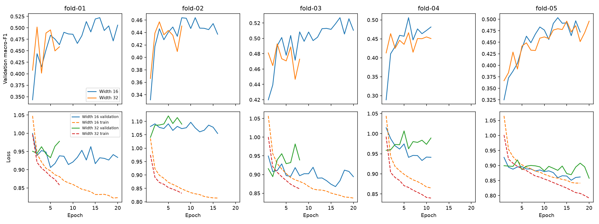

# Measured Transformer capacity comparison

Timo completed five width-32 fits locally on MPS. Results were reviewed on 2026-11-09.
The paired reporter verified 22,708 held-out epochs across the same 26 development participants.
It checked metric hashes, common settings, coverage, provenance, and exact participant/time/target alignment.

| Score | Width 16 | Width 32 | Difference |
| --- | ---: | ---: | ---: |
| Mean fold macro-F1 | 0.50446 | 0.48277 | -0.02169 |
| Pooled macro-F1 | 0.50542 | 0.48677 | -0.01865 |
| Pooled accuracy | 60.855% | 58.574% | -2.281 percentage points |
| Deep F1 | 0.45415 | 0.44322 | -0.01093 |
| REM F1 | 0.39478 | 0.35915 | -0.03562 |

Width 32 lost macro-F1 and accuracy in every fold. Only 7 of 26 participants gained macro-F1.
All four pooled class F1 scores declined. Deep and REM recall also declined.
The paired mean macro-F1 difference was -0.02169, with sample deviation 0.01504.
These descriptive results reject this capacity recipe under the fixed training rules.
They do not prove that larger Transformers cannot work with other optimization or regularization settings.

## Does the evidence support longer training?

| Fold | Width-16 best / completed epochs | Width-32 best / completed epochs |
| --- | ---: | ---: |
| 01 | 16 / 20 | 2 / 7 |
| 02 | 11 / 16 | 3 / 8 |
| 03 | 17 / 20 | 3 / 8 |
| 04 | 6 / 11 | 6 / 11 |
| 05 | 13 / 18 | 15 / 20 |

Width 16 reached the epoch limit in two folds. That makes a larger training budget worth testing.
Its remaining folds stopped after five epochs without a new best macro-F1.
Width 32 selected early checkpoints in four folds while training loss continued to fall.
Validation loss usually stayed flat or rose after those selected checkpoints.
This is consistent with a generalization gap, not proof of its cause.
Fold 05 reached the limit, with falling validation loss and nearly equal macro-F1 at epochs 15 and 20.
That exception does not establish that more epochs would rescue the wider recipe across folds.

Recommend a separate width-16 budget experiment: forty epochs and patience twelve.
Keep capacity, features, context, optimizer, learning rate, folds, seed, and checkpoint criterion fixed.
Treat the cap and patience together as one training-budget policy. Their individual effects would remain unresolved.
This allows more opportunities to select a validation peak and costs more compute.
Any development gain therefore needs caution and later seed replication.
Do not interpret falling training loss or a higher final-epoch accuracy as a better selected checkpoint.

## Artifacts and limits

[summary.json](summary.json) contains complete paired fold, participant, class, and confusion-matrix results.
[training-history.json](training-history.json) contains the histories used in the figure.
Notebook 13 rebuilds the comparison from local verified prediction artifacts and exports HTML without training.
The local input directories are artifacts/transformer-grouped-validation and artifacts/transformer-capacity-grouped-validation.
The curated JSON is evidence for review, not a substitute for those validation inputs.

One seed was used. Fold training sets overlap, and validation folds select checkpoints.
Repeated development tuning increases selection bias. These are not independent outer-test estimates.
The final three test participants remain reserved. No participant-data training was started during this review.
