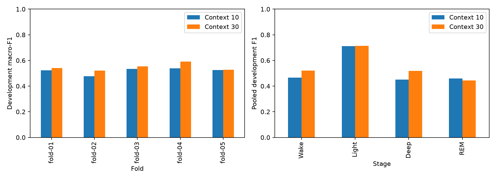
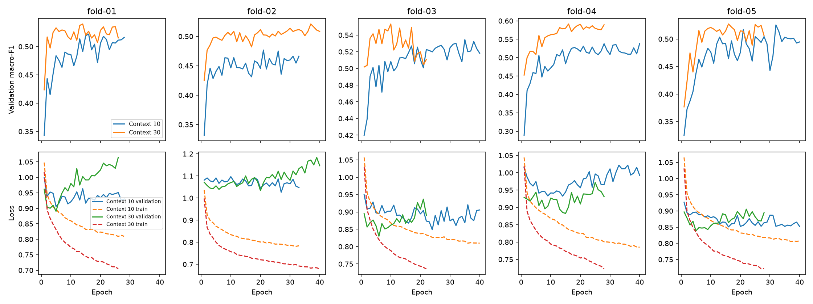

# Measured context-ten versus context-thirty comparison

Timo completed five context-thirty Transformer fits locally on MPS.
The seed-42 comparison was reviewed on 2026-11-10 against the measured context-ten budget-40/12 reference.
The paired report verifies the same 22,708 eligible epochs from 26 development participants.
The model keeps width 16 and the fixed training recipe. The larger position table adds 320 parameters.

| Score | Context 10 | Context 30 | Difference |
| --- | ---: | ---: | ---: |
| Mean fold macro-F1 | 0.51943 | 0.54665 | +0.02722 |
| Pooled macro-F1 | 0.52228 | 0.54916 | +0.02688 |
| Pooled accuracy | 61.538% | 62.256% | +0.718 percentage points |
| Wake F1 | 0.46627 | 0.52196 | +0.05568 |
| Light F1 | 0.71166 | 0.71300 | +0.00134 |
| Deep F1 | 0.45165 | 0.51816 | +0.06652 |
| REM F1 | 0.45955 | 0.44351 | -0.01604 |

Context thirty improves macro-F1 in all five folds, including the nearly unchanged fold 05.
Seventeen participants gain macro-F1 and nine decline. The paired mean gain has sample deviation 0.02111 across folds.
Accuracy improves in three folds and declines in folds 01 and 05.
The result supports context thirty as a promising balanced-class candidate, not a universally better stage classifier.
Deep precision rises from 50.12% to 53.42%; recall rises from 41.10% to 50.30%.
Wake recall rises from 37.39% to 43.70%, with higher precision too.
REM precision falls from 53.51% to 50.96%; recall falls from 40.27% to 39.26%.
The main pooled gains are Wake and Deep, rather than another REM improvement.

## Fold 04 and participant sensitivity

| Fold | Macro-F1, reference → candidate | Accuracy, reference → candidate |
| --- | ---: | ---: |
| 01 | 0.52215 → 0.53996 | 62.743% → 61.587% |
| 02 | 0.47678 → 0.52112 | 58.202% → 60.426% |
| 03 | 0.53452 → 0.55331 | 63.147% → 63.418% |
| 04 | 0.53818 → 0.59155 | 60.425% → 64.468% |
| 05 | 0.52553 → 0.52732 | 62.733% → 61.271% |

Fold 04 has the largest macro-F1 gain (+0.05337) and accuracy gain (+4.043 percentage points).
Every pooled class F1 improves within that fold. Wake F1 rises from 0.48980 to 0.59344.
Four of its five participants gain macro-F1; participant 8530312 declines despite unchanged accuracy.
Participant 8258170 gains overall macro-F1 while Deep F1 falls from 0.11111 to 0.04444.
This illustrates why a good aggregate score does not establish reliable Deep detection for every person.
Excluding fold 04, the remaining four-fold mean macro-F1 gain is still +0.02068.
Fold 04 therefore contributes strongly but does not explain the complete result.

## Curves and work performed

| Fold | Reference best / completed epochs | Candidate best / completed epochs |
| --- | ---: | ---: |
| 01 | 16 / 28 | 14 / 26 |
| 02 | 21 / 33 | 37 / 40 |
| 03 | 35 / 40 | 10 / 22 |
| 04 | 40 / 40 | 16 / 28 |
| 05 | 32 / 40 | 16 / 28 |

Context thirty uses 144 epochs versus 181. It selects earlier checkpoints in four folds.
Only candidate fold 02 reaches the forty-epoch cap, so these curves do not justify another general budget increase.
Candidate training loss falls below the reference, but validation loss does not improve uniformly.
At the selected checkpoints, validation loss is higher in candidate folds 01, 02, and 05.
A better macro-F1 score does not establish lower cross-entropy or improved probability calibration.
The new positions and their initialization draws differ. Shared trajectory prefixes are not expected here.
Unlike the budget comparison, candidate checkpoints are not a superset of the reference trajectory.

Recorded fit elapsed times total 188.83 seconds for the reference and 164.86 seconds for the candidate.
Those runs occurred separately and completed different epoch counts. These totals do not establish a speed advantage per epoch.
[runtime.json](runtime.json) preserves the totals; [training-history.json](training-history.json) preserves all ten histories.

## Post-hoc history diagnostic

Both models were compared on identical targets within each available-history band.
These bands are diagnostic views, not additional independent evaluations or the primary selection score.

| Available history | Eligible targets | Context-10 macro-F1 | Context-30 macro-F1 |
| --- | ---: | ---: | ---: |
| Up to 10 epochs | 1,055 | 0.45862 | 0.44949 |
| 11–29 epochs | 1,519 | 0.49661 | 0.47149 |
| At least 30 epochs | 20,134 | 0.50491 | 0.53380 |

The improvement concentrates in targets with a full thirty-epoch history. Shorter-history bands lose macro-F1.
This is consistent with useful longer history, but it cannot isolate history from position capacity or changed model parameters.
Class mixtures differ across bands. Deep support is only 41 and 53 in the first two bands.
Do not compare band scores as if they described equally difficult populations.
[history-strata.json](history-strata.json) includes class supports and accuracy beside these scores.
The new report-only notebook cell reproduces this diagnostic without optimization.

## Limits and next experiment

This is one training seed on development folds that also select checkpoints.
Fold training sets overlap. The positional table adds 320 parameters, so this is not a parameter-matched context ablation.
The final three test participants remain reserved. These findings do not establish new-participant generalization or significance.
[summary.json](summary.json) preserves complete verified fold, participant, class, and confusion-matrix results.

Recommend two context-thirty repeats with shared seeds 43 and 44, keeping budget 40/12 and every other setting fixed.
Reuse the completed context-ten budget-40/12 runs from the prior seed study. Do not retrain those references.
The maximum new work is ten fits and 400 epochs.
Check paired macro-F1 gains, Wake/Deep gains, REM losses, and short-history behavior before adopting a default.
If the gain survives replication, evaluate a small PatchTST-inspired classifier or another agreed architectural change next.
No replication configuration, new architecture, or participant-data training is added during this result review.
