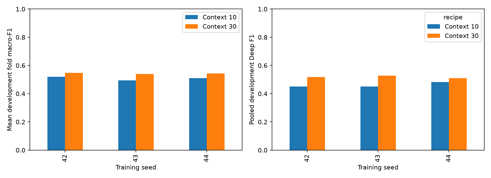
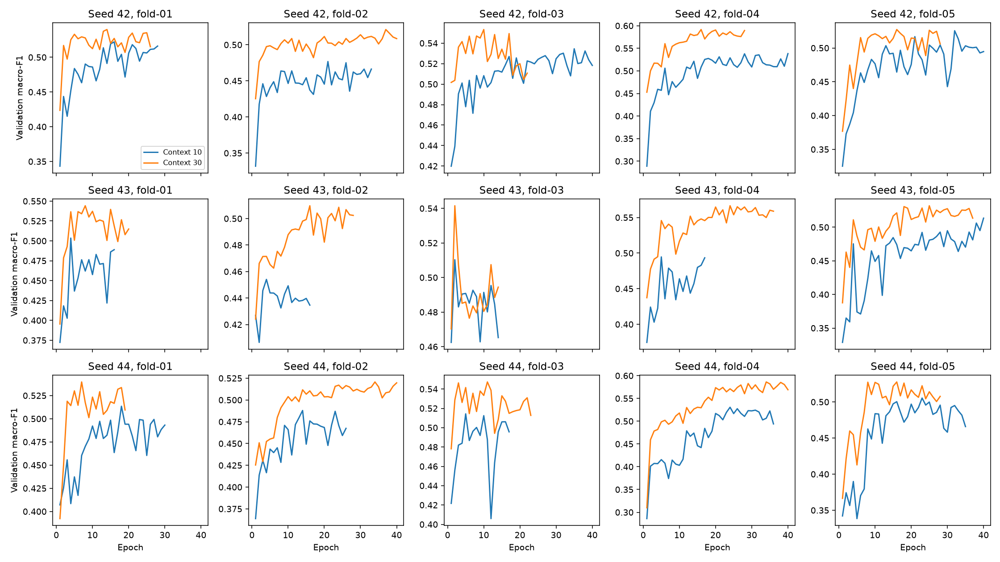

# Measured shared-seed context replication

Timo completed context thirty for seeds 43 and 44 on local MPS.
The study reuses all measured context-ten budget-40/12 references and the seed-42 context-thirty candidate.
Results were verified on 2026-11-11 from saved predictions, metrics, and histories.
Every pair covers the same 22,708 eligible targets from 26 development participants.
The final three test participants remain reserved.

| Seed | Mean fold macro-F1, context 10 → 30 | Paired gain | Pooled accuracy, context 10 → 30 | Improved participants |
| --- | ---: | ---: | ---: | ---: |
| 42 | 0.51943 → 0.54665 | +0.02722 | 61.54% → 62.26% | 17 / 26 |
| 43 | 0.49522 → 0.53879 | +0.04356 | 59.94% → 62.39% | 21 / 26 |
| 44 | 0.51036 → 0.54430 | +0.03394 | 60.26% → 62.81% | 18 / 26 |

All fifteen seed/fold cells improve macro-F1. The mean paired seed effect is +0.03491 with sample deviation 0.00821.
Mean fold macro-F1 across seeds rises from 0.50834 to 0.54325.
Seed 43 has the largest relative macro-F1 gain; seed 42 has the strongest absolute mean fold score.
Seed 44 has the highest pooled accuracy. The near-65% values for seeds 43 and 44 are fold scores, not pooled accuracy.
Their fold-03 accuracies are 64.63% and 64.52%, respectively.
These findings support context thirty as the working development reference.
They do not estimate independent performance on new participants or establish statistical significance.

## Class trade-offs

| Seed | Wake F1, context 10 → 30 | Deep F1, context 10 → 30 | REM F1, context 10 → 30 | REM recall, context 10 → 30 |
| --- | ---: | ---: | ---: | ---: |
| 42 | 0.46627 → 0.52196 | 0.45165 → 0.51816 | 0.45955 → 0.44351 | 40.27% → 39.26% |
| 43 | 0.47107 → 0.52447 | 0.45053 → 0.52780 | 0.37317 → 0.39874 | 30.74% → 32.45% |
| 44 | 0.48591 → 0.51290 | 0.48202 → 0.50962 | 0.38454 → 0.44625 | 32.04% → 39.03% |

Wake, Light, and Deep F1 improve for every seed. The REM cost from seed 42 does not repeat uniformly.
REM precision, recall, and F1 improve for seeds 43 and 44, while declining slightly for seed 42.
Individual participants still lose macro-F1: nine, five, and eight for seeds 42, 43, and 44.
Repeated participant/seed cells are not additional independent people.
[summary.json](summary.json) retains every verified paired fold, participant, class, and confusion-matrix result.

## Curves and the generalization gap

[training-history.json](training-history.json) retains all thirty complete training and validation histories.
Candidate training loss falls while validation loss often flattens or increases.
This is consistent with overfitting, but the curves alone cannot identify its cause.
Participant distribution differences, confidence on errors, and noisy stage decisions can also contribute.
Those explanations remain hypotheses, not diagnosed causes.
Validation macro-F1 and cross-entropy measure different properties and need not move together.
Only three of fifteen candidate fits reach the forty-epoch cap. Increasing duration again is not the next priority.

The new report-only notebook diagnostic recomputes negative log likelihood from selected-checkpoint probabilities.

| Seed | Selected-checkpoint pooled NLL, context 10 → 30 |
| --- | ---: |
| 42 | 0.93741 → 0.95569 |
| 43 | 0.94127 → 0.92796 |
| 44 | 0.94278 → 0.92742 |

Although late validation loss can rise, selected-checkpoint NLL improves for two seeds.
The selected model and the final training epoch are different objects.
Mean confidence among incorrect predictions also increases, but the error sets differ between models.
That observation alone does not establish worse calibration.
[probability-diagnostics.json](probability-diagnostics.json) preserves these descriptive values.
Cross-entropy's definition and optional class weighting are documented by [PyTorch](https://docs.pytorch.org/docs/2.15/generated/torch.nn.CrossEntropyLoss.html).

## Sampling versus regularization

Class imbalance exists, but rising validation loss is not a diagnosis of class imbalance.
Undersampling removes training examples and may discard useful Light variation.
Oversampling repeats minority examples; overlapping sleep windows remain correlated and do not create new participant diversity.
Class weighting changes the loss contribution rather than adding or removing examples.
These interventions may change precision/recall trade-offs, but do not inherently solve participant-level generalization.
The earlier balanced logistic-regression experiment demonstrated a trade-off, not a promise for neural models.

A future sampler must draw complete training windows, preserving their internal time order.
It must not delete or duplicate raw timeline rows before causal preparation.
Compute any sampling weights from training participants only and keep validation frequencies natural.
PyTorch's [WeightedRandomSampler](https://docs.pytorch.org/docs/2.15/data.html#torch.utils.data.WeightedRandomSampler) supports weighted index draws, including replacement.
Do not combine sampling, class weighting, and architecture changes in one uninformative comparison.

## Next bounded experiment

Keep context thirty as the development reference. Stop adding seeds or capacity without a specific new question.
Test residual/feedforward dropout 0.1 versus 0.2 at seed 42 on the same five folds and budget 40/12.
Keep attention-weight dropout zero for the existing MPS-compatible recipe.
Keep the model size, features, optimizer, learning rate, loss, natural sampling, coverage, and target population fixed.
Reuse the completed dropout-0.1 seed-42 candidate. Maximum new work is five fits and 200 epochs.
[PyTorch Dropout](https://docs.pytorch.org/docs/2.15/generated/torch.nn.Dropout.html) applies stochastic masking during training and becomes identity during evaluation.
This is a regularization hypothesis, not an expected accuracy improvement.
A smaller train/validation gap caused only by higher training loss is not success.
Use paired macro-F1 as primary; inspect selected-checkpoint NLL, class trade-offs, and participant behavior as secondary evidence.
If this modest intervention helps, replicate it before adopting it. Otherwise review the result before selecting another model family.
No new participant-data optimization was started during this review.
