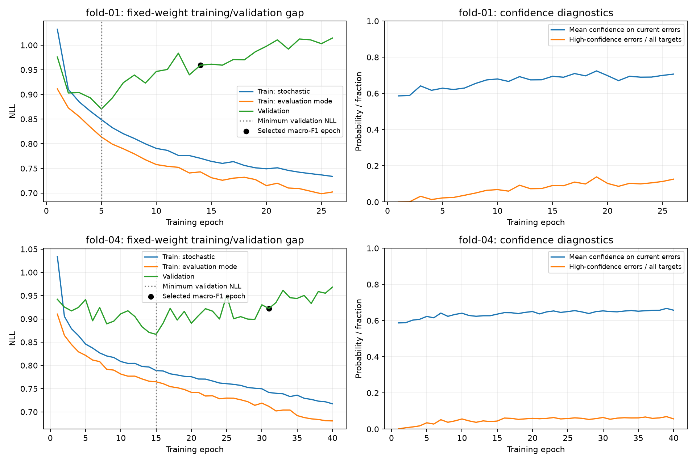

# Measured two-fold diagnostic repeat

Timo completed the instrumented seed-42 repeat locally on MPS. Review date: 2026-11-12.
Both folds completed: fold 01 stopped at epoch 26 and selected epoch 14; fold 04 reached forty and selected epoch 31.
All epoch artifact hashes and aligned prediction populations passed the evidence reader checks.
This is a targeted eleven-participant diagnostic subset, not complete development-cohort validation or an independent test.

## The instrumentation reproduced the original experiment

Both complete scalar histories equal the original dropout-0.2 histories exactly.
Selected checkpoint tensors and selected metrics also match exactly on this checkout.
Fold-01 macro-F1 remains 0.53754; fold-04 macro-F1 remains 0.60478.
[reproduction-checks.json](reproduction-checks.json) records these checks.
The new evidence can therefore describe the earlier observed trajectories, rather than merely a similar repeat.

## Evidence of overfitting in probability quality

| Fold | Minimum validation NLL | Final validation NLL | Evaluation-mode training NLL over the same interval | Selected macro-F1 epoch |
| --- | ---: | ---: | ---: | ---: |
| 01 | 0.87046, epoch 5 | 1.01434, epoch 26 | 0.81379 → 0.70211 | 14 |
| 04 | 0.86678, epoch 15 | 0.96828, epoch 40 | 0.76475 → 0.68063 | 31 |

The fixed-weight training and validation measurements both disable dropout.
The growing gap therefore supports overfitting beyond the earlier stochastic-training-loss explanation.
Validation probability quality deteriorates as the model continues fitting the training participants.
This does not prove whether participant shift, nuisance memorization, label ambiguity, or sensor limitations cause that failure.

Macro-F1 and NLL retain different objectives.
Fold 01 improves macro-F1 from 0.52906 at minimum NLL to 0.53754 at the selected epoch.
Fold 04 improves from 0.58983 to 0.60478.
Do not retrospectively switch checkpoint selection to NLL because it produces a different-looking curve.
The final epochs are diagnostic endpoints, not the checkpoints used for reported inference scores.

## What drives the spikes?

Contributions below divide each group's change in NLL sum by the entire fold's target count.
They sum to the total mean-NLL change. Negative values offset positive values.
Participant and class decompositions describe the same targets; do not add the two decompositions together.

| Fold and transition | Total NLL change | Main true-stage contributions | Main participant contribution |
| --- | ---: | --- | --- |
| 01, 13 → 14 | +0.01956 | Light +0.01841; REM +0.00233 | 781756: +0.01050 |
| 04, 15 → 16 | +0.02411 | REM +0.02009; Light +0.00828; Deep offsets −0.01206 | All five participants worsen |
| 04, 16 → 17 | +0.03190 | Light +0.02009; REM +0.01584; Wake offsets −0.00817 | 8173033: +0.01472 |
| 01, 11 → 12, largest rise | +0.03303 | REM +0.08169; all other stages offset it | 781756: +0.03913 |
| 04, 24 → 25, largest rise | +0.05063 | Light +0.02425; Deep +0.02448; REM +0.01052; Wake offsets −0.00862 | 8258170: +0.03019 |

There is no common epoch-fourteen event. Different updates shift the probability trade-off between stages and held-out people.
For fold 04, epochs 13 → 14 and 14 → 15 actually reduce NLL, before the rises at 15 → 16 and 16 → 17.
[epoch-comparisons.json](epoch-comparisons.json) records the focused window, largest jumps, and minimum-to-final changes with aligned target examples.

## Persistent errors become more confident

Confidence averages on changing error sets can be misleading. We also matched targets that remain wrong at both endpoints.

| Fold, minimum → final | Targets wrong at both endpoints | Mean true-class probability | Their contribution to total NLL change | Total NLL change |
| --- | ---: | ---: | ---: | ---: |
| 01, 5 → 26 | 1,447 | 0.22019 → 0.15944 | +0.18100 | +0.14388 |
| 04, 15 → 40 | 1,244 | 0.20185 → 0.18762 | +0.10113 | +0.10149 |

Other targets offset some of this deterioration, so a group's contribution can exceed the net rise.
Fold 01's largest spike has six fewer wrong labels, yet higher NLL.
The hard-label improvement therefore does not imply improved confidence in the true stages.
High-confidence wrong predictions rise from 2.25% to 12.62% of all targets in fold 01, and 4.47% to 5.69% in fold 04.
[matched-error-partitions.json](matched-error-partitions.json) separates persistent errors, new errors, corrected errors, and persistent correct labels.
These partitions are descriptive evidence, not a complete calibration assessment.

## Optimizer observations

The actual learning rate remains 0.001 throughout both fits.
Gradients remain finite, with pre-clipping maxima generally around two to three.
The evidence does not show an exploding-gradient event at epoch fourteen.
Clipping becomes frequent: approximately 82% and 94% of updates in the final epochs.
Clipping frequency alone does not establish that clipping or the learning rate caused the generalization gap.
[summary.json](summary.json) preserves complete epoch scores, confidence, gradient, class, and participant summaries.

## Next bounded experiment

Test constant learning rate 0.0003 against the completed instrumented 0.001 reference.
Keep seed 42, original folds 01 and 04, model, features, dropout 0.2, sampling, loss, clipping, and budget 40/12 fixed.
Keep the diagnostics enabled and preserve macro-F1 checkpoint selection.
This requires only two new fits, capped at eighty epochs. Reuse the completed reference.

The hypothesis is that smaller steps reduce short-term probability swings without sacrificing selected macro-F1.
This is an optimization hypothesis, not a promised cure for overfitting.
Inspect training progress as well: lower loss volatility caused only by slower fitting is insufficient evidence of improvement.
Report selected macro-F1 as primary, then selected NLL, class trade-offs, loss jumps, confidence, and clipping statistics.
A fixed forty-epoch result does not measure asymptotic convergence at the lower learning rate.

Do not adopt a new global recipe from these two post-hoc diagnostic folds alone.
If useful, validate the intervention across the development folds before adopting it.
If this check provides little benefit, return to the planned small causal patch encoder rather than expanding the learning-rate grid.
No sampler change, longer budget, scheduler, larger architecture, or new regularizer belongs in the same comparison.
The final three test participants remain untouched.

No participant-data optimization ran during this review. Timo executed the measured runs.
