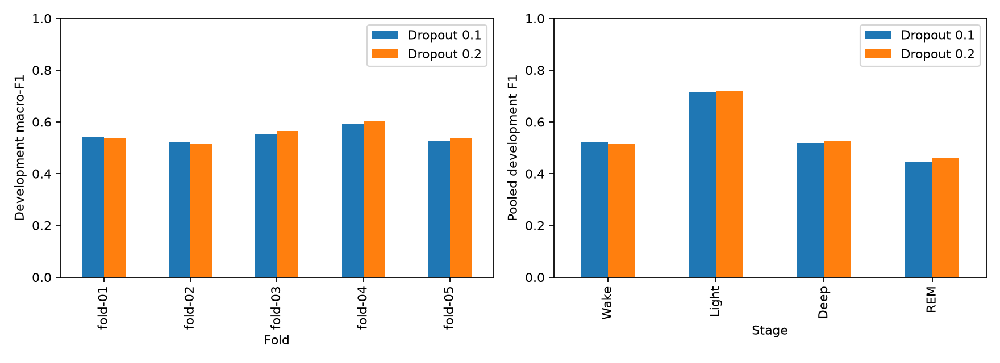
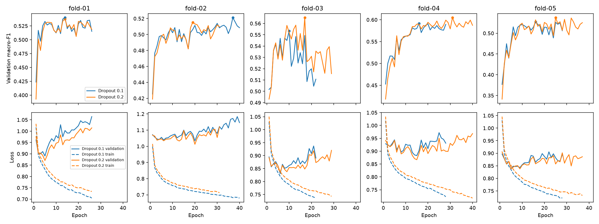

# Measured context-thirty dropout comparison

Timo completed five dropout-0.2 candidate fits locally on MPS.
Results were reviewed on 2026-11-11 against the measured dropout-0.1 context-thirty reference.
Both recipes use seed 42, width 16, budget 40/12, natural sampling, and the same 2,884 parameters.
The paired reporter verified the same 22,708 eligible targets from 26 development participants.
The final three test participants remain reserved.

| Score | Dropout 0.1 | Dropout 0.2 | Difference |
| --- | ---: | ---: | ---: |
| Mean fold macro-F1 | 0.54665 | 0.55204 | +0.00539 |
| Pooled macro-F1 | 0.54916 | 0.55494 | +0.00578 |
| Pooled accuracy | 62.256% | 62.912% | +0.656 percentage points |
| Selected-checkpoint pooled NLL | 0.95569 | 0.92577 | -0.02992 |
| Wake F1 | 0.52196 | 0.51345 | -0.00850 |
| Light F1 | 0.71300 | 0.71836 | +0.00536 |
| Deep F1 | 0.51816 | 0.52660 | +0.00844 |
| REM F1 | 0.44351 | 0.46133 | +0.01781 |

The candidate improves pooled accuracy, macro-F1, and probability loss at the selected checkpoints.
The NLL decrease is evidence of a validation benefit beyond mechanically increasing training loss.
The result is modest and mixed: three folds gain macro-F1, two decline, and only 14 of 26 participants improve.
Twelve participants lose macro-F1. The paired fold gain has sample deviation 0.00888.
That descriptive variation exceeds the mean gain; these overlapping folds are not independent trials.
Do not declare dropout 0.2 a replicated default from this one-seed comparison.

REM recall rises from 39.26% to 41.91%; precision rises slightly from 50.96% to 51.30%.
Deep F1 improves through higher precision, while Deep recall falls from 50.30% to 49.34%.
Wake precision and recall both decline slightly. The intervention does not improve every metric.

## Fold results and fold 05

| Fold | Macro-F1, reference → candidate | Accuracy, reference → candidate |
| --- | ---: | ---: |
| 01 | 0.53996 → 0.53754 | 61.587% → 61.805% |
| 02 | 0.52112 → 0.51518 | 60.426% → 61.358% |
| 03 | 0.55331 → 0.56513 | 63.418% → 64.587% |
| 04 | 0.59155 → 0.60478 | 64.468% → 65.123% |
| 05 | 0.52732 → 0.53758 | 61.271% → 61.589% |

All five folds gain accuracy, but folds 01 and 02 lose macro-F1.
Fold 05 improves by 0.318 accuracy points and 0.01026 macro-F1.
Fold 03 has the largest accuracy gain (+1.169 points); fold 04 has the largest macro-F1 gain (+0.01323).
The completed notebook reports selected-checkpoint scores, not final-epoch scores.

## Did stronger dropout reduce overfitting?

| Fold | Reference best / completed epochs | Candidate best / completed epochs | Selected NLL, reference → candidate |
| --- | ---: | ---: | ---: |
| 01 | 14 / 26 | 14 / 26 | 1.00264 → 0.95933 |
| 02 | 37 / 40 | 19 / 31 | 1.17202 → 1.05867 |
| 03 | 10 / 22 | 17 / 29 | 0.86197 → 0.84823 |
| 04 | 16 / 28 | 31 / 40 | 0.90189 → 0.92241 |
| 05 | 16 / 28 | 25 / 37 | 0.86401 → 0.85730 |

Selected-checkpoint NLL falls in four folds and rises in fold 04, despite that fold's macro-F1 gain.
The pooled NLL is weighted by each fold's eligible target count, not an unweighted mean of fold losses.
Recomputing it from saved class probabilities agrees with the weighted history loss within 1e-7.
The report-only notebook table reproduces the weighted checkpoint result.
[checkpoint-losses.json](checkpoint-losses.json) records counts, selected epochs, and selected/final losses.

The candidate still ends with higher validation loss than its selected checkpoint in all five folds.
Training loss continues to fall. Stronger dropout helped validation loss in this run but did not eliminate the generalization-gap pattern.
Increasing dropout can raise stochastic training loss, so a smaller train/validation gap alone is insufficient evidence.
The selected checkpoints also differ between recipes; this is an end-to-end recipe comparison rather than matched-epoch causal attribution.
Validation NLL is a probability-loss score. It does not by itself diagnose probability calibration.
Participant shift, noisy wearable-stage information, and overconfidence remain possible contributors rather than established causes.

The candidate completes 163 epochs versus 144. Recorded fit elapsed times total 187.49 versus 164.86 seconds.
These separate runs are not a controlled speed benchmark.
[training-history.json](training-history.json) preserves the complete histories.

## Conclusion and next experiment

Treat dropout 0.2 as a promising regularization candidate, with a small macro-F1 gain and a clearer NLL improvement.
Keep the replicated context-thirty architecture as the working baseline; retain dropout 0.1 as its established multi-seed reference until replication.
Repeat only dropout 0.2 with seeds 43 and 44 on the same five folds and budget 40/12.
Reuse their completed dropout-0.1 context-thirty results. Maximum new work is ten fits and 400 epochs.
Keep natural sampling, loss, features, model capacity, optimizer, and every other setting fixed.
Check whether macro-F1 and NLL improvements repeat without unacceptable Wake or Deep-recall costs.
Do not expand the dropout grid or choose separate settings per fold.
If replication is mixed, retain the established recipe and discuss the next architectural or data question.

This is still development evaluation on folds that select checkpoints, with only one training seed for the dropout comparison.
The shared participants and overlapping training folds preclude an independent-test or significance claim.
[summary.json](summary.json) contains the complete verified fold, participant, class, and confusion-matrix results.
No new participant-data training was started during the review, and no next-study configuration is added here.
