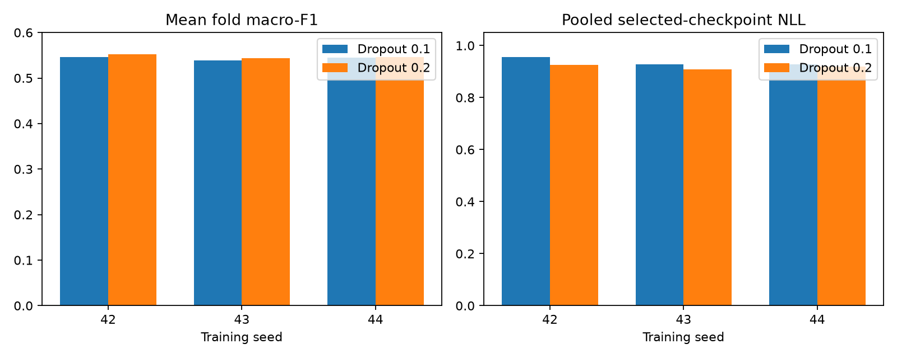
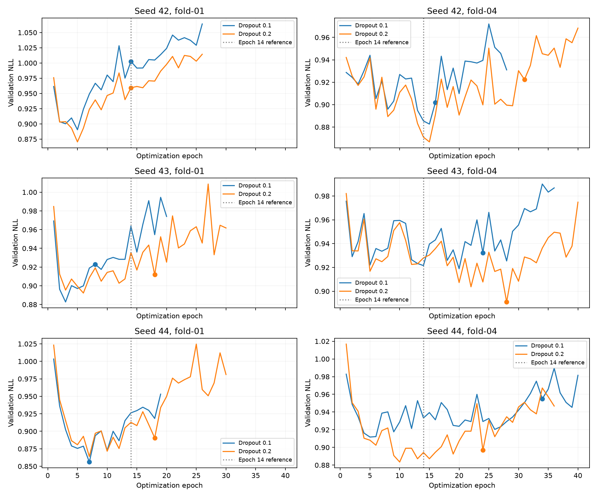

# Measured dropout replication and loss investigation

Timo completed the seed-43 and seed-44 dropout-0.2 candidates locally on MPS.
The review reused their dropout-0.1 references and both measured seed-42 recipes.
All thirty fold results passed the paired report checks on 2026-11-11.
Each recipe scores the same 22,708 eligible targets from 26 development participants per seed.
The three final test participants remain unused.

## Does the benefit repeat?

| Seed | Mean fold macro-F1, 0.1 → 0.2 | Paired difference | Pooled accuracy, 0.1 → 0.2 | Selected pooled NLL, 0.1 → 0.2 |
| --- | ---: | ---: | ---: | ---: |
| 42 | 0.54665 → 0.55204 | +0.00539 | 62.256% → 62.912% | 0.95569 → 0.92577 |
| 43 | 0.53879 → 0.54367 | +0.00488 | 62.388% → 63.859% | 0.92796 → 0.90828 |
| 44 | 0.54430 → 0.54587 | +0.00156 | 62.815% → 61.811% | 0.92742 → 0.91924 |

The mean paired macro-F1 gain is 0.00394, with sample standard deviation 0.00208 across three seeds.
All three seeds improve mean fold macro-F1 and selected-checkpoint pooled NLL.
Only eight of fifteen seed/fold cells improve macro-F1. Seven decline.
Participant macro-F1 improves for 14/26, 15/26, and 12/26 participants at seeds 42, 43, and 44.
These repeated participants and overlapping folds are not independent population replications.

This supports a small, repeatable development benefit from dropout 0.2 under the current checkpoint-selection rule.
It does not establish a uniform class benefit or remove the late validation-loss rise.
Seed 44 loses 1.004 accuracy percentage points despite its small macro-F1 and NLL gains.
Keep dropout 0.2 as the provisional recipe for the next bounded diagnostic, with the established 0.1 results retained for comparison.

## Class trade-offs

| Seed | Wake F1, 0.1 → 0.2 | Light F1 | Deep F1 | REM F1 | REM recall |
| --- | ---: | ---: | ---: | ---: | ---: |
| 42 | 0.52196 → 0.51345 | 0.71300 → 0.71836 | 0.51816 → 0.52660 | 0.44351 → 0.46133 | 39.26% → 41.91% |
| 43 | 0.52447 → 0.51836 | 0.71932 → 0.73491 | 0.52780 → 0.53328 | 0.39874 → 0.40866 | 32.45% → 33.21% |
| 44 | 0.51290 → 0.52374 | 0.72001 → 0.70799 | 0.50962 → 0.53213 | 0.44625 → 0.43347 | 39.03% → 39.12% |

Deep F1 improves for every seed, but Deep recall declines at seeds 42 and 43.
For seed 43, Deep recall falls from 50.98% to 45.72% while precision increases.
REM F1 improves at seeds 42 and 43; it falls at seed 44 because precision declines from 52.09% to 48.61%.
Wake F1 falls for two seeds. Do not describe the result as an across-the-board REM improvement.
[summary.json](summary.json) preserves all fold, participant, class, and confusion-matrix results.

## What happens near epoch fourteen?

The vertical line marks epoch fourteen for inspection. It is not a configured training event.
An epoch is a training-data pass, not the time of night.
There is no common discontinuity at fourteen across seeds or recipes.
The plot shows gradual loss growth mixed with temporary dips and rebounds.

For seed 42, dropout 0.2, fold 04:

| Epoch | 13 | 14 | 15 | 16 | 17 | 18 |
| --- | ---: | ---: | ---: | ---: | ---: | ---: |
| Validation NLL | 0.8832 | 0.8710 | 0.8668 | 0.8909 | 0.9228 | 0.8976 |

The minimum occurs at fifteen; the loss rises at sixteen and seventeen, then partly recovers at eighteen.
Its largest single upward step occurs at twenty-five, not fourteen.
For seed 43, dropout 0.2, fold 01, NLL rises from 0.9073 at thirteen to 0.9356 at fourteen.
It falls to 0.9168 at fifteen. Its largest upward step occurs at twenty-seven.

| Seed | Fold | Minimum NLL epoch, 0.1 / 0.2 | Largest upward step epoch, 0.1 / 0.2 |
| --- | --- | ---: | ---: |
| 42 | 01 | 5 / 5 | 12 / 12 |
| 42 | 04 | 15 / 15 | 17 / 25 |
| 43 | 01 | 3 / 6 | 19 / 27 |
| 43 | 04 | 20 / 28 | 25 / 40 |
| 44 | 01 | 7 / 7 | 8 / 25 |
| 44 | 04 | 5 / 10 | 40 / 25 |

For seed-42 fold 01, both recipes select epoch fourteen by macro-F1, although their minimum NLL occurs at epoch five.
For seed-42 candidate fold 04, the best macro-F1 is at thirty-one, while minimum NLL is at fifteen.
These are different optimization objectives. A selected checkpoint need not minimize probability loss.
[epoch-audit.json](epoch-audit.json) records the exact extrema and epochs ten through eighteen.
[training-history.json](training-history.json) preserves all thirty histories.

### Checks performed

- Adam retains learning rate 0.001; this recipe has no scheduler or OPAL decisions
- Training calls model.train(); validation calls model.eval() and disables gradients
- Validation uses the same targets with shuffle=False
- Each training epoch changes minibatch order and uses stochastic dropout masks
- The trainer restores the best macro-F1 weights after the fit loop, not during epoch fourteen
- No sampler, dropout, data, or checkpoint-selection setting changes at fourteen

The read-only replay restored the selected seed-42 fold-01 and fold-04 checkpoints and their saved training-fitted scalers.
It evaluated each checkpoint twice on MPS, using the same validation inputs.
Both passes reproduced the saved probabilities exactly. Weights stayed unchanged and no gradients were created.
The measured maximum absolute probability differences were zero for both folds.
[checkpoint-replay.json](checkpoint-replay.json) preserves these checks. No optimizer step or scaler fit ran.

These checks make a scheduled switch or persistent selected-checkpoint evaluation mismatch unsupported explanations.
They do not prove the exact cause of a historical loss jump.
Only scalar histories and selected checkpoints were saved. Intermediate per-target probabilities and checkpoints are unavailable.
We cannot retrospectively identify which class or participant caused the epoch-thirteen to epoch-fourteen change.

Continued fitting may increase confidence in incorrect predictions on held-out people.
Fixed-step stochastic updates can also produce temporary rebounds around that longer-term pattern.
Participant shift and limited sensor information remain plausible contributors.
These are hypotheses, not causal findings from scalar loss curves.

## NLL and the next experiment

NLL averages the negative natural logarithm of the correct-class probability. Lower is better.
A probability of 0.8 contributes 0.223; 0.2 contributes 1.609; 0.01 contributes 4.605.
Wrong labels can become more costly without changing the confusion matrix.
Macro-F1 can improve while NLL rises, because it uses hard labels and ignores confidence.
NLL is a probability-loss score, not a complete calibration diagnosis.
The saved-probability pooled calculations are in [probability-losses.json](probability-losses.json).
See the [cell-by-cell guide](../../notebook-19-guide.md) for metrics and every inspection step.

Recommend an instrumented diagnostic repeat before another hyperparameter grid or larger architecture.
Repeat only seed-42 dropout-0.2 folds 01 and 04 with the fixed recipe: two fits, at most eighty epochs.
Record per-epoch NLL by participant and true class, confidence on errors, actual learning rate, and gradient norms.
Reuse each existing validation pass for these summaries. Avoid another validation forward pass where possible.
Compare training and validation NLL in evaluation mode when measuring their gap; ordinary training loss includes dropout and changing weights.
Retain a few intermediate checkpoints around epochs thirteen through seventeen if storage permits.
Use the same macro-F1 checkpoint rule; treat confidence analyses as diagnostics, not new selection criteria.

This repeat can test whether a few people/classes or increasingly confident errors dominate the rise.
Do not change dropout, resample classes, extend training, or lower the learning rate simultaneously.
A small causal patch encoder remains a later architecture candidate after this targeted check.
The next protocol and training remain unimplemented and require the next agreed work chunk.

All results remain development estimates on checkpoint-selection folds.
Repeated inspection also adapts our choices to these participants. The three final test people remain reserved.
No new participant-data training ran during this review.
