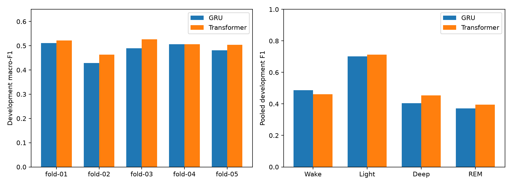

# Measured causal Transformer comparison

Timo ran five development folds locally on MPS. Results were reviewed on 2026-11-09.
The paired report verifies exact participant, timestamp, target, coverage, provenance, and common recipe alignment.
It recomputes scores from 22,708 retained epochs across 26 development participants.
The reserved final test remains unused.

| Score | GRU | Transformer | Difference |
| --- | ---: | ---: | ---: |
| Mean fold macro-F1 | 0.48360 | 0.50446 | +0.02087 |
| Pooled macro-F1 | 0.49145 | 0.50542 | +0.01397 |
| Pooled accuracy | 59.446% | 60.855% | +1.409 percentage points |
| Deep precision | 53.039% | 52.503% | -0.536 points |
| Deep recall | 32.735% | 40.013% | +7.278 points |
| Deep F1 | 0.40484 | 0.45415 | +0.04931 |
| REM precision | 45.921% | 52.236% | +6.314 points |
| REM recall | 31.276% | 31.728% | +0.453 points |
| REM F1 | 0.37209 | 0.39478 | +0.02268 |
| Wake F1 | 0.48720 | 0.46082 | -0.02639 |

Macro-F1 improved in four folds. The paired mean gain was 0.02087 with sample deviation 0.01589.
Fold 03 accuracy increased by 6.615 points. Every participant in that fold gained accuracy.
Participants 5383425 and 8686948 gained about twelve accuracy points each.
Fold 04 macro-F1 was nearly unchanged; folds 04 and 05 lost accuracy.
Only 13 of 26 participants gained macro-F1. In fold 05, one participant improved while four declined.
This makes the participant distribution essential when interpreting pooled gains.

Deep sensitivity improved, with a small precision decrease. REM improved mainly through precision, not recall.
Wake performance declined. A larger model cannot be assumed to fix these trade-offs.
Selected Transformer epochs were 16, 11, 17, 6, and 13. Early checkpoint selection was not universal.

These are matched model-recipe results, including capacity and dropout differences.
One training seed cannot establish an architecture-wide advantage or statistical significance.
Fold training populations overlap. Each validation fold also selected its checkpoint.
Repeated development experiments introduce selection bias; these are not independent outer-test estimates.

## Evidence and reproduction

[summary.json](summary.json) contains the complete paired fold, class, and participant scores.
The local source summaries remain in artifacts/gru-grouped-validation and artifacts/transformer-grouped-validation.
Notebook 12 reproduces the comparison from their validated predictions. It exports HTML without training.
The tracked summary is a curated report, not an input to the artifact validation command.
The local executed HTML remains ignored because it duplicates outputs and can contain machine-specific information.

## Next bounded question

Test representation width 32 and feedforward width 64 against this width-16 reference.
Keep one layer, two heads, context ten, dropout, folds, seed, and training rules fixed.
This changes one capacity recipe; it does not test longer context or deeper attention.
Judge mean paired macro-F1 first. Report participant gains and every class trade-off.
A mixed or negative result remains useful. Do not expand the search automatically.
