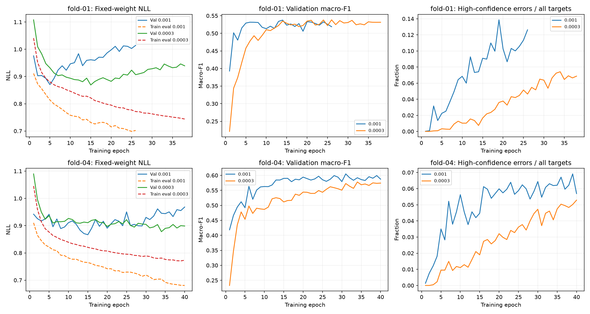

# Measured constant learning-rate comparison

Timo completed both lower-rate fits locally on MPS. Reviewed on 2026-11-12.
The strict paired report verified the same 9,014 eligible targets across eleven people in original folds 01 and 04.
These are post-hoc diagnostic folds, not full-cohort validation or independent test results.

## Lower NLL does not establish an overall stage-classification gain

| Fold | Macro-F1, 0.001 → 0.0003 | Accuracy | Selected NLL | Best/completed epochs |
| --- | ---: | ---: | ---: | ---: |
| 01 | 0.53754 → 0.53830 | 61.805% → 62.961% | 0.95933 → 0.90672 | 14/26 → 26/38 |
| 04 | 0.60478 → 0.57785 | 65.123% → 64.468% | 0.92241 → 0.87794 | 31/40 → 34/40 |

Mean fold macro-F1 falls from 0.57116 to 0.55807, a paired difference of −0.01309.
Pooled accuracy rises slightly from 63.435% to 63.701%; pooled macro-F1 falls from 0.57536 to 0.56011.
Only four of eleven participants gain macro-F1.
Selected-checkpoint pooled NLL improves from 0.94120 to 0.89258.
The candidate helps probability loss and fold-01 accuracy, but loses the primary mean fold macro-F1 comparison.
Retain constant 0.001 as the stronger stage-classification reference. Do not promote 0.0003 as the default.

## Class trade-offs

| Stage | Pooled F1, 0.001 → 0.0003 | Recall | Per-true-class NLL |
| --- | ---: | ---: | ---: |
| Wake | 0.54226 → 0.55652 | 47.12% → 47.01% | 1.61805 → 1.59025 |
| Light | 0.71513 → 0.72825 | 76.54% → 83.10% | 0.58878 → 0.53041 |
| Deep | 0.54352 → 0.51740 | 49.37% → 43.15% | 1.54976 → 1.38109 |
| REM | 0.50052 → 0.43827 | 47.09% → 36.11% | 1.14206 → 1.17829 |

REM precision increases slightly while recall falls substantially.
More true REM and Deep intervals receive Light predictions, while Light recall improves.
Class prevalence lets this shift improve accuracy while macro-F1 declines.
REM NLL also worsens, despite the lower pooled NLL. The probability benefit does not cover every stage.
[paired-comparison.json](paired-comparison.json) includes all fold, participant, class, and confusion-matrix results.
[pooled-nll.json](pooled-nll.json) preserves target-weighted probability losses and true-class decompositions.

## Slower fitting, smoother curves, persistent generalization gaps

| Fold | Largest upward validation-NLL step, reference → candidate | Selected evaluation-mode training NLL | Selected clipped-step fraction |
| --- | ---: | ---: | ---: |
| 01 | 0.03303 → 0.02127 | 0.74292 → 0.77136 | 71.13% → 63.03% |
| 04 | 0.05063 → 0.01526 | 0.71189 → 0.78123 | 85.31% → 67.13% |

The lower rate reduces the largest observed single-step loss rises and fits the training observations less strongly within the fixed budget.
Its selected checkpoints occur later. These observations are consistent with slower optimization, not proof that generalization improved for every objective.
The two folds also complete different epoch counts, so their maximum jumps are descriptive rather than matched-update variability estimates.

For the candidate, fixed-weight training NLL continues falling after selection in both folds.
Validation NLL then rises from 0.90672 to 0.93928 in fold 01 and 0.87794 to 0.89864 in fold 04.
The generalization gap remains. Reduced-confidence errors and lower probability loss alone are not a cure for overfitting.
[checkpoint-diagnostics.json](checkpoint-diagnostics.json) and [epoch-evidence.json](epoch-evidence.json) preserve the trajectories and confidence/gradient evidence.

## Regularization and optimization

An explicit loss penalty, such as L2, changes the objective.
AdamW instead applies decoupled weight decay; it is not equivalent to adding an L2 penalty to Adam's adaptive gradient.
See the [AdamW paper](https://arxiv.org/abs/1711.05101).

Dropout deliberately injects training-time noise to regularize learned representations.
It is a regularization method even though it adds no scalar penalty to the loss.
Thus explicit-versus-implicit is not the same distinction as loss-term-versus-no-loss-term.
See [PyTorch Dropout](https://docs.pytorch.org/docs/2.15/generated/torch.nn.Dropout.html).

Early stopping limits optimization and selects a checkpoint.
Model capacity, architecture, optimization bias, and the training data also constrain what can be learned.
Label smoothing changes target distributions; post-hoc temperature scaling changes confidence without changing hard-label argmax decisions.
These mechanisms answer different questions and should not be treated as interchangeable cures.
More diverse participants and informative causal features can matter when wearable features do not separate stages well.

A learning-rate scheduler controls update sizes over training.
It can affect generalization indirectly, but it adds no capacity constraint or explicit penalty by itself.
A schedule therefore cannot be assumed to solve the observed class trade-offs or participant shift.

## Next bounded experiment

Start at the stronger reference rate 0.001. Reduce it by factor 0.3 when validation macro-F1 plateaus.
Use ReduceLROnPlateau with mode max, patience three, absolute threshold 0.0001, cooldown zero, and floor 0.00003.
PyTorch patience three means reduction after four consecutive non-improving scheduler evaluations, following its initial baseline.
See [PyTorch scheduler semantics](https://docs.pytorch.org/docs/2.15/generated/torch.optim.lr_scheduler.ReduceLROnPlateau.html).

Keep seed 42, original folds 01/04, forty epochs, stopping patience twelve, dropout 0.2, model, sampling, loss, clipping, and diagnostics fixed.
Retain validation macro-F1 checkpoint selection. Do not add AdamW, weight decay, or label smoothing in the same comparison.
The hypothesis is that faster initial learning preserves stage detection, while later smaller updates improve refinement.
It remains a hypothesis: this comparison does not guarantee better macro-F1 or NLL.
Reuse the completed instrumented constant-0.001 reference. Train only two candidate fits, capped at eighty epochs.

Require a schedule activation check and record actual rates used for each epoch separately from rates planned for the next epoch.
Compare selected macro-F1 first, then REM/Deep trade-offs, selected NLL, fitting progress, and probability swings.
If it does not materially help, move to the planned causal patch encoder instead of expanding an optimizer grid.
A promising two-fold result still needs broader development validation before any global default change.
The final three test participants remain untouched.

No participant-data optimization ran during this review. Timo ran the measured experiment locally.
