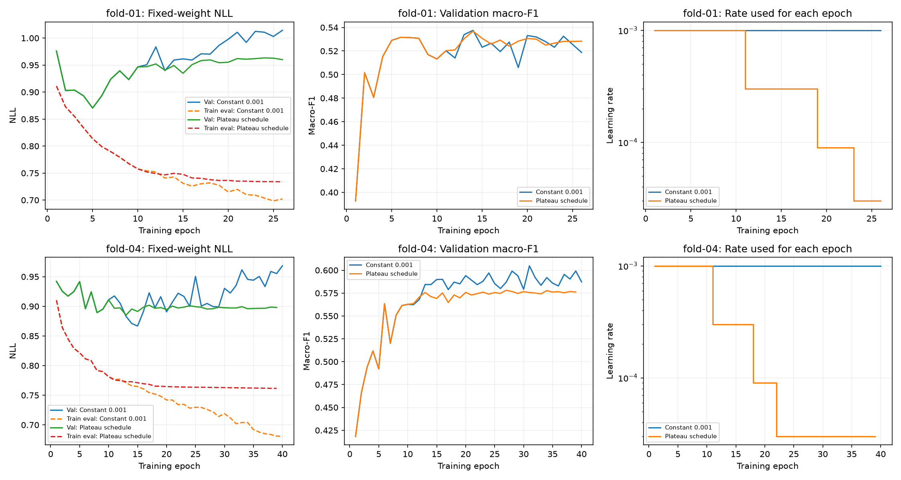

# Measured plateau scheduler comparison

Timo completed both scheduled fits locally on MPS. Reviewed on 2026-11-12.
The strict paired report verifies 9,014 eligible targets from eleven people in original folds 01 and 04.
These are post-hoc diagnostic development folds, not a complete cohort or an independent test.

## Probability loss improves while stage classification loses ground

| Fold | Macro-F1, constant → scheduled | Accuracy | Selected NLL | Best/completed epochs |
| --- | ---: | ---: | ---: | ---: |
| 01 | 0.53754 → 0.53681 | 61.805% → 61.413% | 0.95933 → 0.94916 | 14/26 → 14/26 |
| 04 | 0.60478 → 0.57803 | 65.123% → 64.061% | 0.92241 → 0.89542 | 31/40 → 27/39 |

Mean fold macro-F1 falls from 0.57116 to 0.55742, a paired difference of −0.01374.
Pooled accuracy falls from 63.435% to 62.714%; pooled macro-F1 falls from 0.57536 to 0.55761.
Selected pooled NLL improves from 0.94120 to 0.92277. Only four of eleven participants gain macro-F1.
The scheduler improves probability loss and within-run smoothness, but loses the primary classification comparison.
Retain the constant-0.001 architecture recipe as the reference. Do not adopt this scheduler as the default.

| Stage | Pooled F1, constant → scheduled | Recall |
| --- | ---: | ---: |
| Wake | 0.54226 → 0.54582 | 47.12% → 46.44% |
| Light | 0.71513 → 0.71707 | 76.54% → 79.67% |
| Deep | 0.54352 → 0.51996 | 49.37% → 44.91% |
| REM | 0.50052 → 0.44757 | 47.09% → 39.21% |

[paired-comparison.json](paired-comparison.json) retains every fold, participant, class, and confusion-matrix score.
The lower constant rate from notebook 21 achieved still lower pooled NLL, but also lost macro-F1.
Neither optimizer intervention establishes an overall stage-classification gain.

## The schedule activated as designed

| Fold | Reduction after epoch | Rate used next epoch |
| --- | --- | --- |
| 01 | 10, 18, 22 | 0.0003, 0.00009, 0.00003 |
| 04 | 10, 17, 21 | 0.0003, 0.00009, 0.00003 |

Both runs match every original scalar history value exactly through epoch ten.
The first changed rates apply at epoch eleven. A reduction after ten cannot explain predictions already produced during ten.
No scheduler step occurs after the final capped or stopped epoch.
The observed behavior matches scheduler patience, threshold, rate floor, and independent early stopping.
[scheduler-history.json](scheduler-history.json) records all used/next rate transitions.

## What does stable mean here?

We measured the same post-reduction epoch windows for each paired fold.
These descriptive windows start at eleven and end at the shorter completed fit.

| Fold and common window | Mean absolute epoch-to-epoch macro-F1 change, constant → scheduled | Mean absolute NLL change |
| --- | ---: | ---: |
| 01, epochs 11–26 | 0.00962 → 0.00341 | 0.01422 → 0.00561 |
| 04, epochs 11–39 | 0.00813 → 0.00297 | 0.01745 → 0.00281 |

The user's smoothness observation is supported: scores fluctuate less after reductions.
This does not establish robustness across seeds, people, or deployment conditions.
Epoch observations are autocorrelated, and equal epoch numbers do not imply equal optimization progress after rate changes.
Fold-04 scheduled mean macro-F1 over that window is also lower: 0.57398 versus 0.58732.
A stable lower score is not a classification improvement.
[stability.json](stability.json) records the window definitions, mean absolute changes, sample deviations, and prefix checks.

## Fitting slows near the rate floor

Selected evaluation-mode training NLL is 0.74953 versus 0.74292 in fold 01, and 0.76335 versus 0.71189 in fold 04.
After selection, fold-04 training NLL changes only from 0.76335 to 0.76163 by its last epoch.
Its validation NLL remains near 0.895–0.898, while its macro-F1 stays below the stronger constant-rate result.
The smaller late updates suppress fluctuations and restrict fitting within the fixed budget.
This is consistent with an optimization trade-off, not proof that rate reductions solve overfitting.
[checkpoint-diagnostics.json](checkpoint-diagnostics.json) and [epoch-evidence.json](epoch-evidence.json) preserve the complete evidence.

## Next experiment: change representation, not another optimizer control

Stop the local learning-rate grid. Return to the planned small causal patch-based Transformer.
Use the stronger constant Adam 0.001 reference, dropout 0.2, context thirty, width sixteen, and budget 40/12.
Group three consecutive completed feature epochs into one token, preserving their order rather than averaging them.
This changes temporal representation and attention granularity while keeping the same raw history and six features.

Compare the candidate on all five original development folds with seed 42.
Reuse the completed five-fold dropout-0.2 constant-rate reference rather than retraining it.
Five new fits have a maximum of 200 epochs. Timo runs them locally.
A full-fold comparison avoids deciding another architecture from these two selected diagnostic folds alone.
Keep final-test participants untouched.

The design borrows patching from [PatchTST](https://arxiv.org/abs/2211.14730), not its forecasting claims or complete implementation.
The proposed classifier mixes the six channels jointly and uses causal attention over completed patches.
It is not a faithful channel-independent PatchTST reproduction.
Patching may preserve useful local patterns and alter the model's inductive bias; improved sleep-stage scores remain unmeasured.

No participant-data optimization ran during review. All measured fits were executed by Timo.
