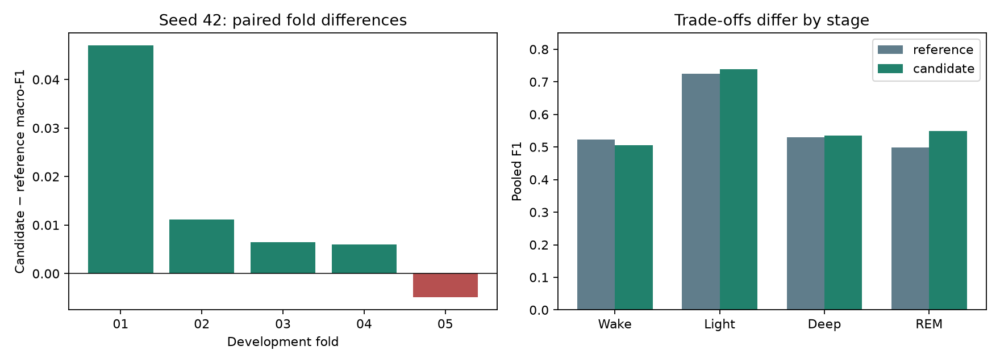
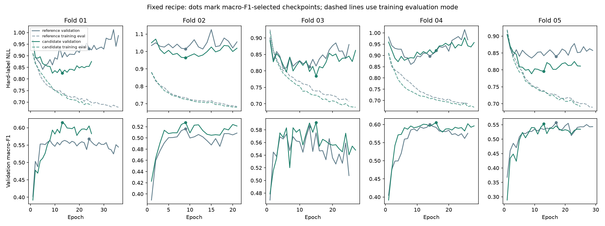

# Window-local heart-rate deviation and availability

Timo completed notebook 29 locally on MPS. All five candidate folds are complete.
The paired validator confirms the same 22,708 eligible targets across 26 development participants.
The original unsmoothed Adam/P3 reference is reused. The final test remains reserved.

## Result: promising overall, with stage and participant trade-offs

| Metric | Original Adam/P3 | HR deviation + availability |
| --- | ---: | ---: |
| Mean fold macro-F1, primary | 0.56538 | 0.57854 |
| Pooled macro-F1 | 0.56939 | 0.58191 |
| Pooled accuracy | 64.149% | 65.964% |
| Selected pooled hard-label NLL | 0.89553 | 0.85473 |

Mean paired fold macro-F1 improves by 0.01316. The five-fold sample deviation of differences is 0.01981.
Four folds improve macro-F1. All five improve accuracy. Fifteen participants improve macro-F1; eleven decline.
Seventeen participants improve accuracy; nine decline.
This supports replication, rather than immediate replacement of the replicated six-channel reference.
The fold differences do not establish statistical significance. Training cohorts overlap, and development choices are adaptive.

| Fold | Reference macro-F1 | Candidate macro-F1 | Difference | Accuracy difference, percentage points |
| --- | ---: | ---: | ---: | ---: |
| 01 | 0.56802 | 0.61502 | +0.04700 | +4.578 |
| 02 | 0.51640 | 0.52758 | +0.01118 | +0.861 |
| 03 | 0.58519 | 0.59170 | +0.00651 | +0.814 |
| 04 | 0.59945 | 0.60548 | +0.00603 | +0.497 |
| 05 | 0.55783 | 0.55293 | −0.00490 | +2.225 |

Fold 01 contributes about 71% of the sum of fold macro-F1 gains.
The remaining four folds average +0.00470, a descriptive sensitivity check rather than a new selection rule.
Fold 05 illustrates why accuracy alone is insufficient: it gains accuracy while losing macro-F1.
[summary.json](summary.json) preserves the verified fold, participant, class, support, and confusion-matrix results.

## REM improves; Wake and Deep recall remain concerns

| Stage | Precision, reference → candidate | Recall | F1 |
| --- | ---: | ---: | ---: |
| Wake | 63.28% → 60.17% | 44.54% → 43.49% | 0.52281 → 0.50488 |
| Light | 68.11% → 69.05% | 77.59% → 79.52% | 0.72540 → 0.73917 |
| Deep | 57.10% → 61.91% | 49.50% → 47.00% | 0.53031 → 0.53435 |
| REM | 54.87% → 59.27% | 45.76% → 51.17% | 0.49905 → 0.54925 |

REM gains 263 correct predictions, from 2,224 to 2,487. Light gains 247, from 9,951 to 10,198.
Wake loses 20 correct predictions. Deep loses 78, while improved precision raises its F1 slightly.
The net increase is 412 correct predictions.
REM-to-Light errors fall from 2,406 to 2,203. Deep-to-Light errors rise from 1,438 to 1,509.
The feature recipe therefore helps one major error direction while worsening another.
Fold-level REM F1 improves on all five folds, but recall improves only on folds 01–03.

Fold 01 has stronger Deep F1 and recall, rather than weaker Deep detection.
Its Deep F1 rises from 0.54398 to 0.56422; recall rises from 43.67% to 45.29%.
Its Wake F1 falls from 0.52566 to 0.50428. REM F1 rises from 0.45892 to 0.62228.
Five of its six participants improve macro-F1, so its gain is not restricted to one person.
Participants 1066528 and 781756 show the largest fold-01 gains, +0.11995 and +0.10156 macro-F1.
Participant 4314139 declines by 0.03634. Participant 1066528 was inspected during early EDA and remains development data.

## What the added features mean

The new numeric channel is a deviation from recent history, rather than another copy of mean heart rate.
For example, current mean HR 70 BPM minus previous mean HR 63 BPM gives a deviation of +7 BPM.
A negative deviation means the current value is below that recent average.
Use up to ten strictly previous epochs inside the current input window.
Require at least four previous epochs. Exclude the current epoch from its reference average.

Standardize the deviation using a mean and scale fitted on available training targets only.
Keep the four original HR summaries and two original motion summaries.
The binary availability channel equals one when the deviation has enough earlier observations; otherwise it equals zero.
Unavailable deviations become zero after standardization. The flag distinguishes missing history from an ordinary standardized zero.

The model input contract specifies the data a caller supplies to the Python model.
Callers still pass six prepared feature channels and valid sequence lengths.
The model derives the two additional channels internally, producing eight channels before patch projection.
The earlier term “input API” referred to this Python interface. It did not describe an HTTP endpoint.

Both channels are deterministic summaries of existing observations. They add no new sensor measurements or history beyond thirty epochs.
This comparison changes both channels together and adds 96 projection parameters.
The larger projection also changes initialization layout. The result cannot isolate deviation, availability, capacity, or initialization effects.

## NLL improves overall, while late overfitting persists

NLL is negative log-likelihood: it penalizes low predicted probability for the true stage.
Lower NLL is better. It evaluates probability quality and can disagree with accuracy or macro-F1.
Both recipes use hard-label, unweighted cross-entropy. Their evaluation-mode NLL curves are directly comparable.

| Fold | Selected epoch, reference → candidate | Reference selected NLL | Candidate selected NLL | Candidate final NLL |
| --- | --- | ---: | ---: | ---: |
| 01 | 24 → 13 | 0.93049 | 0.82513 | 0.87533 |
| 02 | 9 → 9 | 1.01438 | 0.96367 | 1.01862 |
| 03 | 13 → 15 | 0.81257 | 0.78439 | 0.86232 |
| 04 | 14 → 16 | 0.89680 | 0.92144 | 0.95725 |
| 05 | 17 → 13 | 0.83929 | 0.79581 | 0.81126 |

Four selected fold NLLs improve. Fold 04 improves F1 slightly but worsens selected NLL.
Different recipes can select different epochs. These selected-checkpoint comparisons include both representation and checkpoint-selection effects.
In every candidate fold, final validation NLL exceeds selected NLL while training-evaluation NLL declines after selection.
For fold 01, training-evaluation NLL falls from 0.72789 to 0.68613; validation NLL rises from 0.82513 to 0.87533.
The feature recipe improves held-out performance without eliminating late probability overfitting.
Keep macro-F1 checkpoint selection unchanged. Do not substitute the final checkpoint or select checkpoints post-hoc from NLL.
[epoch-evidence.json](epoch-evidence.json) records the selected values and compact evaluation trajectories.

## Availability and transition slices

| Slice | Targets | Reference macro-F1 | Candidate macro-F1 |
| --- | ---: | ---: | ---: |
| History 1–4, deviation unavailable at target | 500 | 0.44369 | 0.44015 |
| History 5–29, deviation available at target | 2,074 | 0.50835 | 0.52929 |
| Full history, 30 epochs | 20,134 | 0.55201 | 0.56061 |
| Stage transitions | 1,398 | 0.40679 | 0.39073 |

The gain is not explained by better startup predictions. Unavailable-history scores decline slightly.
Transition accuracy also falls, from 47.78% to 46.07%.
This recipe does not establish improved stage-boundary detection.
History bins are disjoint; transitions overlap them. Small supports and post-hoc definitions limit interpretation.
The reference and candidate slice reports use the same targets. Labels define evaluation slices only, never model inputs.
[temporal-slices.json](temporal-slices.json) preserves all class scores and supports.

## Recommended next experiment

Repeat the unchanged HR deviation-plus-availability recipe with training seeds 43 and 44 across the same five folds.
Reuse the existing original-P3 results for those seeds. Do not retrain reference models.
Keep normalization policy, context, model width, dropout, optimizer, loss, training budget, and checkpoint selection fixed.
This requires ten new candidate fits, capped at 400 epochs in total.

Check mean paired macro-F1, each seed and fold, pooled REM scores, Wake/Deep regressions, NLL, and transitions.
Do not require identical winning folds. Determine whether the overall gain and stage trade-offs persist.
If replication supports promotion, consider deviation-only and availability-only ablations to separate the two channels.
Do not add another feature family or optimizer change during replication.

No additional participant-data training ran during this review. The final test remains untouched.

Validation: 791 tests pass. Ruff, whitespace checks, and fresh-kernel report export pass.
The source notebook retains no outputs and defaults to training disabled.
