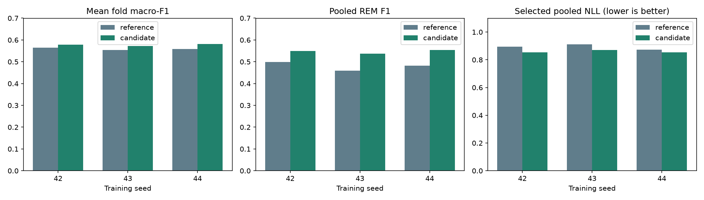
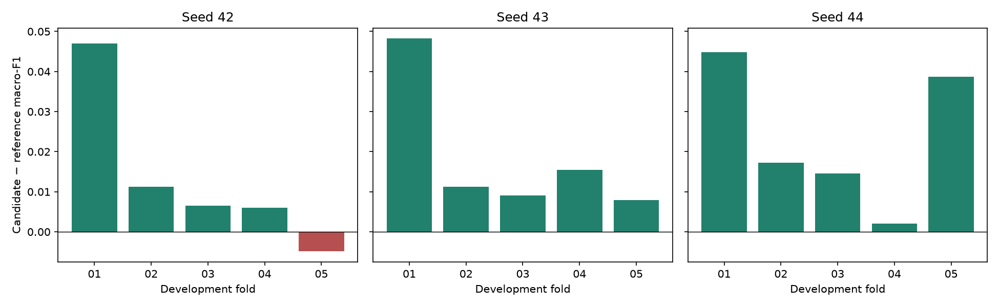

# Window-local HR feature gains repeat across seeds

Timo completed notebook 30 locally on MPS. All three paired seed comparisons are complete.
The paired validators confirm the same 22,708 eligible targets and 26 development participants per seed.
References and candidate seed 42 were reused. Only candidates 43 and 44 required new training.
The three final-test participants remain reserved.

## Replicated gain, with consistent Wake regression

| Seed | Reference mean fold macro-F1 | HR candidate | Paired gain | Pooled accuracy, reference → candidate |
| --- | ---: | ---: | ---: | ---: |
| 42 | 0.56538 | 0.57854 | +0.01316 | 64.149% → 65.964% |
| 43 | 0.55350 | 0.57189 | +0.01839 | 63.339% → 65.184% |
| 44 | 0.55874 | 0.58220 | +0.02347 | 64.497% → 66.404% |

The mean seed effect is +0.01834 macro-F1. The sample deviation of seed effects is 0.00515.
Fourteen of fifteen seed/fold comparisons improve macro-F1. Fourteen improve accuracy.
Participant macro-F1 improves for 15/26, 17/26, and 20/26 participants at seeds 42, 43, and 44.
These are repeated training effects on the same people, not fifteen independent cohorts or independent final-test evidence.
The sample deviation is descriptive. It is not a confidence interval or significance result.
Use the combined HR recipe as the working development reference. Retain the original six-channel recipe for comparisons.
[summary.json](summary.json) preserves the verified fold, participant, class, support, and confusion-matrix reports.

## Fold 01 remains the largest gain, but the effect extends beyond it

| Fold | Seed 42 macro-F1 gain | Seed 43 gain | Seed 44 gain |
| --- | ---: | ---: | ---: |
| 01 | +0.04700 | +0.04824 | +0.04486 |
| 02 | +0.01118 | +0.01118 | +0.01719 |
| 03 | +0.00651 | +0.00910 | +0.01455 |
| 04 | +0.00603 | +0.01550 | +0.00204 |
| 05 | −0.00490 | +0.00795 | +0.03870 |

Fold 01 has the largest macro-F1 improvement at every seed.
Excluding fold 01 descriptively leaves positive mean gains of +0.00470, +0.01093, and +0.01812.
This is a sensitivity summary, not a new checkpoint or recipe-selection rule.
The only negative accuracy difference is seed 43 / fold 03: −0.730 percentage points.
Its macro-F1 nevertheless improves by 0.00910. Balanced stage scores and frequency-weighted accuracy can move in opposite directions.
Seed 42 / fold 05 has the opposite pattern: accuracy improves, but macro-F1 declines.

## Stage trade-offs repeat

| Seed | Wake F1, reference → candidate | Light F1 | Deep F1 | REM F1 |
| --- | ---: | ---: | ---: | ---: |
| 42 | 0.52281 → 0.50488 | 0.72540 → 0.73917 | 0.53031 → 0.53435 | 0.49905 → 0.54925 |
| 43 | 0.52322 → 0.49685 | 0.72290 → 0.73171 | 0.51672 → 0.53988 | 0.45912 → 0.53656 |
| 44 | 0.51693 → 0.51550 | 0.73254 → 0.74365 | 0.52906 → 0.53129 | 0.48200 → 0.55399 |

REM precision, recall, and F1 improve at every seed.
REM recall changes from 45.76% to 51.17%, 40.27% to 50.58%, and 42.98% to 50.51%.
REM precision changes from 54.87% to 59.27%, 53.40% to 57.14%, and 54.86% to 61.33%.
These are combined precision/recall gains, rather than simply predicting REM more often.

Wake F1 and recall decline at every seed. This repeatable trade-off needs explicit tracking in future comparisons.
Deep F1 improves at every seed, but recall falls at seed 42 and rises at seeds 43 and 44.
The seed-42 Deep recall regression therefore does not repeat consistently.
The combined recipe improves balanced stage detection without improving every class or participant.

## Probability quality improves, while late overfitting persists

| Seed | Selected pooled NLL, reference | HR candidate | Difference |
| --- | ---: | ---: | ---: |
| 42 | 0.89553 | 0.85473 | −0.04080 |
| 43 | 0.91153 | 0.86984 | −0.04169 |
| 44 | 0.87284 | 0.85300 | −0.01984 |

NLL is negative log-likelihood: lower values indicate better probability loss on the true stages.
The candidate's selected pooled NLL improves at every seed. This does not establish calibration or eliminate overfitting.
All fifteen candidate final validation NLLs exceed their selected-checkpoint NLLs.
Training-evaluation NLL falls after selection in all fifteen candidate folds.

Fold 04 has slightly worse selected candidate NLL at all three seeds, despite positive macro-F1 differences.
Its reference → candidate NLL values are 0.89680 → 0.92144, 0.86491 → 0.89080, and 0.90912 → 0.91408.
This reinforces the need to show classification and probability metrics together.
Different recipes select different epochs, so selected comparisons include checkpoint-selection effects.
Keep the original macro-F1 selection rule. Do not switch checkpoints after inspecting NLL.
[epoch-evidence.json](epoch-evidence.json) preserves compact trajectories and selected/final evaluation losses.

## History and transition evidence remains mixed

| Slice | Targets per seed | Seed 42 macro-F1 gain | Seed 43 gain | Seed 44 gain |
| --- | ---: | ---: | ---: | ---: |
| History 1–4, deviation unavailable | 500 | −0.00354 | −0.00129 | +0.07856 |
| History 5–29 | 2,074 | +0.02094 | +0.02096 | +0.05955 |
| Full history, 30 epochs | 20,134 | +0.00859 | +0.01746 | +0.01887 |
| Stage transitions | 1,398 | −0.01606 | −0.01799 | +0.00231 |

Full-history scores improve at every seed. Startup and transition effects are less stable.
The recipe does not establish a reliable stage-boundary benefit. History bins are disjoint; transitions overlap them.
The same seed-44 model can improve unavailable-history targets through weights learned from the full training population.
That does not mean unavailable targets secretly receive an HR deviation or establish a causal missingness benefit.
Keep the small supports and differing class mixtures visible.
[Seed 42](seed-42-temporal-slices.json), [seed 43](seed-43-temporal-slices.json), and [seed 44](seed-44-temporal-slices.json) preserve class scores and supports.

## Next: availability-only control at fixed model shape

The replicated result supports the combined feature recipe. It does not isolate which channel contributes.
The availability flag also describes position within a window and segment startup. The model may benefit from that cue.
The two added channels change the original projection layout and initialization.

Prepare one seed-42 availability-only control across all five folds.
Keep the availability channel unchanged and replace the standardized HR-deviation channel with zero.
Retain eight input channels, 2,852 nominal parameters, the same parameter ordering, and the same initialization draws.
Keep normalization fitting and checkpoint metadata intact. Apply the mask inside the deterministic transform before projection.
This avoids conflating the ablation with a changed projection shape or random initialization layout.
The zero channel makes its projection weights inactive; matching nominal parameter count does not imply equal functional capacity.

Reuse the measured full HR seed-42 result. Train five fresh masked candidates, capped at 200 epochs.
Keep the raw history, participants, optimizer, loss, diagnostics, budget, device, and checkpoint rule fixed.
A regression would support the value of the deviation channel conditional on availability and this training recipe.
A near-neutral result would motivate testing whether availability or construction effects explain much of the earlier gain.
Do not claim the zeroed control alone proves a physiological mechanism or feature necessity.

This focused experiment is more informative than another broad audit or a larger model at this point.
No further participant-data training ran during this review. The final test remains untouched.

Validation: all 799 tests, Ruff, whitespace checks, and fresh-kernel HTML export pass.
